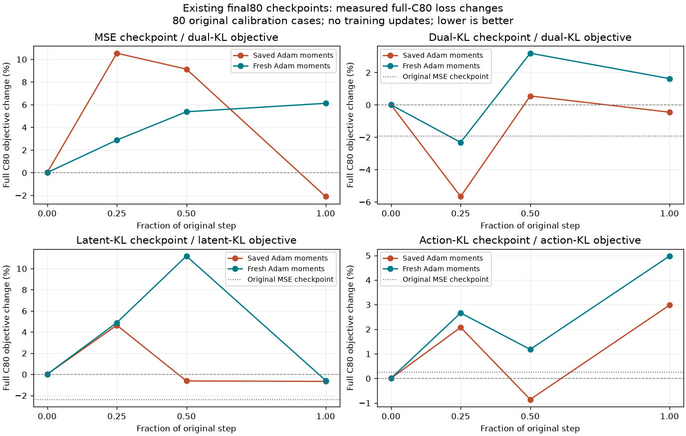

# KL parity 与真实方向诊断结果

全部结果使用原 C80/seed0 和冻结 teacher；没有训练更新或 held-out 调参。每条曲线来自一个已有 checkpoint 的完整 C80 平均 surrogate gradient，不等同于历史单 case 更新。

| Unit | 原 checkpoint | 当前目标 | Action parity max_abs | Future parity max_abs | Baseline objective |
|---|---|---|---:|---:|---:|
| mse_dual | mse_nmse | dual_kl | 0.0 | 0.0 | 0.00274399619 |
| dual_dual | dual_kl | dual_kl | 0.0 | 0.0 | 0.00279766803 |
| latent_latent | latent_kl | latent_kl | 0.0 | 0.0 | 0.00291961082 |
| action_action | action_kl | action_kl | 0.0 | 0.0 | 0.0027371797 |

| Unit | Adam moments | 步长比例 | 真实 C80 loss Δ% | Case中位Δ | Surrogate 一阶预测 Δ | 改善 cases |
|---|---|---:|---:|---:|---:|---:|
| mse_dual | saved_adam | 1.0 | -2.11201% | -0.0001715417 | -1.2694745e-06 | 43/80 |
| mse_dual | saved_adam | 0.5 | +9.12794% | +6.7986199e-05 | -6.3473621e-07 | 37/80 |
| mse_dual | saved_adam | 0.25 | +10.53159% | +2.2513734e-05 | -3.173682e-07 | 40/80 |
| mse_dual | fresh_adam | 1.0 | +6.11370% | -7.7368459e-06 | -1.3192649e-05 | 40/80 |
| mse_dual | fresh_adam | 0.5 | +5.36450% | +0.00014208135 | -6.6131037e-06 | 34/80 |
| mse_dual | fresh_adam | 0.25 | +2.87050% | +9.017461e-05 | -3.3112368e-06 | 36/80 |
| dual_dual | saved_adam | 1.0 | -0.45300% | +1.4338118e-05 | -1.0033313e-06 | 39/80 |
| dual_dual | saved_adam | 0.5 | +0.54964% | -5.4312521e-05 | -5.0166583e-07 | 46/80 |
| dual_dual | saved_adam | 0.25 | -5.66902% | -0.00012586312 | -2.5083349e-07 | 44/80 |
| dual_dual | fresh_adam | 1.0 | +1.62191% | +4.6025438e-05 | -1.8571961e-05 | 37/80 |
| dual_dual | fresh_adam | 0.5 | +3.19165% | -4.5972964e-05 | -9.2999834e-06 | 41/80 |
| dual_dual | fresh_adam | 0.25 | -2.31805% | -3.099849e-05 | -4.6520121e-06 | 42/80 |
| latent_latent | saved_adam | 1.0 | -0.67300% | -0.00011249381 | -9.1440508e-07 | 44/80 |
| latent_latent | saved_adam | 0.5 | -0.62976% | +0.00010381744 | -4.5720247e-07 | 35/80 |
| latent_latent | saved_adam | 0.25 | +4.63761% | +0.00018635497 | -2.2860248e-07 | 35/80 |
| latent_latent | fresh_adam | 1.0 | -0.58423% | -5.5984652e-05 | -2.5035209e-05 | 43/80 |
| latent_latent | fresh_adam | 0.5 | +11.17350% | +0.00011223747 | -1.2517645e-05 | 32/80 |
| latent_latent | fresh_adam | 0.25 | +4.87961% | +6.0222053e-05 | -6.2588403e-06 | 36/80 |
| action_action | saved_adam | 1.0 | +2.97606% | +8.7965163e-06 | -5.7937726e-07 | 40/80 |
| action_action | saved_adam | 0.5 | -0.85838% | -9.5671741e-05 | -2.8968868e-07 | 44/80 |
| action_action | saved_adam | 0.25 | +2.07105% | +8.2340091e-05 | -1.4484454e-07 | 37/80 |
| action_action | fresh_adam | 1.0 | +4.97322% | +0.00014868996 | -1.4358591e-05 | 34/80 |
| action_action | fresh_adam | 0.5 | +1.17670% | +5.2508141e-05 | -7.1793083e-06 | 37/80 |
| action_action | fresh_adam | 0.25 | +2.65794% | +5.1132345e-05 | -3.5896671e-06 | 37/80 |

Case中位Δ及comparison.json中的equal-suite LOCO范围仅作固定C80的敏感性描述；LOCO每次移除一个case，并继续给四个suite各1/4权重，不作独立训练复现或显著性结论。

## 完整 C80 梯度的 case 间变化

`||mean g|| / mean ||g_i||` 越小，表示该固定 checkpoint 上不同 case 的梯度抵消越强。后一列为 `sqrt(mean ||g_i-mean g||^2) / ||mean g||`，只描述这80个case，不代表跨训练复现的不确定性。

| Unit | 完整均值梯度范数 | 单case范数均值 | 均值范数/单case范数均值 | Case偏离RMS/均值范数 |
|---|---:|---:|---:|---:|
| mse_dual | 6.2567979e-05 | 0.00021231686 | 0.29469 | 7.25781 |
| dual_dual | 3.6108375e-05 | 0.00028927711 | 0.12482 | 19.17173 |
| latent_latent | 5.8309868e-05 | 0.00030879699 | 0.18883 | 14.16571 |
| action_action | 1.8293471e-05 | 0.00012081619 | 0.15142 | 8.73826 |

## 是否超过已知更好的原 MSE 解

每行使用该unit的同一种目标公式，候选中包含不更新。最佳值只是已测试条件的最小值，不是最优步长或收敛证明。

| Unit | 原MSE的同公式目标 | 最佳候选 | 最佳目标 | 低于原MSE | 预测下降但实际上升 |
|---|---:|---|---:|---|---:|
| mse_dual | 0.0027439962 | saved_adam × 1.0 | 0.00268604268 | True | 5/6 |
| dual_dual | 0.0027439962 | saved_adam × 0.25 | 0.00263906779 | True | 3/6 |
| latent_latent | 0.00285020463 | saved_adam × 1.0 | 0.00289996195 | False | 3/6 |
| action_action | 0.00274411464 | saved_adam × 0.5 | 0.00271368438 | True | 5/6 |

## 续跑与查询计数

每次attempt从其首次parity_gradient事件中的缓存梯度计数开始，按job.log中实际增加的query计数核算；不重复计算续跑复用的梯度前缀或已保存端点。

| Unit | Attempts | 完整唯一model queries | 实际model queries | 重算queries |
|---|---:|---:|---:|---:|---:|
| mse_dual | 2 | 644 | 644 | 0 |
| dual_dual | 2 | 644 | 644 | 0 |
| latent_latent | 1 | 644 | 644 | 0 |
| action_action | 2 | 644 | 644 | 0 |

分项梯度仅来自预先指定的4个C80case；范数已包含固定alpha和lambda，None梯度按未连接处理，夹角不代表全C80聚合梯度夹角。

| Unit | Case | 参数组 | Action norm | Latent norm | Cosine |
|---|---:|---|---:|---:|---:|
| mse_dual | 2000 | ratio | 5.809094e-05 | 7.195595e-05 | +0.90050 |
| mse_dual | 2000 | channel | 8.291573e-05 | 6.538499e-05 | +0.73898 |
| mse_dual | 2020 | ratio | 3.218796e-05 | 0.0003258724 | -0.92389 |
| mse_dual | 2020 | channel | 2.094791e-05 | 3.161528e-05 | +0.38707 |
| mse_dual | 2040 | ratio | 1.919332e-05 | 4.61693e-05 | +0.87813 |
| mse_dual | 2040 | channel | 5.680459e-05 | 0.0001236525 | +0.94919 |
| mse_dual | 2060 | ratio | 4.019375e-05 | 0.000187868 | -0.89839 |
| mse_dual | 2060 | channel | 3.68438e-05 | 3.211197e-05 | +0.05689 |
| dual_dual | 2000 | ratio | 7.703376e-05 | 1.777741e-05 | -0.46732 |
| dual_dual | 2000 | channel | 6.270096e-05 | 2.251061e-05 | -0.02820 |
| dual_dual | 2020 | ratio | 0.0001264657 | 0.0002897542 | +0.88622 |
| dual_dual | 2020 | channel | 6.284995e-05 | 7.290127e-05 | +0.91143 |
| dual_dual | 2040 | ratio | 9.265523e-05 | 4.446062e-05 | +0.52332 |
| dual_dual | 2040 | channel | 6.830296e-05 | 1.796006e-05 | +0.05180 |
| dual_dual | 2060 | ratio | 5.037084e-05 | 0.0005743492 | +0.98600 |
| dual_dual | 2060 | channel | 4.154771e-05 | 9.314505e-05 | +0.36423 |
| latent_latent | 2000 | ratio | 0.0001311923 | 5.695549e-06 | +0.02237 |
| latent_latent | 2000 | channel | 7.547493e-05 | 1.060006e-05 | +0.02642 |
| latent_latent | 2020 | ratio | 2.854129e-05 | 0.0001079818 | -0.88102 |
| latent_latent | 2020 | channel | 4.229007e-05 | 3.099884e-05 | +0.33394 |
| latent_latent | 2040 | ratio | 0.0001538038 | 0.00014043 | +0.77195 |
| latent_latent | 2040 | channel | 0.0003186031 | 0.0003710374 | +0.83029 |
| latent_latent | 2060 | ratio | 8.903942e-06 | 0.0004050393 | +0.91918 |
| latent_latent | 2060 | channel | 2.57042e-05 | 6.227396e-05 | +0.41245 |
| action_action | 2000 | ratio | 7.658827e-06 | 2.943304e-06 | -0.11467 |
| action_action | 2000 | channel | 3.083143e-05 | 7.045876e-05 | +0.04785 |
| action_action | 2020 | ratio | 3.714941e-05 | 7.543171e-05 | +0.99402 |
| action_action | 2020 | channel | 9.460782e-05 | 0.0001803841 | +0.91902 |
| action_action | 2040 | ratio | 4.002588e-05 | 1.050421e-06 | -0.02645 |
| action_action | 2040 | channel | 2.366877e-05 | 7.790594e-06 | +0.01741 |
| action_action | 2060 | ratio | 4.356258e-05 | 8.284153e-06 | +0.01461 |
| action_action | 2060 | channel | 4.781587e-05 | 8.740128e-05 | +0.20550 |

证据边界：诊断没有保存训练后的模型；每个扰动后恢复原参数。负方向预测与真实forward不一致只能指示当前有限步/离散surrogate问题，不能证明不存在更小有效步长。完整C80下降也不证明held-out或闭环改善。

## 主任务解读与下一轮决定

全部四组均已通过终态、artifact、selfcheck和覆盖门；CPU汇总为25881584.pbs101。320个同参数training/evaluation action+future输出检查的max_abs均为0，24个候选条件各完成80个原C80/seed0 queries。这里验证的是前向输出parity，不是整个backward等于真实离散目标导数。

当前最有证据的问题是有限预算优化未稳定降低完整C80目标。24个候选的surrogate g·delta均为负，但其中16个真实完整C80目标上升。减半或四分之一步并不一致改善；清空Adam的m、v和step也没有普遍帮助。不能据此把原因唯一归到STE、学习率或一阶momentum。

Case间梯度变化很强。双KL起点的`||mean g|| / mean ||g_i||=0.124823`，case偏离RMS约为均值梯度范数的19.17倍；latent-KL对应0.188829与14.17倍。它们支持优先检验完整C80聚合更新，但并不单独证明历史单case训练退化的全部因果机制。分项夹角只来自4个预设case，不能把局部冲突解释为全C80统一冲突。

最值得推进的候选是双KL final80保留原Adam状态的四分之一步。目标由0.0027976680降至0.0026390678（-5.669%），低于原MSE checkpoint在同一双KL公式下的0.0027439962（约-3.82%）。44/80 cases改善，中位delta为-0.0001258631；保留四个suite等权的逐case移除范围为[-0.0002003971,-0.0001235691]，均为负。这是固定C80敏感性描述，不是显著性或跨训练复现证据。

| C80指标 | 原MSE final80 | 双KL四分之一步候选 |
|---|---:|---:|
| Mean first10 motor RMSE | 0.029800742 | 0.029698565 |
| Future latent NMSE | 0.044684950 | 0.042141732 |
| Action KL | 0.068850856 | 0.069049252 |
| Latent KL | 0.142764105 | 0.134683565 |

候选的action KL仍比原MSE略高，不能宣称两个KL分项都已超过MSE。原MSE起点的双KL原步长候选虽降低action MSE与混合目标，mean-case motor RMSE却由0.029800742升至0.029925598；均方误差与逐case RMSE均值不能混用。其他三组最佳候选的LOCO平均delta范围跨过0，双KL四分之一步的稳定性更强，因此下一轮优先两组而不是继续四组训练。

建议的下一轮为mse_nmse与dual_kl各自final80的一次完整C80梯度精修：每组80个额外梯度query、最多1次额外optimizer update；同样提供保留/清空Adam状态的三种步长及不更新候选，只按完整C80各自目标选步。双KL可复用本次已验证梯度和候选；MSE对照必须重新计算其MSE+lambda NMSE梯度，不能用mse_dual单元的双KL梯度冒充MSE优化对照。随后只评估选定候选的原held-out80，主要比较同样精修后的MSE；不引入新development set、teacher、seeds、lambda或loss定义。此建议仅使用C80诊断。按用户最新“先不要启动新训练”的要求，目前仅保留分析与准备代码，不上传或提交下一轮训练。

本次诊断实际2576个model queries、0 teacher queries、0永久训练更新；三次安全续跑均复用已完成数据，重算queries为0。七次GPU allocation累计08:33:52，每次最长01:52:00，均低于2小时；GPU利用率/显存每15秒写入各job log，gpt-6-luna/xhigh每600秒监控已结束。没有运行新的held-out或closed-loop评估，诊断候选未保存为训练checkpoint。
