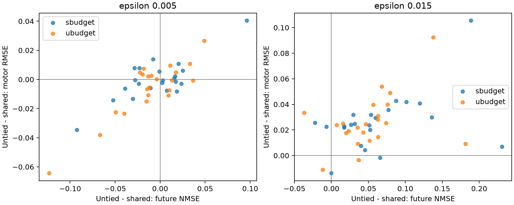

# 逐模块范数匹配：方向、更新分配和存储成本

2026-10-17；protocol `fastwam-vq-module-norm-v1`；完整实验及分析已完成。

**主要判断：小步 untied 的收益没有被模块间分配完全解释，但也不是一个脱离分配方式就稳定成立的“解除共享收益”。方向与模块预算存在明显的条件依赖。直接保存独立 BF16 weights 的成本很小，然而相对已有零新增 bpw 配置的边际 motor 改善不足以支持本轮直接采用 untied。**

## 实验如何拆开两个因素

沿用 action-only checkpoint A、原8个 calibration contexts 的梯度、原选中4个模块及32个 book0 codewords。没有新增 backward、重新选择 support 或实现新 assignment。完整 support 为1,118,810个4D vectors，即4,475,240个有效 weight coordinates。

使用两种模块预算，分别来自上一轮 shared 和 untied 在各模块实际产生的 decoded-BF16 更新范数，简称 S-budget、U-budget。在每一种预算内，shared、untied、random 都对每个模块匹配同一实际更新范数。保持 indices、book1、scales 和其他参数固定。小步 epsilon=0.005为主分析，0.015保留为稳定性检查。

CPU准备时发现U-budget小步text模块的共享BF16 codebook沿固定方向存在离散台阶，最近可实现范数偏离原目标0.9749276%，无法满足原0.5%容差。该作业在任何新模型查询之前主动退出。随后预先修订为：共同目标先取shared方向最近可实现的BF16范数，预算变化上限2%，再匹配其他方向；每方向0.5%、方向间1%的范数匹配要求保持不变。修订和原因见 [README](README.zh.md)，没有根据新future/action结果调整。

小步的实际共同目标如下（这里是每模块绝对更新范数，非learning rate）：

| 模块 | S-budget | U-budget |
|---|---:|---:|
| time_embedding.0 | 0.199083 | 0.163089 |
| text_embedding.0 | 0.00462205 | 0.0361565 |
| blocks.24.ffn.0 | 0.0108833 | 0.0749823 |
| blocks.17.ffn.0 | 0.00486624 | 0.0792989 |

这两种预算直观上分别代表“更新几乎集中在time embedding”和“向text/FFN分配更多更新”。所有预算及方向仍只来自原calibration；不是按test挑出来的。

“同一方向”指相同的rounding前候选梯度方向。改变模块幅度后，BF16舍入会让实际坐标变化也有所改变；跨预算比较包含这项有限精度效应。因此这里归因的是实际部署数值路径下的预算/方向条件差异，不是把连续空间的角度与幅度完全分离。

完整2 budgets × 3 directions × 2 epsilons，共12个条件，覆盖原60 contexts：8 calibration seed0、4 selection cases×2 seeds、22 test cases×2 seeds。共720条结果；120条通过实际权重bitwise相同检查后复用，另600条新native generation及固定BF16 reader replay，共1,200次新查询。原untied条件经过共同范数调整后不再完全相同，因此没有近似复用它们。

Future NMSE与BF16 teacher future比较；motor RMSE固定原BF16 video prepare/prefill、ActionDiT和proprio encoder，只替换future，比较BF16 reference action的前10步6个motor维度。先在case内平均配对seeds，再对cases等权，test n始终为22。指标是teacher fidelity，不是实际未来状态精度或closed-loop成功率。

## 小步结果：剩余收益依赖模块预算

以下均为22 test cases；越低越好。

| 模块预算 | 更新方向 | Future NMSE | 固定reader first10 motor RMSE |
|---|---|---:|---:|
| S-budget | Shared | 0.0832547 | 0.0391120 |
| S-budget | Untied | 0.0791441 | 0.0388714 |
| S-budget | Random | 0.0836557 | 0.0412687 |
| U-budget | Shared | 0.0814880 | 0.0408482 |
| U-budget | Untied | 0.0704862 | 0.0347709 |
| U-budget | Random | 0.0779323 | 0.0353521 |
| 原checkpoint，无新更新 | Action-only A | 0.0930110 | 0.0412432 |
| 已有同格式checkpoint，零新增bpw | Action+latent Z | 未补算 | 0.0350837 |

**在S-budget中，untied的motor均值优势几乎消失。** 相比shared，future均值差-0.00411061，但只有11/22 cases改善，future中位差反而为+0.000792406。Motor均值差仅-0.000240608，13/22改善。此外，full32、late22和native first10均值都比shared差。因此不能只根据future均值较低称它更好地保护了所有下游功能。

**在U-budget中，untied的剩余方向收益仍然存在于均值上。** 相比同模块范数的shared，future均值差-0.0110018，14/22改善；motor均值差-0.00607734，12/22改善。这里每模块更新幅度已经匹配，所以该差异不能归为“untied把更多总能量分给了某个模块”。它支持在这个预算下，独立方向/容量存在有用的小步修正；仍不能单独证明当前assignment异常，更不能证明同bits reassignment能实现相同收益。

但相对同预算random，untied的motor均值只改善0.000581181，12/22获胜。随机方向仅有一个固定实例，不能把它视为随机方向分布的统计结论。

22 cases的配对均值差及描述性case-bootstrap 95%区间：

| 小步untied−shared | Future均值差与区间 | Motor均值差与区间 |
|---|---|---|
| S-budget | -0.00411061 [-0.0192746, 0.0106561] | -0.000240608 [-0.00557082, 0.00544858] |
| U-budget | -0.0110018 [-0.0273348, 0.00331962] | -0.00607734 [-0.0142344, 0.00120779] |

所有这些区间都跨零，case间差异较大，当前样本不足以把均值优势视作稳定的总体效应。没有执行显著性检验；区间未作同时覆盖校正，不用于宣布某个条件“显著”。保留全部cases，没有按outlier删除。

## 为什么答案是交互，而不是二选一

小步motor的四个均值是：

| | S-budget | U-budget |
|---|---:|---:|
| Shared | 0.0391120 | 0.0408482 |
| Untied | 0.0388714 | 0.0347709 |

同一shared方向从S-budget换到U-budget，motor均值变差0.00173624；同一untied方向换预算，motor均值改善0.00410049。也就是说，更多更新进入text/FFN，效果取决于这些位置采用什么修正方向。

因此可以同时得到两点：在一个预算内解除共享不一定带来明显motor收益；只改变shared的模块预算也没有复现小步untied的motor收益。当前结果体现的是方向与分配相互影响，不能强行给“共享解释多少%、分配解释多少%”一个唯一答案。

范数snap使U-budget的原untied权重发生细小变化，所以新的对角差不是上一轮差距的精确重现。CPU分析同时保存两者：上一轮小步motor差为-0.00581106，当前匹配后对角差为-0.00434110；future相应为-0.0102386与-0.0127685。代数分解仅针对当前四个条件，不把snap产生的差别偷偷算进某个机制。

Calibration和selection也并非一致向好：小步U-budget的calibration future从shared的0.0772522降到untied的0.0750549，motor却从0.0256724升到0.0287272。Selection的4 cases中U-budget/untied motor较好，而S-budget/untied两项均较shared差。Future数值变近并不保证每个split上的reader fidelity随之改善。

## 大步仍失败，逐模块匹配没有消除它

| epsilon=0.015 | Shared future / motor | Untied future / motor | Untied motor获胜 |
|---|---|---|---:|
| S-budget | 0.0777560 / 0.0359131 | 0.141454 / 0.0622265 | 2/22 |
| U-budget | 0.0731792 / 0.0342635 | 0.124527 / 0.0603128 | 2/22 |

两种预算下untied各有20/22 cases的motor更差。因此，上轮较大更新的不稳定不能只归因于跨模块norm不匹配。共享约束可能兼具限制自由度和限制危险更新的作用，但当前尚未分离非线性、BF16/A4离散变化与sampler效应，不能指定其中某个为已证实原因。

逐case差值图中，每点是一个case的配对seed均值；左下象限代表untied两项同时改善，右上代表两项同时变差：

## 额外存储到底是多少，是否值得

成本采用明确可恢复的表示，而非训练checkpoint文件大小。Shared原位替换同形状BF16 codebook数值，表示尺寸不增加。Untied保留基础VQ indices/books/scales，通过模块ID和book0 codewords恢复support位置，另保存这些位置的BF16绝对weights；selector和metadata都计入。二进制overlay已写出，并通过bitwise恢复验证。

| 项目 | 数值 |
|---|---:|
| 完整614个目标Linear的weights | 6,016,317,440 |
| 基础表示bytes，含transform及明确metadata | 3,024,201,940 |
| 基础effective bpw | 4.02133294 |
| Shared新增bytes / bpw | 0 / 0 |
| Untied新增BF16 payload | 8,950,480 bytes |
| Untied新增selector/header | 639 bytes |
| Untied合计增量 | 8,951,119 bytes = 8.53645 MiB |
| Untied新增bpw，完整614目标weights分母 | 0.01190246 |
| 加overlay后的effective bpw | 4.03323540 |
| 新增bpw，选中4个模块分母 | 0.70585652 |
| 新增bpw，仅选中support分母 | 16.00114229 |

这些bpw均不是整个policy的非目标参数/偏置或运行时显存分母。基础VQ indices保留用于恢复selector位置，因此这里实际增加的是support的16bit BF16值，没有假设原indices可无成本删除。当前kernel仍解码到dense BF16；不据此声称VRAM或latency改善。

**成本本身较小，但本轮尚不建议直接采用untied overlay。** 较好的小步U-budget/untied motor为0.0347709，已有零新增bpw的Z为0.0350837，仅约0.9%的均值改善；配对差-0.000312775，13/22获胜，描述性95%区间[-0.00481545, 0.00428451]。它尚未体现稳定的边际优势。

Z是已有不同loss/训练过程的同格式配置，不是同训练预算的严格容量消融，但它是“是否值得增加存储”必须面对的可用零增量参考。

另一个已评估的零新增bytes条件U-budget/shared、epsilon0.015，motor均值为0.0342635，也具有竞争力；其future NMSE为0.0731792，略高于小步untied的0.0704862，两者并非所有指标上的支配关系。该比较是看完本轮test后的描述，不能据此宣称这个shared条件已被独立验证为最佳方案或直接按test选部署checkpoint。

实际决策是：暂不为一个相对Z尚不稳定的微小motor改善接受新的独立权重表示，也不把“额外bpw很小”当成充分理由；保留8.54MiB稀疏保护作为后续候选。优先在原bits下联合检查有限步长和模块预算，并以固定reader功能指标评价。若以后独立closed-loop/新测试显示稳定控制收益，这个绝对存储增量并不构成明显障碍；真实decoder/kernel成本仍需另测。

## 完成证据与后续边界

- CPU准备修订后 `25848140.pbs101`：F/Exit0、matching summary、PIPELINE_COMPLETE，8:46；norm匹配、support selector与overlay round-trip均通过。
- GPU分片 `25848279/25848280/25848281/25848283.pbs101`：均F/Exit0及matching marker/summary，最终192/192/168/168行，全部720条件；每个分片218个GPU数值fixture通过，且15秒GPU利用率/显存日志存在。
- 四个GPU作业实际walltime为51:49、43:41、43:07、31:43，全部低于2h。
- 最终CPU `25848845.pbs101`：F/Exit0、matching summary、PIPELINE_COMPLETE，1:12；完整cohort、baseline一致性、有限非负metrics和四片norm receipts检查通过。
- 120条件复用、600新条件、1,200新native/teacher-reader查询、0新gradient queries；监控使用约10min间隔的独立subagent，结束后停止。
- 当前22 test cases已在上一轮查看，本轮是内部归因；case-bootstrap区间仅描述case间差异，不能消除case相关性、重复开发或多重比较问题。
- 没有新assignment训练、closed-loop、native低bit kernel、实际压缩驻留VRAM或latency验证。结果仅覆盖所选4模块、book0-only且book1/scales固定的受限配置。

原始数据：[完整表](retrieved/results/analysis/REPORT.zh.md)、[配对case/context记录](retrieved/results/analysis/paired_contexts.csv)、[紧凑分析JSON](retrieved/results/analysis/compact.json)、[实际范数](retrieved/results/prepare/norms.json)、[存储明细](retrieved/results/prepare/storage.json)。完整per-case contrasts JSON和二进制overlay保留在PBS campaign的results/analysis和results/prepare中，未把tensor传到login或本地计算。

设计和描述性统计流程使用experimental-design、statistical-analysis skills；来源与核实版本见 [README](README.zh.md)。
