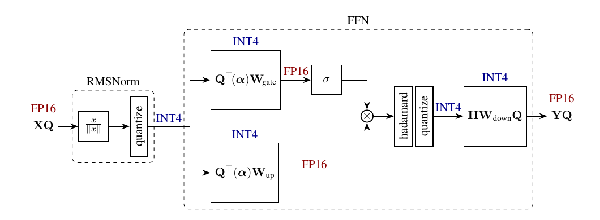
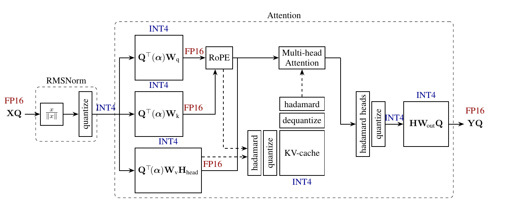

# 023. QuaRot：换一个坐标系，为什么 LLM 就更容易量化？

**QuaRot: Outlier-Free 4-Bit Inference in Rotated LLMs**  
阅读版本：**NeurIPS 2024 official proceedings final，28 个 PDF 物理页**。讲解更新：2026-10-09。

[本地固定 PDF](paper.pdf) · [NeurIPS 论文记录](https://proceedings.neurips.cc/paper_files/paper/2024/hash/b5b939436789f76f08b9d0da5e81af7c-Abstract-Conference.html) · [官方 PDF](https://proceedings.neurips.cc/paper_files/paper/2024/file/b5b939436789f76f08b9d0da5e81af7c-Paper-Conference.pdf) · [arXiv v2](https://arxiv.org/abs/2404.00456v2) · [官方代码](https://github.com/spcl/QuaRot) · [返回 LLM 目录](../README.md)

作者：Saleh Ashkboos、Amirkeivan Mohtashami、Maximilian L. Croci、Bo Li、Pashmina Cameron、Martin Jaggi、Dan Alistarh、Torsten Hoefler、James Hensman。

本地 paper.pdf 是 **venue final**，不是重新下载的 arXiv artifact；arXiv v2 的日期为 2024-10-29，不能因为日期相同就把两个文件称为同一个版本文件。下文页码统一按本地 PDF 从第 1 页开始数，包含 appendix 和 checklist。

本 README 可以独立阅读。顺序是：问题直觉 → 基础概念 → 可计算的例子 → Transformer 中的等价变换 → 量化与 kernel → 实验解读。**论文结果、本文教学推导、对项目的推测分开标明。本地没有运行 QuaRot 量化、训练或 benchmark。** 文中的两个计算例子用于解释机制，不是作者实验。

## 1. 先理解它究竟在解决什么

假设一个 token 的 hidden vector 有几千个数，大部分比较小，但少数特别大。使用一个 scale 把整行映射到 INT4 时，scale 要覆盖这些大值，普通数之间的差别就容易被舍入掉。

一个直接的办法是把那些大值留在 FP16，但这样需要识别、拆分和处理特殊 channel，计算路径也更复杂。QuaRot 尝试另一种办法：

> **保留模型原本的计算功能，改变模型内部表示的坐标系，把集中在少数维度的能量分散开，再量化。**

这里的 rotation 发生在 feature space 中。例如把一个 4096 维向量乘以一个 4096×4096 的正交矩阵。它不是旋转输入图像，也不是改变语言 token 的顺序。

理解论文需要同时抓住两件事：

1. **合法性**：给内部表示换坐标后，能否通过修改相邻 weights 把变换抵消，让 full-precision 模型输出保持不变？
2. **收益**：坐标变了之后，INT4 的逐坐标舍入误差是否更小，实际质量和性能是否更好？

第一件事可以用代数证明；第二件事需要量化实验和 kernel 测量。**原模型等价，不代表量化后的模型也等价。**

QuaRot 的目标是 W4A4KV4：主要 Linear 的 weights、输入 activations，以及 KV cache 都使用 4-bit 表示。方法是 PTQ：先调整 frozen pretrained model 的计算图与权重，再接 weight quantizer。它不通过 QAT 更新原模型来适应量化，也不学习 rotation 的 task loss。

## 2. 阅读所需的几个概念

### 2.1 Weight、activation、KV cache 分别是什么？

| 对象 | 可以怎样理解 | 为什么想量化 |
| --- | --- | --- |
| Weight | 模型已经学好的参数；推理时基本不随 token 改变 | 减少参数存储和读取，支持低精度 Linear |
| Activation | 当前输入在网络中产生的中间特征 | 降低 Linear 输入精度，配合低精度 GEMM |
| K cache / V cache | attention 为历史 token 保存的 key / value | 避免重复计算历史投影，同时减少长序列下的 cache 读取和存储 |

W4、A4、KV4 描述不同对象的 precision。W4A16 的结果不能当作 W4A4 的结果；只压缩 KV cache，也不等于压缩了整个模型。

本文采用 **row-vector 约定**：

$$
y=xW,\qquad
x\in\mathbb R^{1\times d_{\mathrm{in}}},
\quad
W\in\mathbb R^{d_{\mathrm{in}}\times d_{\mathrm{out}}}.
$$

多个 token 堆叠后，输入是 \(X\in\mathbb R^{T\times d_{\mathrm{in}}}\)，每行对应一个 token。PyTorch 的 Linear 参数通常存成 \([d_{\mathrm{out}},d_{\mathrm{in}}]\)，与本文的 \(W\) 转置；判断左右乘顺序时要先确认约定。

### 2.2 “Per-token”“per-channel”“group-wise”是在划分什么？

- **Per-token activation quantization**：一行 activation 共用一个 scale。不同 token 的 scale 可以不同。
- **Per-column weight quantization**：在本文的 \(XW\) 约定下，一个 output column 共用 scale，通常也叫 per-output-channel。
- **Group-wise quantization**：再把一组数分成较小的 groups，每组各自保存 scale 等元数据。这样更容易贴合局部范围，但元数据更多。

因此，同样是 4 bits，group size、scale 方向和 symmetric/asymmetric 设置不同，误差与实际存储成本也会不同。

### 2.3 正交矩阵保持了什么？

设 \(R\in\mathbb R^{d\times d}\)，满足

$$
R^\top R=RR^\top=I.
$$

那么：

$$
\|xR\|_2=\|x\|_2,\qquad
(xR)(yR)^\top=xy^\top.
$$

它保持长度和内积。模型内部的“同一份信息”可以用不同坐标表示，但每个坐标的数值大小可以变化。

正交矩阵也可能含 reflection。论文把这类变换统称为 rotations；阅读时抓住正交性即可。本文用 **\(R\)** 表示全局 residual rotation，用 **\(Q_{\mathrm{att}}\)** 表示 attention query，避免原文中 Q 的两种含义混在一起。

## 3. Outlier 为什么让低比特量化变难？

### 3.1 一个 scale 要照顾整行数据

先看没有 clipping 的 symmetric INT4 示意。令

$$
a=\max_i|x_i|,\qquad s=\frac{a}{7}.
$$

量化和反量化可以理解成：

$$
q_i=\operatorname{clip}
\left(\operatorname{round}\left(\frac{x_i}{s}\right),
q_{\min},q_{\max}\right),
\qquad
\widehat{x}_i=sq_i.
$$

其中 \(q_{\min},q_{\max}\) 是有符号 INT4 的整数端点，正端点为 7；下面的教学例子全部为正数，不依赖负端点如何使用。

相邻表示点的间隔是 \(s\)。没有 clipping 且未触及范围边界时，单个数的 rounding error 最多约 \(s/2\)。于是：

**最大值越大 → scale 越大 → 普通数之间越多差别被舍入掉。**

例如 \(x=[8,0.3,0.2,0.4]\)。由 8 决定的 scale 为 \(8/7\approx1.143\)，三个小值都可能舍入成 0。问题不是这些小值必然无用，而是粗网格无法分辨它们。

### 3.2 Clipping 是另一个取舍

如果用 \(a=0.9\max_i|x_i|\)，网格会更细，但超过新区间的大值会被截断。误差因此分成两部分：

- rounding error：数在区间里，但落在两个表示点之间；
- clipping error：数超出区间，被强行拉回端点。

QuaRot 先通过 rotation 改善范围，再使用 clipping。两者可以一起起作用，不能把全部收益都归给其中一个。

### 3.3 为什么不能只看 activation 的 MSE？

一个 Linear 的输出误差为

$$
\widehat{x}\widehat{W}-xW
=E_xW+xE_W+E_xE_W,
$$

其中 \(E_x=\widehat{x}-x\)，\(E_W=\widehat{W}-W\)。

这说明 activation error 和 weight error 会沿着权重、输入方向传播。某个坐标的小误差，可能被后面的权重放大；较小的局部 MSE，也不自动保证更低的 PPL。最后仍要看模型输出和任务指标。

## 4. 为什么选择 Hadamard，而不是任意稠密 rotation？

### 4.1 Hadamard 的元素简单，而且可以快速计算

归一化的 2 维 Hadamard 为

$$
H_2=\frac{1}{\sqrt2}
\begin{bmatrix}
1&1\\
1&-1
\end{bmatrix}.
$$

本 README 的 4 维例子使用

$$
H_4=\frac12
\begin{bmatrix}
1&1&1&1\\
1&-1&1&-1\\
1&1&-1&-1\\
1&-1&-1&1
\end{bmatrix}.
$$

它满足 \(H_4H_4^\top=I\)，且这里 \(H_4^\top=H_4\)。每个新坐标都是旧坐标的加减组合，一个很大的坐标会参与多个新坐标，而不是只留在原位置。

对 \(d=2^n\)，Walsh-Hadamard transform 可以用 butterfly 结构递归计算，复杂度为 \(O(d\log d)\)；直接乘一个任意稠密矩阵一般需要 \(O(d^2)\)。**Online rotation 必须付出推理成本，所以能否快速计算很关键。**

论文还处理了部分非 \(2^n\) 的尺寸：当 \(d=2^nm\)，且存在适合的 \(H_m\)，可用 Kronecker construction。不能随意截断一个 Hadamard matrix 后，仍假定它正交。对应 Section 3.1，第 3 页。

### 4.2 “Randomized Hadamard”并不是学习矩阵

论文写成

$$
\widetilde H=H\,\operatorname{diag}(s),
\qquad s_i\in\{-1,+1\}.
$$

这里 \(s\) 是随机选取的符号向量。随机符号和正交 Hadamard 的组合仍然正交。具体 row/column 约定决定符号操作出现在乘法哪一侧；涉及 inverse 时必须用 transpose，不能把任意 randomized matrix 都当成自身的 inverse。

QuaRot 的矩阵在准备阶段选定后就固定下来，不会每生成一个 token 就重新采样，也不通过模型 loss 学习这些符号。

### 4.3 Incoherence 可以怎样理解？

论文 Section 3.2，第 3 页，用 maximum coordinate 相对整体能量衡量一个矩阵是否有特别突出的元素。为了帮助理解，对向量可定义教学指标

$$
\mu_x=\frac{\sqrt d\,\|x\|_\infty}{\|x\|_2}.
$$

如果所有坐标绝对值一样，\(\mu_x=1\)；如果能量全部集中在一个坐标，\(\mu_x=\sqrt d\)。较低的 \(\mu_x\) 表示能量更均匀地分布在坐标中。

Rotation 保持 \(\|x\|_2\)，但可以降低 \(\|x\|_\infty\)。这让量化器覆盖同样的信息时，可能使用更细的网格。这里的“消除 outlier”是改变表示分布，不是把原模型中的信息删除。

## 5. 一个可以逐步核算的 INT4 例子

**本节是教学计算：不使用 clipping、不量化 weights，只看同一个向量旋转前后的 rounding error。它不是 QuaRot 的模型实验。**

### 5.1 原坐标中的量化

取

$$
x=[8,\;0.3,\;0.2,\;0.4].
$$

Scale 为 \(s=8/7\approx1.142857\)。因此

$$
\frac{x}{s}=[7,\;0.2625,\;0.175,\;0.35],
$$

舍入后得到 \([7,0,0,0]\)，反量化为

$$
\widehat x=[8,0,0,0].
$$

误差平方和为

$$
\mathrm{SSE}_{\mathrm{original}}
=0^2+0.3^2+0.2^2+0.4^2
=0.29.
$$

### 5.2 先换坐标，再量化

乘上上节的 \(H_4\)：

$$
z=xH_4
=[4.45,\;3.75,\;3.85,\;3.95].
$$

例如第一个坐标是

$$
z_1=(8+0.3+0.2+0.4)/2=4.45.
$$

最大值由 8 降到 4.45，所以

$$
s'=\frac{4.45}{7}\approx0.635714.
$$

| 坐标 | 原值 \(z_i\) | \(z_i/s'\) | 舍入整数 | 反量化值 |
| --- | ---: | ---: | ---: | ---: |
| 1 | 4.45 | 7.0000 | 7 | 4.4500 |
| 2 | 3.75 | 5.8989 | 6 | 3.8143 |
| 3 | 3.85 | 6.0562 | 6 | 3.8143 |
| 4 | 3.95 | 6.2135 | 6 | 3.8143 |

于是

$$
\widehat z
\approx[4.45,\;3.814286,\;3.814286,\;3.814286].
$$

将它换回原坐标：

$$
\widehat x_{\mathrm{rot}}
=\widehat zH_4^\top
\approx[7.946429,\;0.317857,\;0.317857,\;0.317857].
$$

由于正交变换保持误差向量的长度，

$$
\|\widehat x_{\mathrm{rot}}-x\|_2^2
=\|\widehat z-z\|_2^2
\approx0.0238265.
$$

本例的 SSE 从 0.29 降到约 0.02383。原来三个普通坐标全变成 0；现在它们的信息通过组合后的坐标得到更好的保留。**不要直接拿 \(z\) 与 \(x\) 比误差：两者使用不同坐标系。**

### 5.3 但最大值下降，不代表每个向量的误差都下降

使用同一个 \(H_4\)，改取 \(x=[8,1,1,1]\)：

- 原坐标量化的 SSE 约为 0.06122；
- 旋转后 \(z=[5.5,3.5,3.5,3.5]\)，最大值确实变小；
- 但这些数落在新网格的位置较差，旋转后的 SSE 约为 0.38265，反而更大。

因此，QuaRot 的直觉是改善模型中大量特征的量化条件，**不是对每个向量成立的逐样本误差下降定理**。不同合法 rotation 可以产生不同的量化误差；这也为后续 SpinQuant 的 learned rotations 留下空间。

## 6. 怎样改变内部表示，却保持 Linear 的输出？

原来一个 Linear 是

$$
y=xW.
$$

现在把输入改写成 \(x'=xR\)，同时把 weight 改成

$$
W'=R^\top W.
$$

那么

$$
x'W'=(xR)(R^\top W)
=x(RR^\top)W
=xW=y.
$$

这一步不需要训练，因为只是把已知矩阵重新相乘。权重形状不变，计算表达的是同一个函数。

“Fuse rotation into weights”就是提前保存 \(W'\)，推理时直接使用它，而不是每次现场计算 \(R^\top W\)。如果网络本来就把 \(xR\) 作为内部表示传给下一层，也不需要每层都额外插入一个稠密 \(R\) multiplication。

### 6.1 为什么量化后不再保证相同？

令 \(\mathcal Q\) 表示 quantize + dequantize。一般有

$$
\mathcal Q(xR)\ne\mathcal Q(x)R.
$$

原因是量化使用沿坐标轴排列的离散网格，rotation 改变数据相对这个网格的位置。Scale、clipping 与 rounding 也可能随新坐标改变。

因此

$$
\mathcal Q(xR)\,\mathcal Q(R^\top W)
$$

通常不等于

$$
\mathcal Q(x)\,\mathcal Q(W).
$$

QuaRot 利用的正是这种差别：先在 full precision 中选择一个等价表示，再希望该表示在量化时损失较小。数学等价指理想算术；实际 FP16/FP32 重排还可能引入小的数值误差。

## 7. 全局 residual rotation：为什么 RMSNorm 与 residual 都能配合？

对应论文 Section 3.4、Stage 1a，第 4–5 页。

### 7.1 先把 RMSNorm 的 learned scale 融到下一层

LLaMA-style RMSNorm 可写为

$$
\operatorname{RMSNorm}(x)
=\operatorname{RMS}_0(x)D_\gamma,
$$

其中

$$
\operatorname{RMS}_0(x)
=\frac{x}{\sqrt{\frac1d\sum_i x_i^2+\epsilon}},
\qquad
D_\gamma=\operatorname{diag}(\gamma).
$$

\(\gamma\) 是训练学到的逐 channel scale，\(\epsilon\) 是防止数值不稳定的小常数。紧接一个 Linear 时，

$$
\operatorname{RMSNorm}(x)W
=\operatorname{RMS}_0(x)(D_\gamma W).
$$

所以可以先把 \(D_\gamma W\) 存到 weight，RMSNorm 本身只保留归一化部分。

为什么先做这件事？因为一般 \(D_\gamma R\ne RD_\gamma\)。逐 channel scale 和 rotation 不能随意交换顺序。

### 7.2 没有 learned scale 的 RMSNorm 与 rotation 可交换

正交变换保持平方和，因此

$$
\operatorname{RMS}_0(xR)
=\operatorname{RMS}_0(x)R.
$$

保持同一个 \(\epsilon\) 时，该结论同样成立。论文 Eq. (3) 用简化归一化记号表达同样的性质。

设 block 输入为 \(xR\)，将其 input projection 改为

$$
W'_{\mathrm{in}}=R^\top D_\gamma W_{\mathrm{in}}.
$$

则

$$
\operatorname{RMS}_0(xR)W'_{\mathrm{in}}
=\operatorname{RMS}_0(x)RR^\top D_\gamma W_{\mathrm{in}}
=\operatorname{RMSNorm}(x)W_{\mathrm{in}}.
$$

**Input projection 之后的结果回到原来的内部计算。** FFN 中的 gate、up projection 或 attention 的原始 q/k/v 可以先照原方式计算。

### 7.3 Output projection 再把结果送回旋转坐标

如果原 block 输出为 \(F(x)\)，在 output weight 的右侧乘 \(R\)，输出就变成 \(F(x)R\)。Residual addition 为

$$
xR+F(x)R=(x+F(x))R.
$$

两条支路在同一个坐标系中相加，所以 residual 本身也能保持等价。

模型入口的 embedding 和出口的 final norm / language head 也要配对修改，保证模型外部仍输出原来的 logits。只修改某一层，而忘记 residual、入口或出口，就不构成这里的等价变换。

### 7.4 哪些操作不能随意交换？

逐元素 nonlinearity 通常不满足

$$
\sigma(xR)=\sigma(x)R.
$$

例如对 ReLU 而言，先把正负数混合再截断，与先截断再混合会不同。LLaMA 的 SiLU 和逐元素 gating 同样不能任意穿过 rotation。

另外，LayerNorm 会减去均值，任意 rotation 一般不保持每行均值。**这里的 RMSNorm 推导不能直接当作任意 LayerNorm 网络的证明。** 要推广到其他结构，需要处理对应的归一化和计算图条件。

## 8. FFN 的内部为什么还要一个 online Hadamard？

### 8.1 全局 residual rotation 没有覆盖 FFN 的全部特征

一个 gated FFN 可写为

$$
u=\operatorname{RMSNorm}(x)W_{\mathrm{up}},\qquad
g=\operatorname{RMSNorm}(x)W_{\mathrm{gate}},
$$

$$
h=\operatorname{SiLU}(g)\odot u,\qquad
y=hW_{\mathrm{down}}.
$$

其中 \(\odot\) 是逐元素乘法，\(h\in\mathbb R^{1\times d_{\mathrm{ff}}}\)，通常 \(d_{\mathrm{ff}}>d\)。

上节的 input weight 修改让 \(u\) 和 \(g\) 保持原来的数值，因此 nonlinearity 与 gating 也保持原来的结果。于是 down-projection 的输入 \(h\) 仍可能有 outliers。

### 8.2 在 gating 之后再旋转

取尺寸为 \(d_{\mathrm{ff}}\) 的 Hadamard \(H_{\mathrm{ff}}\)，令

$$
h'=hH_{\mathrm{ff}},
\qquad
W'_{\mathrm{down}}
=H_{\mathrm{ff}}^\top W_{\mathrm{down}}R.
$$

则

$$
h'W'_{\mathrm{down}}
=hH_{\mathrm{ff}}H_{\mathrm{ff}}^\top W_{\mathrm{down}}R
=yR.
$$

这样既改善 down-projection 输入的量化条件，又把输出保持在全局 residual 的旋转坐标中。

论文使用的 exact Hadamard 在相应约定下可写成 \(HW_{\mathrm{down}}R\)。这里保留 transpose，强调一般正交矩阵的 inverse 是 transpose，而不是它自己。

### 8.3 为什么这一步不能全部离线完成？

\(h\) 随 token 改变，而且出现在 SiLU 和 gating 之后。把 \(H_{\mathrm{ff}}\) 直接塞进更前面的 up/gate weight，一般不能跨过非线性，保持同一个 \(hH_{\mathrm{ff}}\)。

所以：

- \(H_{\mathrm{ff}}^\top W_{\mathrm{down}}R\) 可以离线算好；
- \(hH_{\mathrm{ff}}\) 必须在推理时对当前 activation 执行。

**Online 的含义是推理时计算，不是推理时学习。**

上图裁自本地 PDF 第 5 页 Figure 3；图中的 Q 对应本文的 \(R\)。从左向右看：FP16 residual → RMSNorm → INT4 input → gate/up INT4 Linear → FP16 nonlinearity/gating → online Hadamard → INT4 down input → INT4 down Linear → FP16 rotated output。蓝色 INT4 标签没有覆盖整个计算图。

## 9. Attention 中的三种旋转，要分开理解

对应 Stage 1c–1d，第 5–6 页，以及 Appendix A.1 / Figure 6，第 13 页。

### 9.1 Query 与 key 同时旋转，attention scores 可以不变

先看单个 head。令 \(Q_{\mathrm{att}},K,V\in\mathbb R^{T\times d_h}\)，attention 为

$$
P=\operatorname{softmax}
\left(\frac{Q_{\mathrm{att}}K^\top}{\sqrt{d_h}}+M\right),
\qquad Z=PV.
$$

\(M\) 是 causal mask 等 mask，\(P\) 的每行表示当前 token 对历史 token 的权重。**Scores 由 query 和 key 决定；value 是随后被加权求和的内容。**

取同一个 head-wise Hadamard \(H_h\)：

$$
Q'=Q_{\mathrm{att}}H_h,\qquad K'=KH_h.
$$

那么

$$
Q'K'^\top
=Q_{\mathrm{att}}H_hH_h^\top K^\top
=Q_{\mathrm{att}}K^\top.
$$

因此在量化前，scores、softmax 与 \(P\) 保持不变。只旋转 key 而不旋转 query，一般就没有这个性质。

### 9.2 为什么要放在 RoPE 之后？

RoPE 对不同位置的 q/k 应用与位置有关的变换。用 row-vector 表示，某位置的操作可写为 \(q\mapsto qR_t\)。

希望的 post-RoPE 结果是

$$
(qR_t)H_h.
$$

如果把 \(H_h\) 融到 projection，先得到 \(qH_h\)，再做 RoPE，则结果是

$$
(qH_h)R_t.
$$

一般 \(R_tH_h\ne H_hR_t\)，两者不能互换。这就是额外的 q/k Hadamard 不能直接按上式完整吸收进 \(W_q,W_k\) 的原因。

QuaRot 在 **RoPE 之后** 在线旋转当前 query 和 key，把 rotated post-RoPE key 存入 cache。Decode 时不需要把全部历史 key 每次重新旋转；历史 key 已经按这个坐标保存。

论文也讨论了 pre-RoPE caching 的其他安排，但那有不同的在线操作与历史 cache 处理成本。不能把两种图混起来理解。

### 9.3 Value 与 output projection 可以配对变换

对一个 head，原来的 output contribution 为

$$
(PV)W_{\mathrm{out}}^{(h)}.
$$

如果

$$
V'=VH_h,\qquad
W_{\mathrm{out}}^{(h)\prime}
=H_h^\top W_{\mathrm{out}}^{(h)},
$$

那么

$$
(PV')W_{\mathrm{out}}^{(h)\prime}
=PVH_hH_h^\top W_{\mathrm{out}}^{(h)}
=PVW_{\mathrm{out}}^{(h)}.
$$

由于 \(V=XW_v\)，可以通过修改 \(W_v\) 的右侧实现 \(V'=VH_h\)，不必先得到原 \(V\) 再额外乘一个 matrix。这样 cache 中的 value 本来就是被旋转后的坐标。

### 9.4 为什么 output projection 前还要跨 heads 的 online transform？

只在 head 内旋转，仍未把不同 heads 的特征充分混合。论文进一步利用 Kronecker structure。

设有 \(n_h\) 个 heads，每个大小为 \(d_h\)，定义

$$
A=I_{n_h}\otimes H_{d_h},\qquad
B=H_{n_h}\otimes I_{d_h}.
$$

- \(A\)：在每个 head 内部做 Hadamard；
- \(B\)：固定 head 内坐标，在不同 heads 之间做 Hadamard；
- 两者组合形成完整特征维度上的 Hadamard，\(H_{\mathrm{full}}=AB\)，适用时需满足相应结构尺寸条件。

设原来的 attention 输出拼接为

$$
Z=\operatorname{concat}(P_1V_1,\ldots,P_{n_h}V_{n_h}).
$$

把 \(A\) 融到 value projection 后，拼接结果变为 \(ZA\)。再在线计算

$$
(ZA)B=ZH_{\mathrm{full}},
$$

并将 output projection 改为

$$
W'_{\mathrm{out}}
=H_{\mathrm{full}}^\top W_{\mathrm{out}}R.
$$

最终得到

$$
(ZH_{\mathrm{full}})W'_{\mathrm{out}}
=ZW_{\mathrm{out}}R,
$$

仍是原 attention output 的全局旋转表示。

**不能把任意跨 heads 的变换提前放到 value projection 就结束。** 不同 head 的 \(P_h\) 一般不同，跨 head 混合不能随意穿过各自的 attention 加权。QuaRot 把剩余的跨 heads 混合放在 attention 之后、out-projection 之前。

上面的公式用标准拼接 heads 的形式说明机制。GQA 的 query heads 与 KV heads 数量不同，实际实现还必须正确对应共享/重复的 KV heads。

上图裁自本地 PDF 第 13 页 Figure 6。可以沿着三条路径读：q/k 在 RoPE 后配对旋转；value 的 head 内旋转融合进 projection；attention output 在 out-projection 前执行剩余的 heads transform。虚线表示 cache 读写。

### 9.5 量化之后，score invariance 也会产生误差

假设暂时忽略 query rotation 的浮点误差，rotated query 为 \(q'=qH_h\)，反量化 key 为

$$
\widehat K'=KH_h+E_K.
$$

则 score error 为

$$
\widehat s-s
=\frac{qH_hE_K^\top}{\sqrt{d_h}}.
$$

这个式子说明：full-precision 的 \(H_hH_h^\top\) 抵消仍是设计依据，但 cache quantization 引入的 \(E_K\) 不会凭空消失。Key error 会先改变 attention 权重，再影响 value 的加权结果；value error 则直接改变被加权的内容。两种敏感性可以不同。

## 10. Stage 2：真正的量化与计算路径

### 10.1 QuaRot 和 GPTQ 是不同分工

QuaRot Stage 1 把模型改写成更容易量化的等价表示；Stage 2 再量化。默认用 GPTQ 处理 weights，activation 与 cache 在推理时量化。

GPTQ 关注 weight approximation 对 calibration inputs 的输出影响。用一个 Linear 示意：

$$
\min_{\widehat W}\|XW-X\widehat W\|_F^2.
$$

对单个 output column，其二阶结构由 \(X^\top X\) 决定，逐步舍入时可补偿其余 weights 的误差。这里的式子解释 GPTQ 的目标，不是 QuaRot 新发明的优化器；详细推导见 [GPTQ / OPTQ 阅读包](../018-gptq-optq/README.md)。

因此，不能把 QuaRot 的主结果理解成“只做 random rotation，然后完全不需要 calibration”。Rotation construction 不学习 calibration loss；**主结果的 GPTQ weight quantization 用了 calibration data。**

### 10.2 论文默认 recipe

| 对象/步骤 | 论文设置 | 怎么理解 |
| --- | --- | --- |
| Global rotation | fixed randomized Hadamard | 准备阶段确定，不通过 task loss 学习 |
| Weight quantization | 默认 GPTQ；symmetric per-column | Weight clipping ratio 用 squared-error linear search 选择 |
| GPTQ calibration | WikiText-2 training：128 samples，每个 sequence length 2048 | 这是量化准备数据；不是 128 个下游任务 |
| Activation | symmetric per-token，constant clipping ratio 0.9 | 每个当前 token 在线计算 scale |
| KV cache | asymmetric group-wise，group size 128，clipping ratio 0.95 | 用较小 group 的范围表示 rotated K/V |
| RMSNorm | normalization 部分 FP32 | Learned scale 已融合进相邻 weights |
| Online Hadamard 的质量实验 | Appendix A.7 说明默认 FP32，另测 FP16 | “W4A4KV4”没有指定这些 transforms 全部是 INT4 |
| 准备耗时示例 | LLaMA-2 70B：QuaRot 修改约 5 min，GPTQ 再约 2 h | 作者在单张 A100 上报告的一次性准备成本 |

来源：第 7 页 setup、Appendix A.2 / A.7，第 13–16 页。准备耗时不是每生成一个 token 的开销，本地也没有复现这个时间。

### 10.3 Asymmetric group-wise cache quantization 怎么理解？

用一个 group 的截断后端点 \(a,b\) 示意，4 bits 有 16 个编码，间隔为

$$
s=\frac{b-a}{15}.
$$

采用 min-offset 的教学写法：

$$
q_i=\operatorname{clip}\left(
\operatorname{round}\left(\frac{x_i-a}{s}\right),0,15\right),
\qquad
\widehat x_i=a+sq_i.
$$

实际 kernel 可用 scale / zero point 等方式存储和表达偏移；上式用于解释 asymmetric interval，并非逐行复述代码。

与围绕 0 的 symmetric grid 相比，它允许表示区间不以 0 为中心，适合 group 中数值范围偏向一侧的情况。每个 group 还要保存元数据，因此真实存储不只是“元素个数 × 4 bits”。

QuaRot 这里的核心组合是 **rotation + asymmetric group-wise cache quantization**。它与 KIVI 的 K per-channel / V per-token 设计不是同一个 recipe，也不能把 KIVI 的 KV2 结果移到 QuaRot 的 W4A4KV4 行上。

### 10.4 一个 INT4 Linear 的实际流程

按 Figure 3、Section 5.2 与 Appendix A.10，可以这样读：

1. 当前 activation 以浮点数到达；需要时先做 online Hadamard。
2. 算 scale，执行 rounding/clipping，把 activation 打包成 INT4。
3. Activation INT4 与 weight INT4 进入 CUTLASS GEMM。
4. 乘法结果用 INT32 accumulator 累加。
5. 用 activation 与 weight scales 反量化，转回 FP16。
6. 后续 nonlinearity、gating、residual 等继续使用对应浮点路径。

理想的 per-token/per-column 情况下，

$$
Y_{tj}\approx s_t^{(x)}s_j^{(w)}
\sum_i q_{ti}^{(x)}q_{ij}^{(w)}.
$$

整数求和对应 INT32 accumulation，外面的 scales 恢复数值范围。更细的 group-wise scale 会改变 kernel 需要处理的缩放结构。

### 10.5 Cache 是 INT4，不代表 attention dot product 是 INT4

论文 Stage 2c，第 7 页，明确保留 queries 为 FP16；从 memory 加载 quantized K/V 后进行 dequantization，attention dot product 使用 FP16，并配合 online softmax。

Appendix A.10，第 17 页，把 cache 路径拆为：

- **Init**：prefill 时建立 cache；该阶段的 attention 可直接使用已存在的浮点 K/V 做 Flash Attention；
- **Append**：decode 时量化当前 K/V，并追加到 cache；
- **Decode**：用当前 query 读取 quantized historical cache，反量化并计算 attention。

因此，论文“end-to-end 4-bit”主要强调 weights、Linear inputs、KV storage 的覆盖及 INT4 Linear kernels。它不能改写成“所有 arithmetic 都只有 INT4”，也不能把 low-bit cache storage 当作 native INT4 attention matmul。

## 11. 质量实验：先理解指标，再看数字

### 11.1 PPL 和 zero-shot Avg. 分别代表什么？

**Perplexity，PPL，越低越好。** 对一段有 \(N\) 个被计分 token 的文本，可以理解为

$$
\mathrm{PPL}
=\exp\left(-\frac1N\sum_{t=1}^{N}
\log p(x_t\mid x_{<t})\right).
$$

它衡量模型给真实下一个 token 分配概率的情况，是语言预测指标。比较时要对齐 dataset、tokenization、sequence length 和计分方式。PPL 增加 0.47 是指标数值增加 0.47，不是 accuracy 下降 0.47 percentage points，也不是“错误率增加 0.47%”。

**Zero-shot Avg.，越高越好。** QuaRot 主表使用六个任务：PIQA、WinoGrande、HellaSwag、ARC-Easy、ARC-Challenge、LAMBADA。Table 2 的 Avg. 是这六个任务分数的算术平均：

$$
\mathrm{Avg.}=\frac16\sum_{k=1}^{6}\mathrm{Accuracy}_k.
$$

它不是把所有任务的样本合在一起重新计算的 accuracy，也不是一个统一的机器人 episode success rate。论文 setup 使用 LM Evaluation Harness 的 default parameters；本 README 没有自行补造每项任务的样本数或重新运行 evaluation。

### 11.2 LLaMA-2 主结果：70B 很强，但 7B 仍有明显下降

第 8 页 Tables 1–2；QuaRot 主行使用 GPTQ weights，W4A4KV4。

| 模型 | FP16 PPL | QuaRot PPL | PPL 增加 | FP16 六任务 Avg. | QuaRot Avg. | Avg. 下降 |
| --- | ---: | ---: | ---: | ---: | ---: | ---: |
| LLaMA-2 7B | 5.47 | 6.10 | 0.63 | 69.82 | 65.64 | 4.18 pp |
| LLaMA-2 13B | 4.88 | 5.40 | 0.52 | 72.59 | 69.79 | 2.80 pp |
| LLaMA-2 70B | 3.32 | 3.79 | 0.47 | 77.07 | 75.98 | 1.09 pp |

这组结果支持：在该 protocol 下，QuaRot 让联合 W4A4KV4 保持了相当一部分原模型能力，70B 的下降较小。但不能只用 70B 的 headline 代表所有模型。

例如 7B 的 ARC-Challenge 从 46.25 降到 40.87，下降 **5.38 pp**。平均分会掩盖单项任务的差异。

### 11.3 “Retains 99%”到底怎么算？

对 70B：

$$
\frac{75.98}{77.07}\times100\%
\approx98.59\%.
$$

这是相对原分数的 **retention ratio**，四舍五入后接近论文宣传的 99%。它不表示最终 accuracy 是 99%，也不表示六项任务各自都只下降 1%。

同样计算 7B：

$$
\frac{65.64}{69.82}\times100\%
\approx94.01\%.
$$

报告时可以同时写“70B 六任务平均分下降 1.09 pp，保留约 98.6% 原平均分”，这样 absolute drop 与 relative retention 都清楚。

### 11.4 与其他方法的比较，为什么不能看成纯 rotation 消融？

Table 1 中，7B 的 PPL 为：

| 方法/设置 | Weight quantizer | 保留的 outlier features | PPL |
| --- | --- | ---: | ---: |
| SmoothQuant 的该 4-bit 配置 | RTN | 0 | 83.12 |
| OmniQuant 的该配置 | RTN | 0 | 14.26 |
| QUIK-4B | GPTQ | 256 | 8.87 |
| QuaRot | GPTQ | 0 | 6.10 |
| Atom-128G | GPTQ-128G | 128 | 6.03 |
| QuaRot-128G | GPTQ-128G | 0 | 5.93 |

这些数字说明论文评估的完整 QuaRot 配置有竞争力，并且不需要单独保留 higher-precision outlier channels。但 rows 还涉及不同 quantizer、grouping、clipping 和 pipeline；SmoothQuant / OmniQuant 的部分结果来自先前论文。

因此，不能从 83.12→6.10 直接断言“只加一个 rotation 就得到全部收益”，也不能据此否定 SmoothQuant 在其原本 W8A8 目标中的效果。机制归因要继续看下面的消融。

## 12. 消融实验：每张表究竟改变了什么？

### 12.1 RTN vs GPTQ：默认 4-bit 结果为什么还需要 calibration？

结合第 8 页 Table 1 和第 9 页 Table 3：

| 模型 | FP16 PPL | QuaRot + RTN，INT4 | QuaRot + GPTQ，INT4 |
| --- | ---: | ---: | ---: |
| LLaMA-2 7B | 5.47 | 8.37 | 6.10 |
| LLaMA-2 70B | 3.32 | 4.14 | 3.79 |

同样使用 QuaRot，改用 GPTQ 后，7B PPL 改善 2.27，70B 改善 0.35。这里的额外质量收益不能全部记在 rotation 名下。

另一方面，70B 的 INT8 RTN 为 PPL 3.33、Avg. 77.17，对应 FP16 为 3.32、77.07；Appendix Table 9，第 16 页，还给出 INT6。论文说 6/8-bit 可以不用 calibration，主要指 **RTN weight quantization 的相应 precision 路径**。这是接近 baseline 的有限 benchmark 结果，不是整数模型与 FP16 logits 完全相等的数学定理。

**记住区分：rotation 不学习 loss、RTN 不用 calibration、默认 GPTQ 需要 calibration，是三件不同的事。**

### 12.2 Group size：更小的 group 改善质量，但有代价

第 9 页 Table 4；改变 weight / activation group sizes，**KV cache group size 始终保持 128**。

| 设置 | 7B PPL | 13B PPL | 70B PPL |
| --- | ---: | ---: | ---: |
| QuaRot 主配置 | 6.10 | 5.40 | 3.79 |
| 256G | 5.98 | 5.28 | 3.63 |
| 128G | 5.93 | 5.26 | 3.61 |
| 64G | 5.88 | 5.25 | 3.58 |

更小的 group 让局部 scale 更贴合数据，所以这些结果的 PPL 更低。但若每组需要 \(m\) bits 元数据，一个 group 有 \(g\) 个 4-bit 元素，则理想化平均存储成本为

$$
b_{\mathrm{effective}}=4+\frac{m}{g}.
$$

这个式子是存储开销的教学拆解，不是论文 kernel 的实际 byte accounting。它说明：group size 减半，单位元素分摊的元数据会增加；kernel 还要处理更多 group scales。不能只报“仍然 4 bits”而忽略这些成本。

### 12.3 K/V bit 消融：key 和 value 的敏感性不同

第 14 页 Table 6。这里保持 **weights 与 activations 为高精度**，只改变 rotated KV cache 的 bit 数，group size 128。

摘取 LLaMA-2 7B：

| K bits | V bits | PPL |
| ---: | ---: | ---: |
| 16 | 16 | 5.47 |
| 4 | 4 | 5.51 |
| 4 | 3 | 5.54 |
| 3 | 4 | 5.65 |
| 3 | 3 | 5.68 |
| 2 | 4 | 8.06 |
| 2 | 2 | 9.23 |

K4V3 与 K3V4 都降低了一部分 precision，但前者 PPL 更好，5.54 vs 5.65。在这组实验中，key 的低比特误差更敏感，符合它会改变 attention weights 的机制。

同时，KV2 并没有自动保持质量：K2V2 的 7B PPL 达到 9.23。这不等于否定 KIVI 的专门 KV2 方法；它只是说明 **QuaRot 的这一套 cache recipe 和测试设置**不能无损推到 2 bits。

不要把这里 KV4 的 PPL 5.51 当成全模型 W4A4KV4 的 6.10。前者把 W/A 保持高精度，是隔离 cache 影响的消融。

### 12.4 Hadamard vs generic random orthogonal：正交性还不够

第 15 页 Table 8，用 QR construction 的 generic random orthogonal matrix，替换相应的 fused rotation；在线 down/out 路径仍使用 fast Hadamard。

| 模型 | FP16 PPL | QuaRot：generic random orthogonal | QuaRot：randomized Hadamard |
| --- | ---: | ---: | ---: |
| LLaMA-2 7B | 5.47 | 7.45 | 6.10 |
| LLaMA-2 13B | 4.88 | 5.84 | 5.40 |
| LLaMA-2 70B | 3.32 | 4.07 | 3.79 |

Full-precision 的等价条件可以都满足，但量化结果不同。该表支持被测试的 Hadamard construction 更好，**没有证明它是最优 rotation，也没有测出所有 Hadamard seeds 的分布**。

顺带注意，7B 两行差值按表计算为 **1.35 PPL**，70B 为 0.28；这是数值差，不是百分点。

### 12.5 Weight-only 消融：rotation 的作用不只在 activations

第 15 页 Table 7，保持 activations / cache 为 FP16，weights 使用 asymmetric per-column quantization。

例如：

- 7B W4：GPTQ PPL 8.25，QuaRot-GPTQ 5.60；
- 70B W2：GPTQ PPL 25.30，QuaRot-GPTQ 5.60。

这表明在该 weight-only recipe 下，变换后的 weight representation 也能显著帮助量化。它没有建立“全模型 W2A2KV2 同样可用”：表中 A/KV 是高精度，weight quantizer 的 symmetric/asymmetric 设置也与主表不同。

表中的 Inf 表示 PPL 超过作者展示阈值 100，NaN 表示该 GPTQ 实验失败；不要把这两个标记读成同一种正常指标。

### 12.6 Online Hadamard 用 FP16 还是 FP32？

Appendix A.7 / Table 10，第 15–16 页，比较 down/out online transforms 的 FP16 和 FP32 实现。比如 7B：

- FP32 Hadamard：PPL 6.10，Avg. 65.64；
- FP16 Hadamard：PPL 6.08，Avg. 66.21。

结果相近，支持在这些模型与指标下较低精度 transform 可以工作。这里没有足够重复试验信息让本 README 把 0.57 pp 的差异宣称为显著提升；也不能据此保证更低 bit 的 Hadamard arithmetic 同样稳定。

## 13. Appendix 的 LLaMA-3 / Phi-3：为什么必须读？

### 13.1 LLaMA-3 的下降比 LLaMA-2 headline 更明显

第 17 页 Tables 11–12，主 QuaRot 配置：

| 模型 | FP16 PPL | QuaRot PPL | FP16 六任务 Avg. | QuaRot Avg. | Avg. 下降 |
| --- | ---: | ---: | ---: | ---: | ---: |
| LLaMA-3 8B | 6.14 | 8.16 | 73.22 | 65.18 | 8.04 pp |
| LLaMA-3 70B | 2.86 | 6.66 | 79.94 | 69.21 | 10.73 pp |

这仍是论文的质量实验，不是本文复现。与 LLaMA-2 70B 的 1.09 pp 下降相比，LLaMA-3 的质量损失明显更大。不能把“70B 通常更容易量化”当成跨架构定律。

Table 11 的 128G 配置把 LLaMA-3 8B PPL 降到 7.36、70B 降到 5.51。但 Table 12 没有在这些行中另列 128G 的完整六任务平均分，不能把 128G PPL 与主配置 Avg. 拼成一行，冒充同一次评估。

### 13.2 Phi-3 也体现 precision 与 quantizer 的取舍

同页 Table 13，Phi-3-mini-4k-instruct，论文标明 revision ff07dc01：

| 配置 | PPL | 六任务 Avg. |
| --- | ---: | ---: |
| FP16 baseline | 6.35 | 73.11 |
| QuaRot-RTN，INT4 | 11.69 | 56.12 |
| QuaRot-GPTQ，INT4 | 7.85 | 66.34 |
| QuaRot-GPTQ，INT8 | 6.58 | 73.18 |

在这组设置中，INT4 的 GPTQ 明显优于 RTN，但仍有质量损失；INT8 更接近 baseline。方法是否适合部署，需要看目标模型、bit budget 与允许的任务损失，不能只看 QuaRot 名称。

## 14. 性能实验：分开读速度、显存和 Hadamard 成本

### 14.1 Figure 4 的 3.33× 是什么？

第 8 页 Figure 4 / 第 20 页 Table 16：

- **设备**：NVIDIA RTX 3090；
- **对象**：LLaMA-2 尺寸的 **single Transformer block**；
- **阶段**：prefill，sequence length 2048；
- **对照**：该 block 的 FP16 implementation；
- **7B block**：batch 1 为 1.97×，batch 64 为 2.16×；
- **70B block**：batch 1 为 3.16×，Figure 4 的 batch 64 为 3.33×；Table 16 的 batch 32 也报告 3.33×。

3.33× 表示这一测量范围的 FP16 time / QuaRot time 约为 3.33。它不是完整 70B 模型服务、网络传输、tokenization 和所有 decode steps 合起来的端到端加速。

为什么范围很重要？假设一个系统只有 70% 时间能被加速 3.33×，其余 30% 不变，教学计算为

$$
\mathrm{Speedup}_{\mathrm{whole}}
=\frac{1}{0.30+0.70/3.33}
\approx1.96.
$$

这里的 70% 是自设例子，不是 QuaRot 测出的占比；公式只是说明局部加速不能直接替代整体加速。

### 14.2 3.89× memory saving 不是“减少了 389%”

Figure 4 右图：batch 16，先 prefill 不同长度，再 decoding 50 tokens，测 **single block peak memory**。70B block 的保存因子约 3.89×；7B block 为 3.63–3.75×。

如果 \(M_{\mathrm{FP16}}/M_{\mathrm{QuaRot}}=3.89\)，那么

$$
\frac{M_{\mathrm{QuaRot}}}{M_{\mathrm{FP16}}}
\approx25.7\%,
$$

即相对 baseline 减少约 74.3%。分母和“节省倍数”的定义要一起写。

INT4 的元素数据相对 FP16 理想压缩为 4×，但 scales、zero points、浮点 intermediate、residual、workspace 等都会占内存，所以实际 peak memory 不能只按 16/4 计算。LLaMA-2 70B 还使用 GQA，KV heads 比 query heads 少，cache 的组成与 7B 也不同。

**原文数字存在不一致**：第 2 页、第 8 页 Figure 4 与正文给出 3.89×，第 10 页 Conclusion 写 3.39×。本 README 按图与主要结果引用 3.89×，不把两个数字混成不同实验证据。

### 14.3 KV cache 省内存，也可能在小 batch 更慢

第 20 页 Table 15，attention layer 的 head_num×head_dim 为 32×128，已有 2047 个历史 tokens，生成第 2048 个 token；RTX 3090，100 runs 平均。取包含 FP32 online Hadamard 的 INT4 行：

| Batch | FP16 attention time | INT4 + FP32 Had time | FP16 / INT4 speedup |
| ---: | ---: | ---: | ---: |
| 1 | 0.713 ms | 1.163 ms | 0.61×，更慢 |
| 32 | 2.098 ms | 1.247 ms | 1.68×，更快 |

这项测试测 attention layer 的对应 decode 路径，不是 full-model ms/token。

为什么小 batch 可能慢？量化、packing、dequantization、Hadamard 和 kernel launches 都有成本。只有 cache I/O 的节省足够大，才能盖过这些成本。较大的 batch 或较长的 cache 更可能有收益，但实际转折点取决于 backend 与硬件。

因此，**更少 memory traffic 不等于任何条件下都更低 latency**。机器人控制经常 batch 较小，更不能把大 batch serving 的收益直接移过来。

### 14.4 “Hadamard overhead 很小”也要带上测量对象

第 19 页 Table 14，sequence length 2048、batch 1、RTX 3090，取 down-projection 尺寸 11008×4096：

- FP16 Linear：2.569 ms；
- INT4 Linear：0.749 ms；
- INT4 + FP32 Hadamard：0.798 ms。

Hadamard 的相对增量为

$$
\frac{0.798-0.749}{0.749}\times100\%
\approx6.54\%.
$$

但同表 4096×4096 的 out-projection，0.370→0.409 ms，增量约 10.5%。所以 Appendix 中基于 Figure 7 的“最多约 7%”说法应按其选取的 FFN/down-projection 测量理解，不能推广为所有 shapes 的统一上限。

这些是作者的 native kernel measurements。本 README 里的小向量矩阵计算只验证了教学数字，不构成任何 latency 或 memory benchmark。

## 15. 把 QuaRot 放回相关工作的脉络

### 15.1 SmoothQuant、GPTQ、QuaRot 的作用层次不同

| 方法 | 主要在改变什么 | 核心理解 |
| --- | --- | --- |
| [SmoothQuant](../017-smoothquant/README.md) | 用配对 diagonal scaling 重新分配 weight / activation 的量化难度 | 用缩放平衡两个量化对象 |
| [GPTQ](../018-gptq-optq/README.md) | 给定表示和 calibration inputs 后，寻找较好的量化 weights | 用二阶信息补偿 weight rounding error |
| QuaRot | 用正交变换重新组织模型内部坐标，同时构造合法的计算图 | 改善 weight / activation / cache 的量化条件 |

它们不是同一个问题的三个别名。QuaRot + GPTQ 就是“先改表示，再做 weight approximation”的组合。

### 15.2 QuaRot 与 SpinQuant：为什么下一篇要学习 rotation？

| 问题 | QuaRot | [SpinQuant](../022-spinquant/README.md) |
| --- | --- | --- |
| 什么保证变换合法？ | 配对正交变换与计算图修改 | 同样利用合法的正交变换空间 |
| Rotation 怎么选？ | fixed randomized Hadamard construction | 通过 quantized-model calibration loss 学习可融合的 rotations |
| 原模型 weights 是否通过普通 fine-tuning 学习？ | 不做这样的 retraining | 原 weights 冻结，学习 rotation 参数；具体设置见对应 guide |
| Online transform 是否消失？ | FFN、attention 等仍有在线 Hadamard | 部分 transforms 仍为固定在线 Hadamard |
| 直接要回答的问题 | 固定结构的旋转能否让联合低比特量化可用？ | 合法 rotations 中，能否找到对量化后任务更好的方向？ |

第 5 节的反例、QuaRot Table 8，以及 appendix 跨模型差异，都说明“正交”只约束 full-precision 等价，不决定量化后的任务质量。

SpinQuant Table 5 对 QuaRot 做完整方法比较，但**两种方法的 rotation placement 与 online operations 也有差异**。不能把那张表全部解释成“唯一变化是 random 改成 learned”。需要更接近单变量的 learned/random 对照时，看 SpinQuant 自己的对应消融。

另外，QuaRot 的主 Avg. 来自六个 zero-shot tasks；SpinQuant guide 使用的八任务平均分有自己的 protocol。两篇论文各自的 LLaMA-3 FP scores 和 PPL 也不同。比较时优先采用同一论文内部对齐的 rows，不把各论文最好的分数随意拼起来。

### 15.3 QuaRot 与 KIVI：都处理 cache，但侧重点不同

[KIVI](../108-kivi/README.md) 重点研究为什么 K cache 和 V cache 适合不同的 quantization axes，并设计 grouped/residual cache 的流式实现，核心目标是低比特 KV storage。

QuaRot 则在 function-preserving rotation 后，采用自己的 group-wise cache recipe，同时量化 weights 和 Linear inputs。一个方法的“2-bit cache”与另一个方法的“W4A4KV4”并不处于同一个资源约束；比较 quality/memory 时还要对齐 W/A precision、cache 元数据、残留高精度部分和硬件。

## 16. 对本项目能带来什么理解？

以下是本文的机制联想，不是 QuaRot 已经验证的 VLA / WAM 结果。

第一，**不要把 activation 的当前坐标当成不可改变的事实**。有时可以在保持 full-precision 功能的前提下改变表示，让后续量化器更容易工作。必须先找合法的变换位置，再讨论误差收益；如果遇到 LayerNorm、nonlinearity、residual 或 attention positional encoding，应逐项证明条件。

第二，**feature MSE、语言 PPL 与 action error 是不同指标**。VLA/WAM 中，一个对语言概率影响较小的方向，仍可能对 action 输出或 dynamics 预测很重要。QuaRot 的 WikiText-2 / zero-shot 结果没有建立 continuous-action fidelity 或 closed-loop success。

第三，**较低 bit 数和实际加速是不同层次的证据**。这篇论文提供了原生 INT4 Linear 和 quantized-cache kernel measurements，范围仍然是其特定硬件、shapes、batch 与局部计算对象。把同样的几何变换搬到一个 fake-quantization 模型，只能先研究数值误差，不能直接得到论文的加速结论。

论文第 10 页 Conclusion 还提出 quantizing residuals、推广到 MoE 等 future work。这也提醒我们：residual stream 的旋转不等于 residual storage 已经全部 INT4；论文覆盖很广，但还有未覆盖的对象。

## 17. 按物理页码阅读

### 17.1 可以把这张表放在 PDF 旁边

| 本地 PDF 物理页 | 内容 | 阅读时抓住的问题 |
| --- | --- | --- |
| 1–2 | Abstract、Introduction、Figure 1 | Outlier 怎么拉大范围？“4-bit”覆盖哪些对象？ |
| 3 | Hadamard、randomization、incoherence | 为什么选择结构化正交矩阵？ |
| 4 | RMSNorm / computational invariance，Eq. (3)，Stage 1a | Learned scale 为什么先融合？ |
| 5 | Figure 3、FFN online transform、value/output 配对 | 哪部分修改是离线，哪部分需要 online？ |
| 6 | 跨 heads 的 transform、post-RoPE q/k、Stage 2a | 哪个 operator 阻止直接 fuse？ |
| 7 | Activation/cache precision、setup、quality protocol、runtime setup | GPTQ 是否用了 calibration？ |
| 8 | Tables 1–2、Figure 4 | 质量、速度、memory 的测量范围分别是什么？ |
| 9–10 | RTN、group-size ablation、Conclusion | Calibration-free 适用于哪条路径？ |
| 13 | 原 attention Figure 5、QuaRot Figure 6 | 分别追踪 q、k、v 和 out-projection |
| 14 | Clipping 与 KV-only bit 消融，Tables 5–6 | W/A 是否仍保持高精度？ |
| 15–16 | Weight-only、random orthogonal、6/8-bit、Hadamard precision | 每张表到底改变了哪一个因素？ |
| 17 | LLaMA-3、Phi-3、cache routines | Headline 能否跨模型推广？ |
| 18–20 | Linear / attention kernel measurements | 何时更快，何时反而更慢？ |

References 和 NeurIPS checklist 可按需查阅；第一次阅读不必从第 1 页机械读到第 28 页。

### 17.2 20-minute route：先建立正确的直觉

1. **0–5 min**：读本 README 第 1、3、5 节，自己核算 \(xH_4\) 与两种 SSE。记住一个改善例子和一个反例。
2. **5–10 min**：看 PDF 第 4–5 页 Eq. (3) / Figure 3，对照第 6–8 节，解释 rotation 为什么合法、FFN 为什么还有 online transform。
3. **10–14 min**：看第 13 页 Figure 6，对照第 9 节，找出 q/k post-RoPE rotation 与 value/output 配对。
4. **14–18 min**：看第 8 页质量主表和 Figure 4。写下 model、bit setting、六任务 Avg.、single block、hardware。
5. **18–20 min**：看第 17 页 LLaMA-3 与第 20 页小 batch decode，补上“质量不总是接近 baseline，cache 不总是加速”的边界。

### 17.3 60-minute route：能把方法讲给别人听

1. **0–10 min**：完成教学例子的计算，说明保持 norm 与改善 rounding error 的区别。
2. **10–25 min**：推导 RMSNorm scale fusion、global rotation、residual addition 和 FFN online transform。
3. **25–40 min**：推导 q/k score invariance、RoPE 的顺序问题、value/output pair、跨 heads 的剩余 transform。
4. **40–50 min**：读默认 recipe 和 Tables 1–4、6、8；每张表写一句“改变了什么，保持了什么”。
5. **50–60 min**：检查 LLaMA-3 appendix、runtime 条件与小 batch slowdown，再完成 Reading Questions 和空白 Meeting Card。

进一步精读时，可单独花一轮时间核对第 15 页 weight-only 表与第 19–20 页 kernel 表；不要把更多消融数字都压进第一次 20-minute 阅读。

## 18. Reading Questions：请自己作答

下面没有预填答案。建议每题记录自己的推导或计算，并标明 PDF Section / Figure / Table 与物理页。

1. 给定一个 row-vector Linear \(xW\)，把输入改为 \(xR\) 后，weight 应该怎样改？如果把 transpose 放错一侧，shape 和函数会有什么问题？
2. 用第 5 节的两个向量分别计算 quantization SSE。为什么 max coordinate 都下降了，但只有一个例子的误差下降？
3. 为什么 RMSNorm 的 learned scale 要先融合？如果换成带均值中心化的 LayerNorm，还缺少什么条件？
4. FFN 的 global rotation 为什么没有自动解决 down-projection input outliers？为什么不能把内部 Hadamard 随便放在 SiLU 前？
5. QuaRot attention 中有哪些 head 内 transforms 可以 fuse，哪一个跨 heads transform 仍需 online？为什么不能把跨 heads mixing 提前到各 head 的 attention 之前？
6. 为什么 q/k Hadamard 放在 RoPE 后？请写出两种操作顺序，并说明什么条件下它们才可能相等。
7. “Weights / activations / cache 都是 4 bits”与“全部 arithmetic 都是 INT4”有什么区别？指出 RMSNorm、GEMM accumulation、queries、cache dequantization 的 precision。
8. 从 Tables 1、3、9 中找出 rotation construction、RTN、GPTQ 对 calibration 的不同要求。怎样准确表述 calibration-free 的结果？
9. 自己计算 70B 和 7B 的 relative score retention。为什么“保留约 99%”不能替代每项任务的 absolute drop？
10. Table 6 的 cache-only PPL 为什么不能与 Table 1 的全模型 PPL 直接当作同一配置比较？K4V3 与 K3V4 怎样支持敏感性不同的判断？
11. Figure 4、Table 14、Table 15 分别测什么？用 batch 1 的 decode 行算 speedup，解释为什么它小于 1。
12. QuaRot Table 8 支持什么，没有证明什么？与 SpinQuant 比较时，怎样区分完整方法比较和纯 learned/random 消融？
13. 如果你的模型使用不同 normalization、multimodal tokens 或 action outputs，哪些代数性质可以先复用，哪些任务质量和 runtime 结论仍需独立建立？

## 19. 空白 Meeting Card

- **阅读日期 / 阅读者**：____
- **Paper / 固定版本 / 本地 PDF**：____
- **用自己的话描述问题**：____
- **核心方法，一句话**：____
- **一个自己算过的例子或公式**：____
- **哪些 transforms 离线融合，哪些 online**：____
- **最关键的质量证据，含 model / precision / dataset / 数字**：____
- **最关键的系统证据，含对象 / hardware / batch / sequence / 数字**：____
- **作者结论的成立范围**：____
- **我认为最需要讨论的局限**：____
- **与 SpinQuant / KIVI 或项目的联系**：____
- **想在组会上问的问题**：____

## 20. 来源与状态

| 内容类型 | 依据 / 状态 |
| --- | --- |
| 论文身份、方法和主要结果 | 本地 NeurIPS final PDF；正文 Sections 3–5，第 3–9 页 |
| Attention 图与补充质量/性能数据 | Appendix A.1–A.10，第 13–20 页 |
| 本地两张图 | 原论文 Figure 3 / Figure 6 的裁图；页码与图号在正文标明 |
| 小向量算例、误差传播、Amdahl / 存储公式 | 本 README 的教学计算与推导，不是论文新增实验 |
| QuaRot → SpinQuant 的关系 | QuaRot 方法与消融，配合 [SpinQuant 详细讲解](../022-spinquant/README.md)；不混用两篇的 evaluation protocol |
| KIVI 的对应阅读 | [KIVI 详细讲解](../108-kivi/README.md)；独立的 cache quantization recipe |
| 本地复现状态 | **未运行** quantization、training、native kernels 或 downstream benchmarks |

如需进一步核对实现，使用 [官方 QuaRot repository](https://github.com/spcl/QuaRot)，并记录所读 commit。本文依据固定论文讲解方法，没有把 repository 当前默认行为、其他 serving backend 或新硬件能力当作已复现事实。
