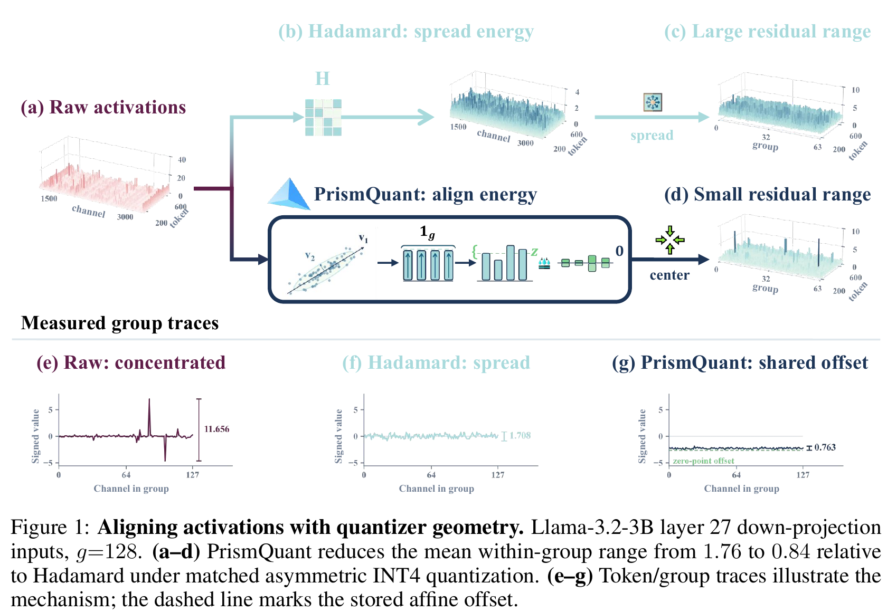
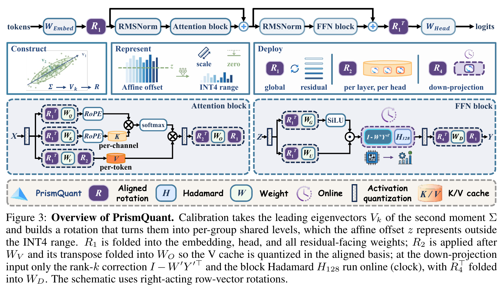

# 109. PrismQuant：把主要能量旋转到量化器容易表示的方向

**PrismQuant: Optimal Null-Space Rotations for Grouped Quantizers**  
阅读版本：**arXiv:2609.32429v1，2026-09-26，38 页**；arXiv preprint，论文页面标注 under review。讲解整理：2026-10-11。

[固定版本 PDF](paper-arxiv-v1.pdf) · [固定版本 arXiv](https://arxiv.org/abs/2609.32429v1) · [HTML 正文](https://arxiv.org/html/2609.32429v1) · [官方代码](https://github.com/ForeverBlue816/PrismQuant) · [返回 LLM 目录](../README.md)

作者：Yanlong Chen、Yining Chen、Song Zhang、Amirhossein Habibian、Yawei Li。

本 README 按“量化器的直觉 → 手算例子 → 子空间与最优性 → 结构化实现 → Transformer 集成 → 实验与部署边界”展开，可以独立阅读。所有页码都是本地 PDF 的**物理页码，从第 1 页开始数**。实验数字来自论文；标明“教学例子／教学推导”的内容是为理解方法补充的说明。本地没有运行量化、模型推理或 benchmark。

如果先读过 [QuaRot](../023-quarot/README.md) 和 [SpinQuant](../022-spinquant/README.md)，可以把本文看成一个新问题：**允许使用正交变换以后，能否直接从量化器的结构推出应该对齐到哪里？**

## 1. 先抓住核心：大数不一定难量化

考虑两组 activation：

- 第一组：10、−10、10、−10。
- 第二组：10、10、10、10。

它们的最大绝对值相同，平方和也相同，都是 400。但它们对 asymmetric min–max quantizer 的难度不同：第一组的组内 range 是 20；第二组的 range 是 0，只需要记录一个共同水平。

PrismQuant 的想法是：**利用 full-precision 函数允许的正交重参数化，把 activation 的主要能量转成这种“组内共同水平”。量化器已有的 offset 可以记录它，INT4 网格集中表示剩下的组内变化。**

这里的 rotation 作用于 hidden feature channels，不是旋转输入图像。方法保留全部 activation 维度和能量，不把主要成分删掉。

全文有三层问题，需要分开理解：

1. **几何问题**：哪些方向不会增加组内 range？
2. **优化问题**：怎样把尽可能多的能量送到这些方向？
3. **系统问题**：怎样实现这个变换，使在线成本足够小？

论文证明第二层的一个明确目标有闭式最优解。实际量化误差、PPL、任务准确率和 GPU 延迟仍由实验回答。

## 2. 阅读所需的基础概念

### 2.1 Weight、activation、KV cache

| 对象 | 是什么 | 本文怎样处理 |
|---|---|---|
| Weight | 预训练得到的 Linear 参数 | 旋转及补偿后，用 GPTQ 做 INT4 PTQ |
| Activation | 当前 token 在层内的特征 | 动态 asymmetric grouped INT4 |
| K cache | 历史 token 的 key | 沿 token 轴 per-channel 分组量化 |
| V cache | 历史 token 的 value | 沿 head feature 轴 per-token 分组量化，并对齐 value 方向 |

W4A4KV4 是这些路径的名义 bit-width。它没有说明 normalization、Softmax、累加器、metadata、所有输出或近期 cache 都是 4-bit。

本文的 quantizer 是 **scalar quantization**：每个数有一个整数码，同组共享 scale 和 offset。它不是 AQLM/VQVLA 那种用 codebook 表示整个向量的 Weight VQ。

### 2.2 Group 是哪些数组成的一组？

对一个 token 的 \(d\) 个 features，以连续 \(g\) 个 features 为一组：

\[
M=d/g.
\]

\(M\) 是每 token 的 group 数，假设 \(g\) 整除 \(d\)。例如 \(d=8192,\ g=128\)，每 token 有 64 组，各有自己的 scale 和 offset。

因此这里的 grouping 不跨 token。后面的 K cache 则沿时间方向分组，是另一条轴，不能混用。

### 2.3 PTQ 与 gradient-free

PrismQuant 在 pretrained model 上做 PTQ。它用 calibration 数据估计统计量，构造 rotation，再量化 weights；不通过 task loss 的反向传播学习 rotation，也不微调原模型参数。

所以可以说它的 **rotation construction 是 gradient-free / training-free**。但它不是 data-free，也不是没有准备成本：采集 activation、估计 eigenspace、构造 factors、fold weights 和 GPTQ 都需要离线工作。

## 3. Asymmetric INT4 到底记录了什么？

论文 Eq. (1)，第 4 页，采用下面的理想形式。对一组 \(y\in\mathbb R^g\)：

\[
z=\min_i y_i,\qquad
s=\frac{\max_i y_i-\min_i y_i}{15},
\]

\[
q_i=\operatorname{clip}_{[0,15]}
\left(\operatorname{round}\frac{y_i-z}{s}\right),
\qquad
\widehat y_i=sq_i+z.
\]

| 变量 | 含义 |
|---|---|
| \(q_i\) | 0 到 15 的整数码，共 16 个表示点 |
| \(s\) | 相邻表示点的间距，称为 scale / quantization step |
| \(z\) | 实数 affine offset，确定网格起点 |
| \(\widehat y_i\) | 解码后的数 |

这里的 \(z\) 是存为 FP16 的实数 offset。不能直接把它理解成另一种实现中整数域的 zero-point。论文文字及图中也会把这个 offset 称为 zero-point，阅读时以公式为准。

如果一组都是相同数，作者实现用正的 fallback scale，配合 \(q=0\) 和 offset 表示常数组，避免除以零。

### 3.1 一个能完整手算的例子

**以下沿用 Appendix B.1 的四维示意，并补充教学计算；不是模型实验。** 对齐后的输入为：

\[
y=(9.80,\ 9.97,\ 10.03,\ 10.20).
\]

它可以分解为共同水平 10，加上小变化：

\[
y=10\mathbf 1_4+(-0.20,-0.03,0.03,0.20).
\]

共同水平很大，但理想量化参数只需：

\[
z=9.80,\qquad s=0.40/15\approx0.026667.
\]

码与重建结果为：

| 输入 | \((y_i-z)/s\) | 取整后的码 | 重建值 |
|---|---:|---:|---:|
| 9.80 | 0 | 0 | 9.80 |
| 9.97 | 6.375 | 6 | 9.96 |
| 10.03 | 8.625 | 9 | 10.04 |
| 10.20 | 15 | 15 | 10.20 |

理想重建误差是 \((0,-0.01,0.01,0)\)，平方和为 0.0002。这个计算暂时把 \(s,z\) 当作精确实数；实际 FP16 metadata 还会引入舍入误差。

注意：**组均值是 10，保存的 offset 是 9.80。** offset 同时包含共同水平和剩余变化的最小值，两者不必相等。

### 3.2 为什么“给整组加一个常数”本身不能解决问题？

因为：

\[
\operatorname{range}(y+c\mathbf 1_g)=\operatorname{range}(y).
\]

把 \((10,-10,10,-10)\) 全部加上 10，得到 \((20,0,20,0)\)，range 仍然是 20。

PrismQuant 的作用不是平移同一组，而是**改变特征坐标系，把原来有正有负的主要方向转成常数方向**，同时对相邻 weights 做补偿。

## 4. 原论文 Figure 1 应该怎样看？

来源：Chen et al., PrismQuant，arXiv:2609.32429v1，物理第 2 页 Figure 1；原图及 caption 从 PDF 裁切，未重绘，采用 [CC BY 4.0](https://creativecommons.org/licenses/by/4.0/)。

先看下面三条 group trace：

- Raw trace 的能量集中在少数 channels。
- Hadamard 把能量分散，但组内仍有上下变化。
- PrismQuant 的一部分能量成为组内共同水平，offset 跟着这个水平移动，剩余 range 更小。

图中一个选定层的平均组内 range 从 Hadamard 的 1.76 降到 0.84。这是 Llama-3.2-3B layer 27 down-projection inputs 的局部比较，不是所有层的平均值。

第 3 页 Figure 2 才汇总全部 28 个 down-projection inputs：在相同 tokens、\(g=128\)、匹配 asymmetric INT4 条件下，论文报告平均 range 和 activation NMSE 相对 Hadamard 约下降 25% 和 40%。

NMSE 是归一化 activation 重建误差，与任务准确率是不同指标。大约 40% 的 NMSE 降幅不能改写成“准确率提高 40%”。

## 5. Range-null subspace：哪些方向量化器最容易表示？

### 5.1 一组有一个常数方向

设第 \(j\) 组的 normalized indicator 为：

\[
u_j=\frac{\mathbf 1_{\mathcal I_j}}{\sqrt g}.
\]

\(\mathbf 1_{\mathcal I_j}\) 在该组位置为 1，其他位置为 0；除以 \(\sqrt g\) 后向量长度为 1。

各组互不重叠，所以这些向量相互正交。把它们拼起来：

\[
U=[u_1,\ldots,u_M],\qquad U^\top U=I_M,
\]

\[
\mathcal S=\operatorname{span}(u_1,\ldots,u_M),\qquad
P_{\mathcal S}=UU^\top.
\]

\(\mathcal S\) 的维度是 \(M=d/g\)。落在这个子空间里的向量，每组内部都是常数，但不同组可以有不同的常数。

### 5.2 Projection 做了什么？

**教学例子：** \(d=4,\ g=2\)，两组分别是位置 1–2 和 3–4：

\[
u_1=(1,1,0,0)^\top/\sqrt2,\quad
u_2=(0,0,1,1)^\top/\sqrt2.
\]

若 \(y=(2,4,10,14)^\top\)，则：

\[
P_{\mathcal S}y=(3,3,12,12)^\top,
\]

\[
(I-P_{\mathcal S})y=(-1,1,-2,2)^\top.
\]

投影部分记录每组共同水平，剩余部分记录组内变化。原来的两个 group ranges 是 2、4，剩余部分的 ranges 仍是 2、4。因此：

\[
\operatorname{range}(y^{(j)})
=\operatorname{range}\left([(I-P_{\mathcal S})y]^{(j)}\right).
\]

### 5.3 “Null” 到底是谁的 null？

它是 **range-null**：加上该子空间中的成分不会改变 group range。它不是 weight matrix 的 null space，也不是说这部分信息在重建后消失，更不是“可以丢掉而不影响模型输出”。

上面的 projector 是分析工具。实际推理不需要单独求每组均值再存一份系数；rotate 后直接使用原来的 min–max quantizer 即可。

“免费表示”也有具体前提：量化格式已经为每组付出了 offset 的存储成本。这不等于零 metadata、无限精度或完全无误差。

## 6. 主要能量方向从哪里来？

单个 activation 采用 column-vector 约定 \(x\in\mathbb R^d\)，rotation 是：

\[
y=Rx,\qquad R^\top R=I.
\]

把 \(N\) 个 tokens 按行存成 \(X\in\mathbb R^{N\times d}\)，对应的 batched 形式是：

\[
Y=XR^\top.
\]

本文统一采用这个约定；Figure 3 的示意采用右作用 row-vector rotation，照抄图中文字时要留意 transpose。

论文从 **uncentered second moment** 得到主要方向：

\[
\Sigma=\mathbb E[xx^\top],
\qquad
\widehat\Sigma=\frac1{N_{\mathrm{cal}}}X_{\mathrm{cal}}^\top X_{\mathrm{cal}}.
\]

不是先减均值后的 covariance。若 \(\mu=\mathbb E[x]\)，有：

\[
\Sigma=\operatorname{Cov}(x)+\mu\mu^\top.
\]

原因是持续存在的非零共同成分也携带能量，也会影响量化。把均值减掉再分析，可能忽略这部分可以对齐的成分。

对 \(\Sigma\) 做 eigendecomposition：

\[
\Sigma v_i=\lambda_i v_i,\qquad
\lambda_1\ge\lambda_2\ge\cdots\ge\lambda_d\ge0.
\]

若 \(\|v_i\|_2=1\)，则：

\[
\lambda_i=\mathbb E[(v_i^\top x)^2].
\]

也就是说，\(\lambda_i\) 表示 activation 沿方向 \(v_i\) 的平均平方能量。最大的几个 eigenvalues 对应最值得对齐的方向。

## 7. “Optimal” 的目标、解和证明

### 7.1 先选择 \(k\) 个可用方向

令 \(k\le M\)，选出 \(k\) 个 group-constant targets，组成 \(U_k\)。目标为论文 Eq. (6)，第 5 页：

\[
\mathcal J_k(R)
=\mathbb E\|U_k^\top Rx\|_2^2
=\operatorname{Tr}(U_k^\top R\Sigma R^\top U_k),
\]

\[
\max_{R^\top R=I}\mathcal J_k(R).
\]

它问的是：**旋转后，送进选定 \(k\) 个常数方向的平均能量最多能有多少？**

设 \(V_k=[v_1,\ldots,v_k]\)。闭式答案为：

\[
\max_R\mathcal J_k(R)=\sum_{i=1}^k\lambda_i.
\]

只要正交 \(R\) 把 leading eigenspace 映射到 target subspace，就能达到这个最优值；一个具体构造满足：

\[
RV_k=U_k
\]

或各列带固定符号。Eigenvalue 重复时可能有多个最优 eigenspaces；即使 eigenspace 固定，补空间也能有不同正交映射，所以最优 rotation 不唯一。

### 7.2 不必先懂 Ky Fan，也可以理解这个证明

令 \(B=R^\top U_k\)，则 \(B^\top B=I_k\)。目标变成：

\[
\operatorname{Tr}(B^\top\Sigma B)
=\sum_i\lambda_i\gamma_i,\qquad
\gamma_i=\|B^\top v_i\|_2^2.
\]

因为 \(BB^\top\) 是 rank-\(k\) orthogonal projector：

\[
0\le\gamma_i\le1,\qquad\sum_i\gamma_i=k.
\]

可以把它理解成有 \(k\) 份容量，每个方向最多拿一份。为了让加权和最大，应先拿最大的 \(k\) 个 \(\lambda_i\)。这正是 Ky Fan maximum principle 在这里的用法。完整证明见第 23 页 Appendix B.2。

### 7.3 一个谱能量的教学算例

假设 \(d=4,\ g=2,\ M=2\)，second moment 的 eigenvalues 是 \(9,4,2,1\)，总能量为 16：

| \(k\) | 最多对齐的能量 | 对齐比例 \(f_k\) | 选定 targets 之外的能量 |
|---:|---:|---:|---:|
| 1 | 9 | 56.25% | 7 |
| 2 | 13 | 81.25% | 3 |

其中：

\[
f_k=\frac{\sum_{i=1}^k\lambda_i}{\operatorname{Tr}(\Sigma)}.
\]

在 \(k=M\) 时，这也最小化整个 \(\mathcal S\) 之外的能量。在 \(k<M\) 时，最优性仅针对所选的 \(k\) 维 target；其他未选 group slots 还可能偶然捕获能量。

实践中从有限 calibration 数据得到的是 \(\widehat\Sigma\) 和近似 \(\widehat V_k\)。对经验统计量的最优构造，不保证它也达到真实输入分布的 population optimum。

## 8. 为什么这个目标有用，又为什么不等于最低任务 loss？

### 8.1 从残余能量到量化误差的桥梁

令 \(e=(I-P_{\mathcal S})Rx\)。一组的最大值和最小值之差满足：

\[
\operatorname{range}(e^{(j)})^2
\le2\|e^{(j)}\|_2^2.
\]

把各组相加：

\[
\sum_j\operatorname{range}((Rx)^{(j)})^2
\le2\|(I-P_{\mathcal S})Rx\|_2^2.
\]

**教学解释：** 两个坐标的差不可能无限大而平方能量很小。把大量能量移到不会影响 range 的子空间后，剩余 range 的一个上界也随之降低。

理想 nearest-grid INT4 的每坐标 rounding error 至多 \(s_j/2\)，所以 Appendix B.1 进一步给出：

\[
\|\widehat y-y\|_2^2
\le \frac{g}{4\cdot15^2}\sum_j\operatorname{range}(y^{(j)})^2
\le \frac{g}{2\cdot15^2}\|(I-P_{\mathcal S})y\|_2^2.
\]

这些是理想实数 metadata 下的 worst-case bounds。它们没有把每组实际 range、实际 rounding error 或 PPL 变成残余能量的等式。

### 8.2 三个不能跨越的推断

- 较低残余能量，不保证每一组的实际 range 都更低。
- 较低 activation reconstruction error，不保证下游敏感方向受到的损伤最小。
- 较大 \(k\)、较高捕获能量，不保证最终 PPL 或平均准确率单调改善。

另外，weight quantization、FP16 metadata、后续非线性和层间误差传播都不在上面的简单 activation bound 中。

因此，标题中的 optimal 应读成 **optimal spectral alignment for the stated objective**。例如主实验 70B 的 \(k=8\) 比 \(k=\max\) 的 PPL 和平均准确率更好，正好说明这一区别。

## 9. 怎样把闭式方向变成便宜的 rotation？

### 9.1 Householder：一次反射对齐一个方向

Householder transform 的形式是：

\[
\mathcal H=I-2hh^\top,\qquad \|h\|_2=1.
\]

它是 orthogonal reflection，保留向量长度。若单位向量 \(b\) 要映射到单位坐标 anchor \(e_t\)，取：

\[
h=\frac{b-e_t}{\|b-e_t\|_2}.
\]

就有 \(\mathcal H b=e_t\)。若 \(b=e_t\)，无需反射，应跳过，避免零分母。

**二维教学例子：** \(b=(0,1)^\top,\ e_t=(1,0)^\top\)，有：

\[
h=(-1,1)^\top/\sqrt2,\qquad
\mathcal H=
\begin{bmatrix}0&1\\1&0\end{bmatrix}.
\]

于是 \(\mathcal H(0,1)^\top=(1,0)^\top\)。这说明这里的“rotation”允许反射，并不要求 determinant 为 +1。

论文按 leading eigenvector 的顺序构造至多 \(k\) 个 reflections。每次把当前方向送到新的 anchor，并利用正交性保持此前 anchors 不变。详细 induction 见第 24 页 Appendix B.3。

### 9.2 再把 anchor 变成 group 常数

完整 column-vector 变换为：

\[
R=H_gD\Pi G,\qquad G=I-WY^\top.
\]

从右到左理解：

| 部分 | 作用 |
|---|---|
| \(G\) | 把 leading eigenvectors 映射到各组第一个坐标的 anchors |
| \(\Pi\) | 保留 selected anchors，安排其他 coordinates，平衡各组 residual energy |
| \(D\) | 固定的 signed diagonal transform |
| \(H_g\) | 每组一个 normalized Hadamard，把该组第一个坐标变成 \(\mathbf1_g/\sqrt g\) |

Hadamard 的其他 columns 与常数方向正交，因此主要成分被送进共享水平，剩余成分在组内混合。

如果 \(k<M\)，作者用低能量 coordinates 填充未使用的 anchors，避免 rank ablation 偶然又把额外高能量方向对齐进去。

### 9.3 Compact-WY：低秩的是 correction，不是模型

\(W,Y\in\mathbb R^{d\times k}\) 是 Householder product 的两个 thin factors，不是 Transformer 的模型 weight。按本文的 row-batch 约定：

\[
XG^\top=X-(XY)W^\top.
\]

不用显式保存 \(d\times d\) 的 dense \(G\)。每 token 的成本变成：

\[
O(dk)+O(d\log g),
\]

分别对应 low-rank correction 和 block Hadamard；factors 的存储是 \(O(dk)\)。

**\(G\) 本身仍是 full-rank orthogonal matrix。** rank 至多 \(k\) 的是 \(I-G=WY^\top\)，activation 仍有 \(d\) 个 channels。这不是把模型降到 \(k\) 维，也不是 low-rank weight approximation。

教学量级：若 \(d=8192,\ k=8\)，dense matrix 有 67,108,864 个元素，两个 \(d\times k\) factors 共 131,072 个元素，相差 512 倍。这只比较表示大小；实际 kernel 的 padding、factor precision、scratch buffers 和运行效率仍需单独计入。

## 10. 放进 Transformer，怎样保持原来的函数？

来源：Chen et al., PrismQuant，arXiv:2609.32429v1，物理第 6 页 Figure 3；原图及 caption 从 PDF 裁切，未重绘，采用 [CC BY 4.0](https://creativecommons.org/licenses/by/4.0/)。

### 10.1 一个 Linear 的等价变换

按 column-vector 约定，原输出是 \(Ax\)。因为 \(R^\top R=I\)：

\[
Ax=(AR^\top)(Rx).
\]

把输入变成 \(Rx\)，把 weight 换成预计算的 \(AR^\top\)，full-precision 输出相同。

但量化一般不与 rotation 交换：

\[
Q(Rx)\ne RQ(x).
\]

这正是有机会改善量化的原因。还要处理 residual、normalization、attention 和 FFN 非线性，不能在任意 tensor 上加一个 rotation 就宣称整个模型等价。

### 10.2 三类位置

| 位置 | 校准与作用 | 推理时的处理 |
|---|---|---|
| \(R_1\)：residual stream | 全网共享 basis，统计量池化各层 attention-input RMSNorm outputs，各 token 等权 | 把变换并入 embedding、head 和所有 residual-facing weights；无额外 online rotation |
| \(R_2\)：values | 每层池化 tokens 和 KV heads 的 head-dimensional second moment；该层各 KV heads 共享 rotation | 补偿并入 output projection；reference evaluation 用 value hook 应用 forward rotation，代数上也可并入 value projection |
| \(R_4\)：down projection input | 每层 FFN gate 后分别校准 | 需要 online correction + block Hadamard，inverse 补偿并入 down weight |

本文没有额外的 post-RoPE Q/K quantization rotation：Algorithm 1 中 \(R_3=I\)。这与直接套用 SpinQuant/QuaRot 的四类位置说明不同。

\(R_1\) 的“optimal”针对 pooled objective，不是每一层各自的最优 rotation。不同层共用 residual basis，不能随意改成互不一致的 rotations。

### 10.3 为什么 RMSNorm gain 要先 fold？

正交变换保持范数，所以不带 channel gain 的 RMS normalization 满足：

\[
\operatorname{RMSNorm}_0(Rx)
=R\operatorname{RMSNorm}_0(x).
\]

但逐 channel 的 learned gain 一般不与任意 \(R\) 交换。作者先把 gain 吸收到相邻 reading weights，再处理 basis change。Residual 两条分支也必须使用同一 basis：

\[
R(x+f(x))=Rx+Rf(x).
\]

### 10.4 为什么 \(R_4\) 不能全部离线消失？

Gated FFN 的中间值为：

\[
h=\operatorname{SiLU}(A_{\mathrm{gate}}x)
\odot(A_{\mathrm{up}}x).
\]

一般而言，dense rotation 不能穿过 SiLU 或 element-wise product。因此需要在形成 \(h\) 后，在线做 rotation。

但 signed permutation \(T=D\Pi\) 可以部分 fold：

\[
A_{\mathrm{gate}}\leftarrow\Pi A_{\mathrm{gate}},\qquad
A_{\mathrm{up}}\leftarrow D\Pi A_{\mathrm{up}}.
\]

这样 FFN 直接输出 \(h_T=Th\)。**Signs 只放在 up branch**，因为 SiLU 不与 sign flips 交换；permutation 则可以作用于两条 branch。

剩下：

\[
R_4h=H_g\widetilde G h_T,\qquad
\widetilde G=TGT^\top.
\]

这让 online path 只需 compact correction 和 block Hadamard，避免额外 online gather。第 7 页的这个细节，是把数学构造变成实际 kernel 的关键。

### 10.5 K/V 的 grouping 和 rotation 各做什么？

本文使用 KIVI-style cache policy：

- K：同一 channel 沿 32 tokens 组成完整 group 后量化；当前未完成 chunk 保持高精度。
- V：每 token 沿 head features 量化；最近 32 tokens 保持高精度。
- \(R_2\)：本实验 head dimension 为 128，单个 head 是一个 group，只有一个 group-constant direction，所以 \(k_{R_2}=1\)。

一个 head 内的 value rotation 可以与 output projection 的补偿配对，包括 GQA 对应 head blocks 的处理。它保留 attention 输出的 full-precision 等价关系；它没有把 K 也改成 per-token grouping。

## 11. 从 calibration 到 evaluation 的完整流程

第 22 页 Algorithm 1 和第 15 页 Appendix A.1 给出的流程可以按下面读：

1. **采集统计量。** 使用 WikiText-2 training split 的 128 个 sequences，每个 2048 tokens，共 262,144 calibration token positions。Residual \(R_1\) 池化多层；\(R_4\) 按层／expert；\(R_2\) 按层 head dimension。
2. **求 leading eigenspace。** Wide sites 使用 randomized eigensolver，默认三 passes，配合 orthogonalization 和 Rayleigh–Ritz extraction；较小的 value moments 显式求解。
3. **构造固定变换。** 生成 Householder / compact-WY factors，再单独估计 \(G\) 后的 coordinate energies，生成固定 permutation 和 seeded signs。
4. **Fold 合法的 weights。** 融合 RMSNorm gains，并入 \(R_1\) 和相邻补偿；安排 online \(R_2/R_4\)。
5. **运行 GPTQ。** 在 rotations 已就位的模型上量化 weights；此时 activation / KV quantization 关闭。
6. **附上动态 quantizers。** Evaluation 才启用 activation INT4 和 KIVI-style KV quantization，测 PPL 和任务 scores。

三 passes 不是完整准备流程只需三次 model forward：permutation energy estimation、不同 rotation sites、GPTQ 和其他步骤仍有工作量。本文未在本地执行这些步骤。

这套 pipeline 没有 rotation gradient optimization，但最终质量并非由 rotation 一项单独决定。

## 12. 名义 4-bit、有效存储位数与真实显存

### 12.1 Activation metadata 的账

每组有 \(g\) 个 INT4 codes，一个 FP16 scale，一个 FP16 offset：

\[
b_{\mathrm{eff}}=\frac{4g+16+16}{g}
=4+\frac{32}{g}\quad\text{bits/value}.
\]

| Group size \(g\) | 有效表示成本 | 对齐子空间维数 |
|---:|---:|---:|
| 64 | 4.50 bits/value | \(d/64\) |
| 128 | 4.25 bits/value | \(d/128\) |
| 256 | 4.125 bits/value | \(d/256\) |

细分 group 同时买到更细的 scale 和更多 constant directions，但付出更多 metadata。增加 \(k\) 而保持 \(g\) 不变，则不改变这个格式成本；它增加 factors 的存储和 online work。

### 12.2 W/K/V 不一定也正好是 4.25

第 15 页 protocol 中：

- 3B、Qwen3、MoE 和 Mistral 的 weights 使用 group-128 asymmetric GPTQ，FP16 scale 加 INT4 zero，约 4.16 bits/weight。
- Llama-3.1-8B / 70B 的 weights 使用 per-channel GPTQ，论文记为约 4.00 bits/weight。
- Context 2048 时，cache 的逻辑成本约为 **K 5.17、V 4.43 bits/value**，已经计入不同 grouping 和近期高精度部分。

**教学核算 cache：** 完整 K group 的成本是 \(4+32/32=5\) bits/value，V 是 4.25。按 32 个 FP16 tail tokens 的格式账：

\[
b_K=\frac{2016\times5+32\times16}{2048}=5.171875,
\]

\[
b_V=\frac{2016\times4.25+32\times16}{2048}=4.433594.
\]

K 当前 chunk 长度随完成边界变化；这些数是指定 context 下的格式口径，不是所有 decode positions 的恒定值。

### 12.3 格式账不能直接当作实测 VRAM

以上没有把 shared rotation factors、padding、packing、临时 buffer、allocator、未量化算子等全算进去。正文精度评价使用浮点 QDQ containers，官方 reference loader 也保留 floating-point storage，因此名义 4-bit 或逻辑 bits/value 不等于该 loader 实际占用同等低位数显存。

真实 peak allocated memory 必须看独立 deployment benchmark 的条件。

## 13. 精度实验的比较条件先读清楚

第 15 页 Appendix A.1 最值得在读表之前看：

| 项目 | 论文的精度协议 |
|---|---|
| Pretrained weights / containers | Released bf16 weights 放在 FP32 containers；bf16 reference 标签也走相同 containers |
| Activation | 每 Linear input，group-128 asymmetric INT4，FP16 scale / offset |
| Weight | GPTQ asymmetric INT4；模型间 granularity 有上述区别 |
| KV | K per-channel、time group 32；V per-token、head group 128；高精度近期部分 |
| Calibration | WT2 train，128 × 2048；rotation 和 GPTQ 共享序列 |
| WT2 PPL | Test split 的 141 个连续 2048-token windows |
| C4 PPL | First validation shard 的 256 个 2048-token windows |
| Zero-shot Avg. | ARC-c、ARC-e、BoolQ、HellaSwag、OBQA、PIQA、SIQA、WinoGrande，八项算术平均 |
| 随机性 | PrismQuant end-to-end rows 为三 seeds；对应 ablations 使用 paired seeds |

这八项的 Avg. 是每项 task score 等权平均，不是把全部题目合并后计算一次准确率。部分 tasks 用 acc_norm，其他用 acc，不能只凭各 task 名称假设统一打分方式。

Table 1 有两类对照：

1. **作者同 pipeline 的 Hadamard / PrismQuant。** 除 rotation 外，保持相同量化格式等条件，这是解释方法贡献最直接的比较。
2. **Published method rows。** 引用 QuaRot、SpinQuant、OffQ 等已有报告，有不同原始协议。Published QuaRot 采用 per-token symmetric activation grid，作者的 Hadamard row 使用这里的 group-128 asymmetric grid，两行不可直接当成“同一算法被复现出完全不同结果”。

Published rows 可帮助定位文献水平，但 PrismQuant 的机制增益应优先对照匹配 Hadamard。

## 14. Table 1：三个 Llama 规模分别说明了什么？

第 9 页 Table 1 的核心数字如下。PPL 越低越好，Avg. 越高越好：

| Model | Method | WT2 PPL | 八项 Avg. (%) |
|---|---|---:|---:|
| Llama-3.2-3B | bf16 reference | 7.80 | 62.73 |
| | Hadamard | 9.04 | 59.29 |
| | PrismQuant \(k=8\) | 8.60 | 60.80 |
| | PrismQuant \(k=\max\) | 8.58 | 61.23 |
| Llama-3.1-8B | bf16 reference | 6.23 | 67.81 |
| | Hadamard | 7.21 | 65.37 |
| | PrismQuant \(k=8\) | 6.99 | 65.36 |
| | PrismQuant \(k=\max\) | 6.92 | 65.43 |
| Llama-3.1-70B | bf16 reference | 2.81 | 72.68 |
| | Hadamard | 4.22 | 71.36 |
| | PrismQuant \(k=8\) | 3.85 | 72.46 |
| | PrismQuant \(k=\max\) | 3.89 | 71.97 |

### 14.1 3B：PPL 和 Avg. 都有明确改善

\(k=\max\) 相对匹配 Hadamard，PPL 降 0.46，Avg. 增 1.94 **percentage points**。相对 bf16 仍差 1.50 points。

论文提到恢复约 37% 的 PPL gap，分母是 Hadamard 到 bf16 的差距：

\[
\frac{9.04-8.58}{9.04-7.80}\approx37.1\%.
\]

这不是 PPL 本身下降 37%，更不是错误率降低 37%。

### 14.2 8B：PPL 改善，匹配 Avg. 增益很小

\(k=\max\) 的 PPL 从 7.21 降到 6.92，但 Avg. 只从 65.37 到 65.43，增加 0.06 points；\(k=8\) 为 65.36。

作者给出的八项 mean 的 binomial standard error 约 0.43 points。这里的 0.06-point margin 很小，不能从这张表推成稳健的平均准确率优势。这个 0.43 也不是所有 paired method differences 的完整显著性检验。

相对 published SpinQuant row，表上差距更大，但这是另一种比较口径，不能替换成匹配 Hadamard 的机制收益。

### 14.3 70B：接近 reference Avg.，PPL 仍有差距

\(k=8\) 相对 Hadamard 增加 1.10 points，距 bf16 Avg. 0.22 points；但 PPL 3.85 与 reference 2.81 仍有差距。

而 \(k=\max\) 的两项 aggregate 都弱于 \(k=8\)。因此：

> 捕获更多谱能量，不等于所有终端指标都更好；部署选 \(k=8\) 是质量与成本的 operating point。

“在表中 compared methods 上领先”也不等于穷尽了所有 quantization 方法、所有模型和所有指标。

## 15. MoE 与跨模型结果

### 15.1 Table 2：Qwen3-30B-A3B

第 9 页 Table 2：

| Method | WT2 PPL | C4 PPL | 八项 Avg. (%) |
|---|---:|---:|---:|
| bf16 | 6.11 | 10.70 | 68.71 |
| Hadamard | 6.68 | 11.47 | 67.47 |
| PrismQuant \(k=8\) | 6.45 | 11.19 | 68.52 |
| PrismQuant \(k=\max\) | 6.42 | 11.18 | 68.23 |

这是总参数约 30B、activated parameters 约 3B 的 MoE，不应叫作普通 3B dense model。每层 128 experts，每 token top-8 routing。

每个 expert 有自己的 \(R_4\)。Expert intermediate width 为 768，\(g=128\)，所以其 full slot count 为 6：两条 PrismQuant rows 的 expert \(R_4\) 都是 \(k=6\)，**两行改变的是 \(R_1\) 的 rank**。

Router 保留 bf16，并入 input basis compensation；不能读成“router 也 INT4”。冷 expert 的 second moment 使用：

\[
\widetilde\Sigma_e
=\frac{n_e\Sigma_e+n_0\Sigma_{\mathrm{pool}}}{n_e+n_0},
\qquad n_0=2048.
\]

\(n_e\) 是该 expert 收到的 calibration tokens。样本少时更多依靠 layer-pooled statistics，避免估计过于不稳定。

Avg. 恢复比例按显示值计算：

\[
\frac{68.52-67.47}{68.71-67.47}\approx84.7\%.
\]

约 85% 指恢复 Hadamard 丢失的 Avg. points，并不是 robot task success，也不是模型只剩 15% 错误。论文没有为该 MoE 报告 fused-kernel timing。

### 15.2 Qwen3 dense 与 Mistral 是边界，不只是补充名单

第 16 页 Table 4 中，Qwen3-8B 的 WT2 PPL 从 Hadamard 11.39 降到 \(k=8\) 的 9.73；其 activation-only rank ablation 的高恢复比例，不能替换成 full W4A4KV4 完全无损。

第 17 页 Table 5 中，Mistral-7B-v0.3 的 matched improvement 较小：WT2 PPL 5.64 → 5.62，八项 Avg. 67.29 → 67.67。Avg. margin 在作者给出的 standard error 内；\(k=\max\) 的八项 Avg. 67.18 还略低于 Hadamard。

不同模型、不同 rank、不同指标之间有取舍，适合用来检查机制在哪些分布下有效。

## 16. Rank 与 metadata ablation 怎样读？

### 16.1 Table 3 是 activation-only

第 10 页 Table 3 保持 **weights 和 KV states 为 bf16**，只量化指定 activation sites。它报告：

\[
\mathrm{Recovery}
=\frac{\mathrm{PPL}_{\mathrm{Had}}-\mathrm{PPL}_{\mathrm{PQ}}}
{\mathrm{PPL}_{\mathrm{Had}}-\mathrm{PPL}_{\mathrm{bf16}}}
\times100\%.
\]

| Model | Hadamard-to-reference PPL gap | \(k=8\) recovery | \(k=\max\) recovery |
|---|---:|---:|---:|
| Llama-3.2-3B | +0.154 | 38.59% | 42.67% |
| Llama-3.1-8B | +0.142 | 35.53% | 43.12% |
| Qwen3-8B | +0.442 | 59.12% | 99.95% |

对 Llama，small rank 已拿到较多收益；Qwen3-8B 的 additional ranks 更有价值。Intermediate ranks 并非严格单调。

教学代入：Qwen 的 99.95% recovery 表示剩余 activation-only PPL gap 约 \(0.442\times0.0005=0.000221\)，分母很小且与 full W4A4KV4 不同；不能用它证明 weights 和 KV 也量化后近乎无损。

### 16.2 Table 6：同一 bit budget，买更多 directions 还是细 group？

第 17 页 Table 6(a) 比较 extended-affine controls：一组保留 \(m\) 个固定 directions，含原来的常数方向，格式成本为：

\[
b_{\mathrm{eff}}(g,m)=4+\frac{16(m+1)}g.
\]

额外 directions 需要额外 coefficients；这是一组 ablation controls，不是默认量化器免费增加了 \(m\) 个 offsets。

以下两种都是 4.25 bits/value：

| \((g,m)\) | PQ activation-only 3B PPL | PQ activation-only 8B PPL |
|---|---:|---:|
| \((256,3)\) | 7.73 | 6.30 |
| \((128,1)\)，default | 7.71 | 6.29 |

在测试条件内，细 group 更好；更多 represented directions 不是唯一值得花预算的资源。差距较小，也不构成所有模型上的普遍定律。

## 17. 收益全靠 offset 吗？Appendix 的答案更细

这一节建议在形成自己的方法解释前读。第 19–20 页 Appendix A.4 / Table 9 保持同一个 rotation，改变 quantizer：

| Quantizer，\(g=128\) | Qwen3-4B：PQ−Had PPL | Llama-3.2-3B：PQ−Had PPL |
|---|---:|---:|
| Asymmetric | −0.179 | −0.061 |
| Symmetric，没有 offset | −0.194 | −0.060 |

在这些 activation-only controls 中，收益在 symmetric format 下仍存在。因为对齐还有两个作用：

1. **组内 flatness**：主要方向在所属 group 的幅度均匀，减少 peak 相对 r.m.s. 的放大。
2. **局部集中**：主要方向集中在一个 group，而不是影响很多组的 extrema。
3. **Offset absorption**：在 asymmetric format 中，共同水平进一步不进入组内 range。

为隔离第三项，作者把 anchor 从 constant Walsh column 移到同一 group 的非恒定 column，保持 flatness 和局部集中，但让主要成分进入 range。Sequency-1 control 损失约 16%–25% 的总 PPL gain；其余大部分保留。Alternating-column control 也是相近的局部诊断，不能把单一比例当成所有构造的固定常数。

当一整个 token 只有一个 group（\(g=d,\ k=1\)）时，offset 的贡献更大。因此，“免费 offset directions”是构造目标的重要几何理由，**不是说默认 group-128 条件下的全部改善都只来自 offset**。

第 18 页 Table 7 还比较 all-token second moment 与只选极端 tokens 的 eigenspace estimator。All-token estimator 在这里最好，但不是每个比较的 interval 都排除零。OffQ-style top-1 estimator 放进同一 PrismQuant pipeline 后仍保留约四分之三收益；这个 ablation 只隔离 token selection，不能当成完整复现 OffQ。

## 18. Range law：哪里是定理，哪里是近似？

第 25–29 页 Appendix C 把谱能量、group size 与 quantization step 联系起来。

### 18.1 简单预测式

正文 Eq. (11)：

\[
\widehat s(g,k)=s_{\mathrm H}(g)\sqrt{1-f_k}.
\]

\(s_{\mathrm H}(g)\) 是在相同 site、group size、matched tokens 上测得的 Hadamard mean step；\(f_k\) 来自 calibration spectrum。没有额外拟合系数。

**教学例子：** 若 matched Hadamard step 为 0.10、对齐能量比例为 0.75，则预测 step 为 \(0.10\sqrt{0.25}=0.05\)。即 step 减半；没有因此得到任务 error 减半的结论。

### 18.2 这个式子不是 distribution-free bound

定义：

\[
\sigma_R^2
=\frac{\mathbb E\|(I-P_{\mathcal S})Rx\|_2^2}{d},
\qquad
\kappa_R=\frac{15\bar s_R}{\sigma_R}.
\]

\(\kappa_R\) 是 mean group range 相对 residual r.m.s. 的 crest factor，衡量剩余分布的极值形状。只要相关分母非零，定义直接给出精确 identity：

\[
\frac{\bar s_{\mathrm{PQ}}}{\bar s_{\mathrm H}}
=\frac{\kappa_{\mathrm{PQ}}}{\kappa_{\mathrm H}}
\sqrt{\frac{1-f_{\mathrm{PQ}}}{1-f_{\mathrm H}}}.
\]

要退化到简单 predictor，需要近似 residual crest factor 不变，忽略 reference 的 incidental capture 和未使用 slots 的影响；在 full capacity、精确对齐时 \(f_{\mathrm{PQ}}=f_k\)。

第 29 页 Table 12 直接检查这个近似：q/k/v inputs 的 crest-factor ratio 约 0.98–1.03，但 down inputs 约 0.87–0.92；Qwen3-4B down site 的 median absolute predictor error 达 18.1%，P90 为 52.2%。

也就是说，预测式能帮助理解趋势和排序，但不能逐层当作严格保证。第 8 节的残余能量 inequality 才是另一类 distribution-free 结论。

### 18.3 Group size 的第二个因素

在 Gaussian residual surrogate 中，定义：

\[
\eta_g=\mathbb E[\max_{i\le g}Z_i-\min_{i\le g}Z_i],
\qquad Z_i\overset{\mathrm{iid}}{\sim}\mathcal N(0,1).
\]

论文用 finite-\(g\) quadrature 得到：

| \(g\) | \(\eta_g\) |
|---:|---:|
| 64 | 4.687467 |
| 128 | 5.189195 |
| 256 | 5.653727 |

在 residual scales 可比的假设下，group 越大，从更多坐标取 max/min，预期 range 越大。这一项和 \(\sqrt{1-f_k}\) 的能量项一起构成 two-factor 直觉。

实际残余可能有 correlations、heavy tails、非均匀 scales 和 calibration mismatch。Gaussian surrogate 与谱最优性是两件事，不能因为后一项有定理，便把前一项的假设也当成定理。

## 19. 实际 GPU 性能：先看测试了什么

第 29–34 页 Appendix D 是独立的 deployment study。最重要的条件在第 32–34 页：

| 项目 | Performance benchmark 的条件 |
|---|---|
| Hardware | 单张 NVIDIA A40，sm86 |
| Model architecture | Llama-3.2-3B、Llama-3.1-8B；**全部 performance models 使用 random weights** |
| Quantized pipeline | 两方法共享 packed INT4 weights、quantizer、GEMM、attention、KV 实现；替换 online \(R_4\) |
| Activation / KV format | QuaRot-derived per-token symmetric activation backend；KV interface 与正文 accuracy protocol 不同 |
| Prefill | 每 sequence 2048 tokens，batch 1 / 16；各方法只算最后位置的 vocabulary logits |
| Decode | Batch 1，2048-token prefix 后 128 causal steps，剔除前 8 steps 的 steady-state timing |
| 重复测量 | 每 condition 三个 balanced sessions，每 session 10 warmups、50 measured runs；报告 pooled timing medians |
| CUDA Graph | Compilation / capture 不计入 steady-state；replay 的 position / KV metadata updates 计入 |
| Memory | 独立进程测 peak allocated memory，decimal GB，取三个 session peaks 的最大值 |

这些实验有真实 GPU packed-INT4 path，能说明 compact transform 的实现成本；但它们**不是正文 pretrained checkpoint 在同一 asymmetric quantizer 下的 accuracy–speed 联合测量**。

### 19.1 Table 13 的完整关键对照

第 33 页；prefill 单位 input tokens/s，decode 单位 ms/token：

| Model / Method | Prefill B1 | Prefill B16 | Eager decode | Graph decode | Graph peak GB |
|---|---:|---:|---:|---:|---:|
| 3B FP16 | 10,163.48 | 13,985.13 | 21.86 | 15.04 | 8.74 |
| 3B Hadamard | 12,819.74 | 17,894.66 | 42.83 | 16.33 | 4.37 |
| 3B PrismQuant \(k=8\) | 12,674.40 | 17,630.27 | 43.08 | 16.65 | 4.39 |
| 8B FP16 | 5,241.70 | 6,418.43 | 30.22 | 28.83 | 18.77 |
| 8B Hadamard | 7,607.40 | 9,556.00 | 52.31 | 23.10 | 8.15 |
| 8B PrismQuant \(k=8\) | 7,677.01 | 9,661.75 | 49.99 | 23.64 | 8.19 |

对于 8B：

- B16 prefill 的 speedup 为 \(9661.75/6418.43\approx1.51\times\)。
- Graph decode 的 speedup 为 \(28.83/23.64\approx1.22\times\)，对照同模式 FP16。
- 相对同模式 Hadamard，Graph latency 增约 2.35%（论文按原始未取整值报告）。
- Graph peak memory 降约 56.34%，对照 FP16；不是“rotation 自己节省 56.34%”。

对于 3B，Graph decode **16.65 ms/token 高于 FP16 的 15.04**，速度约 \(0.90\times\)。尽管 prefill 更快、memory 更低，这个 decode condition 没有获得 FP16 speedup。

两个规模的 quantized eager decode 也都慢于各自 FP16。PrismQuant 从自己 eager 到自己 Graph 的改善是执行模式变化，不是 rotation 相对 Hadamard 的独立加速。

### 19.2 两个 kernel 如何实现 \(R_4\)？

作者把 online path 写成：

\[
U=XA,\qquad Z=XH_{\mathrm{blk}}-UB,
\]

\[
A\in\mathbb R^{d\times k},\qquad B\in\mathbb R^{k\times d}.
\]

这里的 \(A,B\) 是实现用 factors，和第 10 节 Linear 的 \(A\) 属于不同上下文。Kernel A 算小 projection，Kernel B 融合 block Hadamard 与 correction；避免写出一份完整 Hadamard intermediate。随后输出 FP16 \(Z\)，接共享 quantizer 和 INT4 GEMM。

作者还复用 buffers、预绑定 kernel launches、减少每步 metadata 重复准备，使用 CUDA Graph replay。这些共同 runtime 改动按可适用范围作用于全部对照，所以整体 gain 包含量化 backend 与执行模式等因素。

### 19.3 存储和局部 timing 的边界

8B resident factors 约 44.04 MB，3B 约 22.02 MB，另有 shared Hadamard matrix 和 scratch storage。它们解释了 PrismQuant 为什么比 Hadamard 稍多占显存，也说明 \(O(dk)\) 不是零成本。

第 34 页 Table 14 测 rotation-plus-quantization frontend。8B 的 tested shapes 有 1.12–1.73× 局部 speedup；3B 的 \(T=2048/32768\) 则分别只有 0.93× / 0.85×。局部 transform chain 不能当作 whole-model speedup。

论文还记录 shared backend 的 large-accumulator FP16 conversion failures。Passed rotation checks 和 growing-cache Graph checks，不能替代 pretrained checkpoint 上的数值与质量验证。

## 20. 官方代码目前能用来理解什么？

截至 2026-10-11 查看，[官方 repository](https://github.com/ForeverBlue816/PrismQuant) 提供 core rotation、quantization、GPTQ、folding、loading、CUDA kernels、released checkpoint links 和 figures。原论文固定为 v1；repository main 会继续变化。

官方 README 明确区分两条路径：

| 路径 | 阅读时如何定位 |
|---|---|
| Reference loader / released artifacts | GPTQ INT4 值以反量化 floating-point tensors 保存，activation / KV quantization 用 reference QDQ；不能直接当作 packed INT4 serving engine |
| Fused \(R_4\) kernels / dedicated deployment study | 用来理解 compact transform 的实现与性能实验；不自动提供正文准确率协议下同 checkpoint 的完整 serving 证据 |

因此，下载 checkpoint 后能 generate，并不自动意味着复现 Table 13 的 memory 和 throughput。包里保留了官方入口，本次没有下载模型、安装代码或运行 generation。

它值得与本地资料连着读：

| 阅读包 | 与 PrismQuant 的联系 |
|---|---|
| [QuaRot](../023-quarot/README.md) | 正交等价性、fixed Hadamard 与低位数系统路径的基础 |
| [SpinQuant](../022-spinquant/README.md) | 用 quantized task loss 学习 rotations，对照统计量闭式构造 |
| [KIVI](../108-kivi/README.md) | K/V grouping axes、高精度 tail 与 cache 格式成本 |
| [GPTQ](../018-gptq-optq/README.md) | PrismQuant weight path 使用的二阶 PTQ 机制 |
| [VQVLA](../../vla/101-vqvla/README.md) | 主要是 Weight VQ 与 centroid reuse；帮助区分 scalar rotation 与 codebook quantization |

PrismQuant 与 SpinQuant 的一个关键区别，是前者最大化 quantizer target subspace 中的 activation energy，后者优化带量化影响的 task loss。无需梯度是构造方式的优势，但目标不同，不意味着闭式对齐在所有任务上更优。

## 21. 对 FYP 的启发：先形成一个有边界的机制假设

**以下是阅读后的研究推论，不是论文已验证的 VLA/WAM 结果，也不是本次运行的实验。**

PrismQuant 最值得借用的是它的提问方式：先写出 quantizer 实际怎么表示数据，找出它对哪些成分特别宽容，再设计等价变换。不要仅凭 activation maximum 下降，便假设行动误差也会下降。

如果考虑 Fast-WAM 的 A4 path，可以先问：

1. 实际 activation quantizer 是否 asymmetric、grouped？Group axis、size、offset precision 是什么？它的 target subspace 是否真的具有本文的 range-neutral 性质？
2. 在同一批固定 inputs 上，leading eigenspace 捕获比例、group range、activation NMSE 和最终 action RMSE 是否沿同一方向变化？
3. 哪些 rotations 可合法 fold，哪些跨越 gate、attention 或其他非线性必须 online？
4. 同一个 \(k\) 是否值得付出 factor memory 和 kernel latency？有无 native quantization path？

若当前使用 symmetric quantizer，Table 9 说明 flatness / localization 仍可能有效，但不能照搬“offset 已吸收主要水平”的解释。若使用 vector codebook，目标则可能取决于 codebook geometry，本文的 group-constant 最优性不能直接挪用。

谱能量最大，也可能偏向“能量大但对 action 不敏感”的方向。加入 task sensitivity 是可研究的另一个目标，但需要重新推导，而不能直接沿用这里的最优性宣称。

固定输入的误差改善只支持局部 fidelity 结论；promising 方法还要进入 closed-loop task success 和实测端到端 latency。本文的 LLM PPL、eight-task Avg. 和 A40 timing 都不能直接替代 robot-control 指标。

## 22. 回到 PDF 的三条阅读路线

### 20 分钟：抓住主线和边界

| 时间 | 物理页 | 看什么 | 阅读后应能说明 |
|---|---|---|---|
| 4 分钟 | 1–3 | Abstract、Figure 1/2 | 为什么 maximum magnitude 不够；局部图与全层 aggregate 的区别 |
| 7 分钟 | 4–6 | §§3.1–3.3、Figure 3 | Range-null subspace、Eq. (6)、leading eigenspace |
| 4 分钟 | 9–10 | Tables 1–3 | Matched Hadamard、8B 小 Avg. margin、activation-only rank |
| 5 分钟 | 32–34 | Protocol、Tables 13/14、scope | Random weights、不同 quantizer、3B decode slowdown |

可先读本 README 第 1、3、5、7、14、19 节，再打开上述 PDF 页。

### 90 分钟：能够解释方法与实验

1. **0–15 分钟：** 第 1–3 页，结合 README 的 INT4 手算，说明“大幅度共同水平”为何不增加 range。
2. **15–40 分钟：** 第 4–8 页，推导 subspace objective、读 Householder / compact-WY 和 Transformer 集成；区分 pooled \(R_1\)、rank-one \(R_2\)、online \(R_4\)。
3. **40–55 分钟：** 第 9–10、15 页，读 matched comparison 和完整 protocol；自己计算一项 recovery 的分母。
4. **55–70 分钟：** 第 17–20 页，读 metadata、token selection、symmetric control、nonconstant anchor controls。
5. **70–90 分钟：** 第 25–29、32–34 页，区分 range bound / predictor，并把 performance 条件填进自己的笔记。

### 180 分钟：检查推导与准备讨论

| 时间 | 物理页 | 深入目标 |
|---|---|---|
| 0–25 分钟 | 1–8 | 用自己的四维向量重做 group projection，整理变量与 transpose 约定 |
| 25–55 分钟 | 21–25 | Appendix B、Algorithm 1 在 22；证明 Ky Fan optimum、Householder 保持旧 anchors、metadata finite precision 的限制 |
| 55–85 分钟 | 25–30 | Appendix C、Table 12、Figure 5；从 exact identity 找出 predictor 的假设 |
| 85–120 分钟 | 9–10、15–20 | 逐一确认 full W4A4KV4、activation-only、published rows 的不同条件 |
| 120–150 分钟 | 29–34 | 两-kernel path、whole-model 与局部 timing；检查 speedup 的 reference 和 execution mode |
| 150–170 分钟 | 35–38 | Appendix E；区分 end-to-end activation geometry 与 paired-local rotation-only effects |
| 170–180 分钟 | README 末尾 | 作答 Reading Questions，填写 Meeting Card |

Appendix E 的 3D surfaces 显示 absolute activation magnitudes，不是 group-centered residual 或 reconstruction error；显示的是固定 token/channel window，不是全评估集 aggregate。Figure 10 才把不同 transforms 应用于同一 captured input，隔离局部 basis change。

## 23. Reading Questions（留待自己回答）

1. 为什么 \((10,-10,10,-10)\) 和 \((10,10,10,10)\) 能量相同，asymmetric grouped INT4 的难度却不同？
2. 为什么把同一组整体平移不能缩小它的 range？
3. Range-null subspace 的 null 与 matrix null space 有什么区别？
4. \(P_{\mathcal S}\) 在一组 coordinates 上具体算了什么？它是不是推理额外需要执行的操作？
5. 为什么论文用 uncentered second moment，而不是 centered covariance？
6. \(k\)、\(M=d/g\)、head dimension 和模型 channel dimension 分别限制什么？
7. 如何从 \(\gamma_i\) 的约束证明 \(\mathcal J_k\le\sum_{i\le k}\lambda_i\)？
8. 当 \(k<M\) 时，最优性为什么不能直接改写为对整个 \(\mathcal S\) 的最优性？
9. Householder 为什么能保持此前 aligned anchors？\(b=e_t\) 时应该怎么办？
10. Compact-WY 中，哪个矩阵是 full rank，哪个 correction 是 low rank？
11. 为什么 \(R_1\) 可以 fold，而 \(R_4\) 需要 online？SiLU 为什么让 signs 的 placement 变得重要？
12. 本文为什么设 \(R_3=I\)？K 和 V 的 grouping axes 分别是什么？
13. 增加 \(k\) 与减小 \(g\)，对 metadata、factor storage 和 online cost 的影响有什么不同？
14. Table 1 的 published QuaRot row 与 matched Hadamard row 为什么不是同一对照条件？
15. 8B 的 PPL 改善和 Avg. 小 margin 应该怎样一起报告？
16. Table 3 中 99.95% recovery 的分母是什么？为什么它不证明 full W4A4KV4 无损？
17. Table 9 的 symmetric 和 nonconstant-column controls 分别隔离了哪一种解释？
18. Range predictor 相比 exact crest-factor identity 忽略了什么？这些假设是否来自 Ky Fan theorem？
19. Table 13 的 random weights 与不同 quantizer，给 accuracy–speed 联合结论留下什么缺口？
20. 如果把这套思想用于 VLA/WAM，你最先需要确认哪一个 quantizer 性质，才能写出合理的 bounded hypothesis？

## 24. Meeting Card（留空，阅读后填写）

| 项目 | 我的记录 |
|---|---|
| 阅读日期 / 用时 | |
| 用自己的话写出论文问题 | |
| 核心机制，一句话 | |
| 最重要的公式与变量 | |
| “Optimal” 的准确范围 | |
| 最有说服力的 matched result | |
| 最关键的 ablation / counterexample | |
| 性能结果的 hardware / model / format / mode | |
| 一个还没想明白的问题 | |
| 与已有 FYP 方法的共同点和不同点 | |
| 可检验的有边界机制假设 | |
| 下一步需要的证据 | |

## 25. 来源、版本和阅读状态

- **主要来源：** [arXiv:2609.32429v1](https://arxiv.org/abs/2609.32429v1)、随包原 PDF 和同版本 HTML；所有论文数字以此固定版本为准。
- **实现入口：** [官方 PrismQuant repository](https://github.com/ForeverBlue816/PrismQuant)，本次只查看文档入口及 reference/deployment 区分；未执行代码。Repository 信息以 2026-10-11 查看时为准，main 不是固定 paper version。
- **本地文件：** [原 PDF](paper-arxiv-v1.pdf)、[metadata](metadata.json)、上面的两张原论文裁切图；LLM library 已加入 #109。
- **版权与改编：** 原论文采用 [CC BY 4.0](https://creativecommons.org/licenses/by/4.0/)；作者、title、固定版本及原图出处已标明。本 README 是中文教学整理，含自行补充的推导和算例，并非作者官方译文；两张原图只裁切原 PDF 页面，内容未重绘。
- **阅读状态：** unread；Reading Questions 未作答，Meeting Card 未填写。
- **本地复现状态：** not run；没有本地 quantization quality、closed-loop success 或 GPU performance 结果。

引用入口：

    @article{chen2026prismquant,
      title={PrismQuant: Optimal Null-Space Rotations for Grouped Quantizers},
      author={Chen, Yanlong and Chen, Yining and Zhang, Song
              and Habibian, Amirhossein and Li, Yawei},
      journal={arXiv preprint arXiv:2609.32429},
      year={2026},
      doi={10.48550/arXiv.2609.32429},
      url={https://arxiv.org/abs/2609.32429v1}
    }
