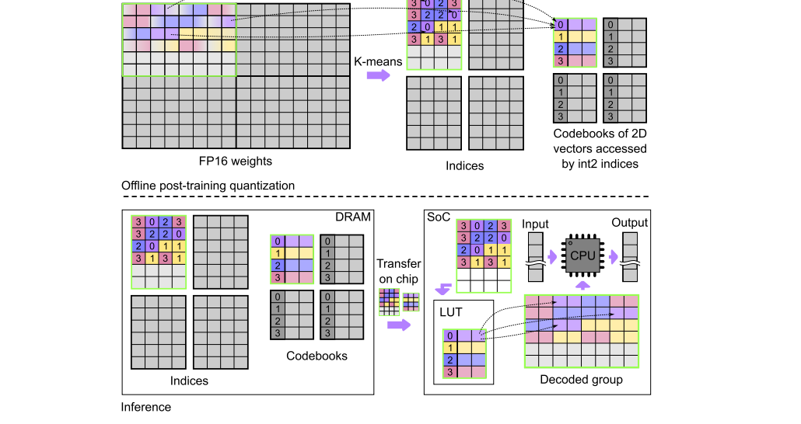

# 110. GPTVQ：用小码本表示权重向量，并让解码适合真实硬件

**GPTVQ: The Blessing of Dimensionality for LLM Quantization**  
固定阅读版本：**arXiv:2402.15319v2，2025-06-03，21 页**。首次提交于 2024-02-23。本包整理于 2026-10-28。

[本地 PDF](paper-arxiv-v2.pdf) · [固定版本页面](https://arxiv.org/abs/2402.15319v2) · [官方代码](https://github.com/Qualcomm-AI-research/gptvq) · [版本记录](metadata.json) · [返回总目录](../README.md)

作者：Mart van Baalen、Andrey Kuzmin、Ivan Koryakovskiy、Cedric Bastoul、Peter Couperus、Eric Mahurin、Tijmen Blankevoort、Markus Nagel、Paul Whatmough。作者顺序按本地 PDF 首页。

**版本提醒：**v2 正文明显扩展了移动 CPU 部署、完整推理引擎、INT4 codebook 和 LoRA 内容，页眉使用 *Efficient LLM Inference using Vector Quantization on Mobile CPUs*。arXiv 条目仍以 GPTVQ 命名，其网页摘要与新版 PDF 首页摘要也不完全相同。本 README 以本地 v2 正文为准，不将它自行标注为某个已确认的会议版本。

本文的页码均为 **PDF 物理页码，从 1 开始**。“教学例子”是补充说明；实验数字来自论文。本地只准备阅读资料，没有运行量化、推理或速度测试。

## 1. 先读懂一句话

GPTVQ 把几个相邻权重一起替换成一个“向量码字”，用校准输入判断哪些误差更重要，再沿用 GPTQ 的二阶补偿思路，让尚未量化的权重吸收已产生的误差。新版还强调：**码本必须足够小，查表与解码足够便宜，压缩才能转化为真实推理收益。**

阅读时抓住三个互相制约的量：

| 量 | 增大后的好处 | 代价 |
|---|---|---|
| 向量维度 \(d\) | 多个数一起编码，表示点的形状更灵活 | 相同 bits/weight 下，码本大小通常指数增长 |
| 码本条目数 \(K\) | 可选的近似向量更多 | 索引更长、搜索更贵、码本更难放进缓存 |
| 共享码本的权重数 \(\ell\) | 码本成本摊得更薄 | 一个码本要适应更多权重，局部分布可能更难兼顾 |

因此“维度越高越好”只描述表示能力的一面。GPTVQ 的手机部署方案最后选择 **2D、小码本和紧凑索引**，体现了质量与解码成本的折中。

## 2. 从标量量化到向量量化

### 2.1 Scalar quantization：每个数单独选一个值

均匀 INT4 常写成 \(\widehat w=sq\)，其中 \(q\) 是 4-bit 整数，\(s\) 是共享 scale。可表示的值排列成等间距网格。

非均匀标量量化允许网格不等间距，例如 \(\{-1,-0.2,0.1,0.8\}\)，但每个权重仍独立选一个标量。

### 2.2 VQ：几个数一起选一个向量

把 \(d\) 个权重组成 \(v\in\mathbb R^d\)，存一个索引 \(a\)，解码成码本中的向量：

\[
\widehat v=C_a,\qquad C\in\mathbb R^{K\times d}.
\]

一个索引需要 \(\log_2K\) bits；只算索引时，每个权重花费 \(\log_2K/d\) bits。注意 **“6-bit 索引表示两个权重”相当于 3 bits/weight，并非每个权重 6 bits。**

**教学例子：相同索引预算下，VQ 为什么更灵活？**

假设二维数据只出现在 \((-1,-1),(-0.3,-0.3),(0.3,0.3),(1,1)\) 四处。每个标量 1 bit，一对共 2 bits，只能为每个坐标选两个标量值，无法准确覆盖这四个不同的对角点。二维 VQ 用同样的 2-bit 索引，可以直接把四个对角点作为四个码字。

这个例子暂不计算码本存储，只解释表示点的形状。真实模型必须把码本开销计入总预算，不能只比较索引。

## 3. 原论文 Figure 1：存储与计算之间发生了什么？

来源：本地 v2，第 2 页 Figure 1 的原图区域，未重绘。

从上到下读：

1. 原始 FP16 矩阵被分成若干组，每组有自己的码本。
2. 每个权重向量由一个短索引替代，另存码本中的向量值。
3. 推理时从 DRAM 搬运的是索引、码本和相关 scale。
4. 进入片上缓存后，通过硬件查表指令恢复到可计算的数据类型，再参与矩阵运算。

图中的玩具索引位宽用于示意，不等于移动 CPU 实验实际使用的 6-bit 索引。

**VQ 在这里是一种存储表示。**正文第 4 页的部署路径把码本解码成 INT8 数值进行后续运算；不能把它理解为 CPU 原生执行“VQ 浮点数乘法”，也不能假设所有实现都先恢复整份 FP16 模型。

## 4. 为什么不直接对权重做普通 K-means？

对一层 \(Y=WX\)，量化后为 \(\widehat Y=\widehat WX\)。GPTVQ 关注的是：

\[
\mathcal L_{\mathrm{layer}}=\|(W-\widehat W)X\|_F^2.
\]

这里 \(W\in\mathbb R^{d_{out}\times d_{in}}\)，\(X\in\mathbb R^{d_{in}\times N}\) 的列是校准输入。它可写为：

\[
\mathcal L_{\mathrm{layer}}=\operatorname{tr}(EHE^T),
\quad E=W-\widehat W,\quad H=XX^T.
\]

归一化与常数因子不影响这里的核心理解。\(H\) 是**层输出重建目标的曲率/二阶统计量**，不是完整语言模型最终损失的精确 Hessian。

普通 K-means 默认每个坐标的误差同等重要；\(H\) 告诉我们输入经常激活哪些方向、哪些误差会相互放大或抵消。

**教学例子：最近的码字取决于误差度量。**

目标向量 \(v=(1,1)\)，两个候选码字 \(c_A=(0,1)\)、\(c_B=(1,0)\)。普通欧氏距离都是 1；如果加权矩阵为 \(D=\operatorname{diag}(9,1)\)，两者误差分别是 9 和 1。因此应选 \(c_B\)，优先保护更重要的第一维。

## 5. GPTVQ 的离线算法，分四步理解

依据第 5–6 页、Algorithm 1–2、Eq. (4)–(6)。

### 5.1 采集校准输入，构造二阶统计量

把少量文本送进原模型，收集每层输入并形成 \(H\)。沿用 GPTQ 的 Cholesky 处理与块式更新，降低数值和访存成本。

这一步需要数据。GPTVQ 不是 data-free 方法。

### 5.2 用 data-aware EM 初始化码本

对每组 \(d\) 维权重向量 \(v_i\)，优化：

\[
\min_{a_i,c_m}\sum_i(v_i-c_{a_i})^TD_i(v_i-c_{a_i}).
\]

论文以逆 Hessian 对角线构造 \(D_i\)。它保留坐标重要性，但不等于在初始化时使用整个模型的完整 Hessian。

- **E-step**：固定码本，为每个向量找加权误差最小的码字。
- **M-step**：固定分配，更新每个码字。

固定分配后，码字有加权最小二乘形式：

\[
c_m=\left(\sum_{i:a_i=m}D_i\right)^+
       \left(\sum_{i:a_i=m}D_iv_i\right).
\]

\(^{+}\) 表示伪逆。若 \(D_i=I\)，它就退化为普通 K-means 的“取所属点平均值”。

### 5.3 每次量化 \(d\) 列，再补偿剩余权重

GPTQ 一次处理一列；GPTVQ 把它推广到一次处理 \(d\) 列，使同一行中相邻的 \(d\) 个权重形成一个向量。选定码字后，利用二阶信息更新尚未量化的列。

这里的补偿不是把码字改回原权重，而是在剩余自由变量里寻找更好的整体重建。

**教学例子：误差可以被另一个权重部分抵消。**

假设某输出通道的误差为 \(e=(e_1,e_2)\)，二阶矩阵是

\[
H=\begin{pmatrix}1&1\\1&2\end{pmatrix}.
\]

第一项量化后 \(e_1=-0.2\)。不补偿时 \(e_2=0\)，误差 \(e^THe=0.04\)。允许第二项调整为 \(e_2=0.1\) 后，误差降为 0.02。这说明逐项最接近原权重，不一定使层输出最接近原输出。

### 5.4 块式更新与码本压缩

为了避免每量化一点就重写大矩阵，局部块内先更新，块外的误差补偿聚合后批量执行。

需要区分三种“块/组”：

| 名称 | 管什么 |
|---|---|
| GPTVQ group | 哪些权重共享一个 VQ 码本 |
| 误差更新 block | 哪些列的补偿先局部处理，再批量更新其余部分 |
| Codebook quantization group | 将码本数值进一步量化时，哪些解码值共享 scale |

正文 §5.3 讨论 INT4 codebook；附录 A/F/G/H 等讨论码本 SVD、归一化和其他扩展。首次阅读先掌握主算法，再研究这些选项。

## 6. 3-bit 到底存了多少东西？

论文第 6 页采用的主体 bits per value 计算是：

\[
\mathrm{bpv}=\frac{\log_2K}{d}+\frac{Kdb_c}{\ell},
\]

其中 \(b_c\) 为每个码本坐标的位数，\(\ell\) 为共享这个码本的标量权重数。

部署配置 \(d=2,K=64,b_c=8,\ell=8192\) 对应：

\[
6/2+64\times2\times8/8192=3+0.125=3.125.
\]

这是论文对索引与码本的计数方式。额外 scale、对齐、未量化层和推理工作区，要通过真实 checkpoint 大小与内存测量另行记录；**3.125 bpv 不等于整个程序只需 FP16 程序的 3.125/16 内存。**

码本越大、共享权重越少，metadata 占比越大。比较 GPTVQ、AQLM、QuIP# 时，应先对齐实际 bit budget。

## 7. 实验应该怎样读？

### 7.1 手机 CPU 的速度证据：同引擎比较最有解释力

第 7 页 Table 1，Llama-3-8B，**Snapdragon X Elite、Windows，端到端 token generation**：

| 格式 | 论文 bpv | 引擎 | Footprint，GB | Throughput，tok/s |
|---|---:|---|---:|---:|
| INT4，group 32 | 4.5 | llama.cpp | 4.64 | 17.95 ± 1.01 |
| INT4，group 128 | 4.125 | 作者引擎 | 4.33 | 23.81 ± 0.27 |
| 2D VQ，group 8192 | 3.125 | 作者引擎 | 3.52 | 26.15 ± 0.31 |

论文报告的约 **19% footprint 降低、10% token rate 提升**对应后两行。与 llama.cpp 的差距同时包含引擎实现差异，不能全部归因于 VQ。这里的 footprint 也不应直接改名为 GPU peak allocated。

### 7.2 维度提高的质量收益

第 8 页 Table 2，Llama-2-7B，WikiText2、context 2048，2.125 bpv：

| 方法 | Perplexity，越低越好 |
|---|---:|
| FP16 reference | 5.47 |
| GPTQ | 36.8 |
| GPTVQ 1D | 12.2 |
| GPTVQ 2D | 7.77 |
| GPTVQ 4D | 7.18 |

这组结果支持“给定报告预算下，多维表示有价值”。它不证明手机 CPU 上 4D 一定比 2D 更快。

### 7.3 与 AQLM 的质量和量化时间取舍

同页 Table 3 改用另一套协议：SlimPajama 校准、4096-token WikiText2 评估、五任务 zero-shot average；**不能与 Table 2 的 PPL 直接混排。**

Llama-2-7B 的例子：

| 方法 | bpv | WikiText2 PPL | 量化时间，小时 |
|---|---:|---:|---:|
| AQLM，无 block fine-tuning | 2.29 | 7.49 | 18.3 |
| AQLM，有 block fine-tuning | 2.29 | 6.65 | 35.2 |
| GPTVQ，4D | 2.25 | 7.11 | 2.5 |

GPTVQ 的重点是较快完成压缩并兼顾部署。它不是在这张表中精度全面胜过经过额外微调的 AQLM。

## 8. 官方代码怎样读？

先看 [vq_quant.py](https://github.com/Qualcomm-AI-research/gptvq/blob/main/vq_quant.py) 中的码本与分配逻辑，再看 [gptq.py](https://github.com/Qualcomm-AI-research/gptvq/blob/main/gptq.py) 中的二阶更新，最后看仓库提供的实验脚本和 `llama.py`。

官方 README 记录使用 Python 3.9 和单张 80GB H100 的实验环境，并说明公开模型 checkpoint 可能与论文实验所用 checkpoint 不完全相同。阅读时把它视为复现入口，不把当前主分支视为固定 v2 PDF 的逐字对应快照。

公开仓库的量化脚本，也不自动意味着论文中的完整手机 CPU 内部引擎已全部开放。本包只保存论文与官方代码链接，未克隆、编译或执行仓库。

## 9. 与其他三篇和 FYP 的联系

- **与 [QuIP#](../112-quip-sharp/README.md)**：GPTVQ 用学习得到的小码本；QuIP# 先使权重更接近适合固定格点的分布，再用结构化 E8 码本降低查表成本。
- **与 [QTIP](../111-qtip/README.md)**：QTIP 针对普通 VQ 高维码本指数增长的问题，改用 trellis 路径表示高维向量。
- **与 [GuidedQuant](../113-guidedquant/README.md)**：GPTVQ 的局部目标看层输出误差；GuidedQuant 进一步用最终损失梯度给输出误差加权。其 LNQ 主要对应对非均匀标量量化求解器的改进。

对 WAM/VQ engine 最值得带走的是一个设计问题：**压缩权重从内存取出以后，要经历哪些查表、解码、格式转换和矩阵运算？每一步节省或增加了什么？**

LLM 的小 batch 自回归解码常受权重带宽限制；WAM 的实际矩阵形状与重复调用方式可能不同。因此手机 CPU 的 10% 提速不能直接作为 WAM GPU 提速预期。上述联系属于阅读启发，论文没有完成 WAM 的 action/future latent 或机器人闭环验证。

## 10. 阅读路线

| 时间 | 阅读内容 | 读完应能解释 |
|---|---|---|
| 20–30 分钟 | 第 1–4 页、Figure 1–2；第 7 页 Table 1 | VQ 为什么更灵活，以及小码本为什么关系到速度 |
| 60–90 分钟 | 第 5–6 页 Algorithm 1–2、Eq. (4)–(6)；第 8 页 Table 2–3 | 初始化、误差补偿、bpv 和评估协议的差别 |
| 深入阅读 | §5.3–5.4，第 9 页；附录 A/F/G/H | 码本再量化、SVD/归一化和 LoRA 的额外收益与成本 |

## Reading Questions：读完后自行回答

1. 为什么一个 6-bit 索引在 2D VQ 中只贡献 3 bits/weight？
2. 普通 K-means 的距离与 GPTVQ 的 data-aware 距离差在哪里？
3. 调整未量化权重为什么可能降低层输出误差？
4. 为什么更多维度会改善表示能力，却可能降低实际解码效率？
5. Table 1 的 19%/10% 应比较哪两行？
6. 如果要把该方法用于 WAM，除了重建误差，还需要哪些部署和任务证据？

## Meeting Card：阅读后填写

- 我用自己的话解释的核心贡献：
- 我能手算的一个例子：
- 我最认可的实验及其协议：
- 我认为最重要的限制：
- 与现有 FYP 方法真正不同的部分：
- 下一次讨论想问的问题：
