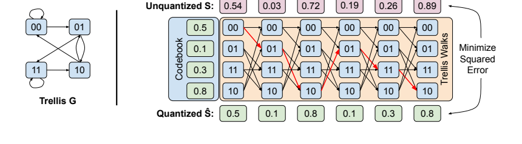

# 111. QTIP：用一条网格路径表示高维权重，避免存储巨型 VQ 码本

**QTIP: Quantization with Trellises and Incoherence Processing**  
NeurIPS 2024 Spotlight；固定阅读版本：**arXiv:2406.11235v4，2025-06-18，25 页**。整理于 2026-10-28。

[本地 PDF](paper-arxiv-v4.pdf) · [固定版本页面](https://arxiv.org/abs/2406.11235v4) · [官方代码](https://github.com/Cornell-RelaxML/qtip) · [版本记录](metadata.json) · [返回总目录](../README.md)

作者：Albert Tseng、Qingyao Sun、David Hou、Christopher De Sa。这里的 QTIP 是 LLM 量化方法，与量子系统软件 QuTiP 无关。

所有页码为本地 PDF 的物理页码。本 README 中的教学推导不是额外模型实验；本地未执行量化、推理或 benchmark。建议先读 [QuIP#](../112-quip-sharp/README.md) 的 RHT、局部输出目标和 BlockLDLQ。

## 1. 一句话理解

普通向量量化把一个高维向量替换成“巨型词典里的一行”。QTIP 改成：**用很少的 bits 描述一条合法路径，路径经过的状态共同生成整个向量。**

这让很多权重共同决定一条路径，获得高维编码的收益，同时避免显式保存指数规模的高维码本。

QTIP 还要解决一个工程难题：有状态的路径表示通常需要逐步解码。它通过 **bitshift trellis**，让每一段权重只依赖压缩比特流中的一个短窗口，从而支持并行解码。

## 2. 普通 VQ 为什么很难继续增加维度？

设每个权重预算为 \(k\) bits，向量维度为 \(d\)。普通未结构化 VQ 需要

\[
K=2^{kd}
\]

个 \(d\) 维码字。固定 \(k=2\)：

| 维度 \(d\) | 码字数 | 直觉 |
|---:|---:|---|
| 2 | 16 | 很小 |
| 8 | 65536 | 已需要考虑存储和缓存结构 |
| 16 | 约 43 亿 | 显式保存和搜索非常昂贵 |
| 256 | \(2^{512}\) | 无法直接建立这样的词典 |

[QuIP#](../112-quip-sharp/README.md) 用 E8 对称性压缩八维码本；[GPTVQ](../110-gptvq/README.md) 为硬件选择较低维小码本。QTIP 则改变表示本身，转向 Trellis-Coded Quantization，简称 TCQ。

这里不能简单把 AQLM 的所有多码本配置都当成一个未结构化的巨型码本；指数关系描述的是普通显式 VQ 的基本难点，具体方法各有规避方式。

## 3. Trellis 是什么？先看原图



来源：本地 v4，第 5 页 Figure 2 原图区域，未重绘。图中蓝色节点是状态，边规定哪些状态能连续出现。

Trellis 可理解为沿序列展开的状态网格：

- 每个状态对应一个可重建的标量或小向量。
- 每一步只允许沿合法边转移。
- 一整条路径对应一个完整的重建向量。
- 量化的任务是找出总误差最小的合法路径。

普通 VQ 是“选一行”；TCQ 是“选一条路径”。这种类比只帮助理解，不表示两者具有相同的任意码字集合。

## 4. 四个符号：\(L,k,V,T\)

| 符号 | 意义 | 论文常用示例 |
|---|---|---|
| \(L\) | 状态编号位数；状态总数 \(2^L\) | 16，即 65536 个状态 |
| \(k\) | 每个标量权重的名义 bits | 2、3、4 |
| \(V\) | 每个状态一次输出几个权重 | 纯计算码为 1；HYB 为 2 |
| \(T\) | 一条序列总共表示的标量权重数 | 256，即 16×16 权重 tile |

每一步输出 \(V\) 个权重，消耗 \(kV\) 个新 bits；序列共有 \(T/V\) 步。

**\(V=2\) 不意味着有效维度只有 2。**局部状态输出可以是二维，但整条路径的选择共同优化 256 个权重。论文所谓高维指后者。

## 5. 编码为什么要 Viterbi，而不是逐点选最近值？

设第 \(t\) 个目标小向量为 \(s_t\)，状态 \(y\) 输出 \(C_y\)。Viterbi 保存：

\[
D_t(y)=\text{处理前 }t\text{ 段且最后位于 }y\text{ 的最小累计误差}.
\]

递推为：

\[
D_t(y)=\min_{x\to y}\left[D_{t-1}(x)+\|C_y-s_t\|_2^2\right].
\]

关键在于 \(x\to y\) 必须合法。某个点最近的状态可能让后面无法选择更合适的值，因此需要比较整条路径。

对给定 trellis 和可加 distortion，动态规划能找到相应问题的最优路径。**这不等于完整神经网络的 end loss 被全局最小化。**

论文将其优化后的复杂度概括为 \(O(2^LT)\)：固定 \(L\) 后，对序列长度是线性的，而非普通高维 VQ 的指数规模。仍要看到 \(2^L\) 本身：增加状态数会显著增加离线编码成本；朴素实现还要处理各条边，不能据此认为任意 bitrate 和实现的运行时间都一样。

## 6. Bitshift trellis：为什么有状态却仍能并行解码？

第 4 页 §3.1 的转移规则是：

\[
j=(i\cdot2^{kV}\bmod2^L)+c,
\qquad 0\le c<2^{kV}.
\]

用位操作写，就是把状态左移 \(kV\) 位，保留低 \(L\) 位，再补上 \(kV\) 个新 bits。相邻状态因此共享很多 bits。

### 6.1 一个完整的二进制例子

沿用 Figure 2 的参数 \(L=2,k=1,V=1\)，状态到数值的映射为：

| 状态 | 00 | 01 | 11 | 10 |
|---|---:|---:|---:|---:|
| 重建值 | 0.5 | 0.1 | 0.3 | 0.8 |

对比特串 `0010110`，读取长度为 2 的滑动窗口：

```text
比特窗口：00 → 01 → 10 → 01 → 11 → 10
重建数值：0.5  0.1  0.8  0.1  0.3  0.8
```

每个状态与下一个状态重叠 1 bit，所以六个值只需七个 bits，而不是每个状态独立存 2 bits、总共十二个 bits。

更重要的是，若需要第 5 个值，直接读取对应位置的窗口 `11` 就能得到 0.3，**无需从第一个状态连续走到第五个状态。**多个线程可以从不同窗口同时开始解码。

注意区分两个过程：

- **编码/量化**：离线搜索最合适的合法路径，仍有动态规划依赖。
- **推理解码**：直接从压缩 bits 恢复状态窗口，可以并行。

### 6.2 Tail-biting：让首尾也共享 bits

一般有限序列需要额外的起始信息，共 \(kT+L-kV\) bits。若首尾满足循环重叠，就能只保留约 \(kT\) bits。

上例 `0010110` 最后一位 `0` 可由开头恢复，因此可只存 `001011`，跨末尾读取时循环取开头 bits。

精确求解 tail-biting 的约束问题比普通 Viterbi 昂贵。论文 §3.2、Algorithm 4 使用两次 Viterbi 的近似方案；第 8 页 Table 2 显示该方案在相应高斯实验中接近最优。**普通路径动态规划的最优性，不应扩大成该近似方案总能精确求出循环路径最优解。**

## 7. 65536 个状态的输出值也很大，怎么办？

仅解决图的存储还不够，状态到数值的表仍可能很大；相邻状态又共享 bits，容易产生不希望的数值相关性。QTIP 提出三类状态解码方式：

| 类型 | 主要做法 | 好处与代价 |
|---|---|---|
| 1MAD | 对状态做确定性整数混合，将若干字节求和，再缩放到近似高斯 | 几乎不用大查表；需合适常数避免相关性 |
| 3INST | 整数混合后构造两个 FP16 数并相加 | 少量指令生成近似高斯值；依赖硬件指令与数据移动 |
| HYB | 先 hash 状态，再查一个小二维表，加符号处理 | 小表可微调，适合 GPU；仍存在小表访问成本 |

这里的“伪随机”是**固定状态确定地生成固定值**，推理时不是每次随机采样新权重。

HYB 典型配置为 \(Q=9,V=2\)，小表有 \(2^9\) 个二维 FP16 向量：

\[
512\times2\times2\text{ bytes}=2048\text{ bytes}=2\text{ KiB}.
\]

\(L=16\) 决定状态空间，\(Q=9\) 决定实际查表大小；这两个参数不必相同。完整路径依旧可以形成高维重建。

论文的“每权重少量指令”指状态解码的特定实现，不包含整个矩阵乘、Hadamard、模型其余运算或内存同步。3INST 的名字也不应当作整条推理路径严格只有三条机器指令的保证。

## 8. 为什么还需要 incoherence processing 和 BlockLDLQ？

### 8.1 RHT 让状态解码值的分布更适合权重

QTIP 生成的码值近似高斯，而原权重未必天然适合。它沿用 QuIP# 的随机 Hadamard 处理，使权重及 proxy Hessian 的方向更分散，权重分布更接近设计假设。

这是数据分布整形的作用，不是证明所有权重严格变成独立高斯。

### 8.2 完整局部目标并不是单纯可加的坐标误差

LLM 的局部目标仍是：

\[
\mathcal L=\operatorname{tr}((\widehat W-W)H(\widehat W-W)^T).
\]

\(H\) 含有非对角项，所以不能直接把整层塞给只处理可加平方误差的 Viterbi，就声称精确优化了上式。

论文第 7 页采用 **QTIP quantizer + BlockLDLQ rounding**：一块 \(T_x\times T_y\) 权重用一条 TCQ 序列表示，块之间沿输入维度传播二阶补偿。典型 \(T_x=T_y=16\)，对应 256 维序列。

所以 QTIP 的贡献主要是 **用什么表示/舍入到哪里**；BlockLDLQ 负责更大范围的误差反馈。更换求解器与更换量化表示是两条可组合的研究方向。

## 9. 哪些实验最能帮助理解？

### 9.1 高斯源实验：看编码本身的失真

第 5 页 Table 1，2 bits/weight，标准高斯源：

| 方法 | 有效维度 | 每元素 MSE ↓ |
|---|---:|---:|
| Lloyd-Max 标量量化 | 1 | 0.118 |
| QuIP# E8P | 8 | 0.089 |
| QTIP 1MAD / 3INST，\(L=16\) | 256 | 0.069 / 0.069 |
| QTIP HYB，\(L=16\) | 256 | 0.071 |
| 无限维 distortion-rate bound | ∞ | 0.063 |

这解释了高维编码的动机。该 MSE 不是 WikiText2 PPL，也不是机器人任务成功率；理论下界更不是某个实际神经模型的可达精度保证。

### 9.2 模型结果：把纯计算码与 HYB 分开

第 9 页 Table 5，**Llama-2-7B，context 4096，HYB 路线**：

| 配置 | Bits | WikiText2 PPL ↓ | C4 PPL ↓ |
|---|---:|---:|---:|
| FP16 reference | 16 | 5.12 | 6.63 |
| QuIP# | 2 | 6.19 | 8.16 |
| QTIP HYB | 2 | 5.86 | 7.73 |
| QuIP# | 3 | 5.41 | 7.04 |
| QTIP HYB | 3 | 5.28 | 6.87 |

HYB 主实验使用 blockwise fine-tuning，包括小码表等连续参数。第 8 页 Table 3 的纯计算码实验**不做 fine-tuning**；相同 Llama-2-7B、2-bit 下，1MAD 与 3INST 的 WikiText2 PPL 是 7.05、6.82。

后续 GuidedQuant 常用纯计算码作基线，因此会出现“QTIP 从 6.82 改善到 6.11”。不能拿这个起点替代 HYB 微调路线的 5.86，进而误判论文前后矛盾。

### 9.3 吞吐：QTIP 的优势包含质量，速度提升并非总是很大

第 8 页 Table 4，**RTX 6000 Ada，batch 1 decoding，融合 q/k/v 与 up/gate 矩阵**：

| 方法 | Llama-2-7B，tok/s ↑ | Llama-2-70B，tok/s ↑ |
|---|---:|---:|
| FP16 | 55.9 | OOM |
| AQLM 2-bit | 81.5 | 8.78 |
| QuIP# 2-bit | 186 | 22.2 |
| QTIP 2-bit | 188 | 23.5 |

有价值的结论是：QTIP 在有效维度提高到 256 的同时，仍保持接近 QuIP# 的吞吐，并提高量化质量。这里并非相对 QuIP# 有数倍速度提升。

官方 README 特别说明，公开的 `interactive_gen.py` 没有相同矩阵融合，因此直接运行不会自然得到上表速度。也不能用 OOM 当成 FP16 吞吐为零来计算“无限加速”。

## 10. 新版正文还提醒了哪些边界？

- 第 8、10 页：Llama-3 70B 某些变体的第 0 层 v projection 量化可能引起 zero-shot 灾难性退化；特殊前缀、chat template 或保留该层会影响结果。说明 PPL、提示格式与下游准确率需要分别核对。
- 小型 Llama-3 模型里 embedding 占比很大，把 decoder 从 4-bit 再压低，不一定明显减小整模型体积。
- HYB、纯计算码、是否微调、矩阵融合和模型家族都是实验协议的一部分。
- 论文测试的 GPU kernel 不自动覆盖所有硬件。关于 ARM 查表指令的讨论包含设计可行性，不能一概写成完整手机端实测吞吐。

## 11. 官方代码阅读入口

1. [lib/codebook/bitshift.py](https://github.com/Cornell-RelaxML/qtip/blob/main/lib/codebook/bitshift.py)：TCQ、bitshift 与 `BitshiftLinear`。
2. [lib/algo/finetune.py](https://github.com/Cornell-RelaxML/qtip/blob/main/lib/algo/finetune.py)：与 BlockLDLQ/微调结合的量化流程。
3. [qtip-kernels](https://github.com/Cornell-RelaxML/qtip/tree/main/qtip-kernels)：公开的 HYB 2/3/4-bit kernel；配置范围见官方 README。
4. [examples](https://github.com/Cornell-RelaxML/qtip/tree/main/examples)：实际参数与运行顺序。

先把论文参数与代码对应起来：`L/K/V` 对应 \(L/k/V\)，`tlut_bits` 对应 HYB 的 \(Q\)，`td_x/td_y` 对应 tile 形状，`decode_mode` 区分 HYB、1MAD、3INST 等。

当前仓库首页还指向新的 rounding 工作 YAQA。它说明 quantizer 与 rounding 可以分开发展；本包固定阅读的仍是 QTIP v4，没有把后续方法当成原论文结果。

## 12. 对 FYP 可以带走什么？

这是一个很清楚的表示与系统共同设计案例：**用更复杂的离线搜索，换取很短的在线编码和便宜的解码。**

若用于 WAM，应先核对 16×16 tile 是否适合实际矩阵形状、是否能在解码后直接参与矩阵运算，以及需要保留什么旋转、scale 与工作区。只把 TCQ 权重先恢复为 BF16，再走现有 GEMM，并不自动等于 QTIP kernel 的执行方式。

这些属于迁移启发；QTIP 原论文没有验证 WAM 多步采样、action/future latent 或机器人闭环。[GuidedQuant](../113-guidedquant/README.md) 则适合接着阅读，理解如何在保留表示的基础上改变优化目标。

## 13. 阅读路线

| 时间 | 阅读范围 | 验收目标 |
|---|---|---|
| 25–30 分钟 | 第 1–5 页，尤其 Figure 2、Table 1 | 能解释路径表示和滑动窗口解码 |
| 60–90 分钟 | 第 3–8 页，§2.3、§3、Algorithm 1–4、§4.1–4.2 | 能区分编码、解码、tail-biting、纯计算码与 HYB |
| 精度与部署 | 第 8–10 页 Tables 3–9；官方 README | 能标出 FT、context、matrix fusion 和提示模板 |
| 深入实现 | 附录 Algorithm 5 与代码入口 | 看懂 TCQ tile 如何嵌入 BlockLDLQ |

## Reading Questions：读完后自行回答

1. 为什么 \(V=2\) 的 HYB 仍然可以称为 256 维量化？
2. Viterbi 优化的误差目标和完整局部 Hessian 目标是否相同？
3. 自己用 `0010110` 解码六个值，并解释为何只存六位也可能足够。
4. 有状态编码为什么不必导致顺序解码？
5. \(L\)、\(Q\)、bitrate、tile size 各自控制什么？
6. QTIP 6.82、5.86 两个 PPL 数字对应哪些不同设置？

## Meeting Card：阅读后填写

- 我对“用路径代替词典”的解释：
- 我能手算的 bitshift 例子：
- 质量收益最直接的证据：
- 实际吞吐依赖的条件：
- 对当前 VQ engine 的一个具体启发：
- 尚需讨论的问题：
