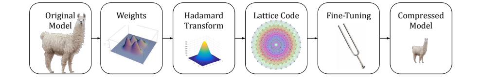

# 112. QuIP#：先旋转权重，再用八维格点码本高效压缩

**QuIP#: Even Better LLM Quantization with Hadamard Incoherence and Lattice Codebooks**  
ICML 2024；固定阅读版本：**arXiv:2402.04396v2，2024-06-04，27 页**。整理于 2026-10-28。

[本地 PDF](paper-arxiv-v2.pdf) · [固定版本页面](https://arxiv.org/abs/2402.04396v2) · [官方代码](https://github.com/Cornell-RelaxML/quip-sharp) · [版本记录](metadata.json) · [返回总目录](../README.md)

作者：Albert Tseng、Jerry Chee、Qingyao Sun、Volodymyr Kuleshov、Christopher De Sa。

QuIP# 是继 QuIP 之后的独立工作，名称中的 `#` 读作 sharp。本文页码均为本地 PDF 的物理页码；教学例子与论文结果分开标记。本地未运行量化、推理或 benchmark。

## 1. 先记住三件事

QuIP# 的完整思路是：

1. **变换分布**：用随机 Hadamard 变换，把权重及重要误差方向从少数坐标上分散开。
2. **改变表示**：用结构化八维 E8P 码本，一次表示八个权重。
3. **恢复精度**：量化过程中与完成后进行有限微调，补偿跨层误差。

如果只记“用了旋转”，会漏掉格点码本的质量与解码收益；如果只记“E8 最优”，会漏掉输入分布、局部误差补偿和微调的作用。

来源：本地 v2，第 2 页 Figure 2 原图区域，未重绘。图从权重分布整形开始，经过 lattice quantization 和 fine-tuning，得到压缩模型。

## 2. 从一个线性层理解：旋转为什么不必改变原函数？

设原层为 \(y=Wx\)，\(W\in\mathbb R^{m\times n}\)。选两个正交矩阵：

\[
U\in\mathbb R^{m\times m},\quad V\in\mathbb R^{n\times n},
\quad \widetilde W=UWV^T.
\]

输入先变成 \(\widetilde x=Vx\)，输出再变回来：

\[
U^T\widetilde W\widetilde x
=U^TUWV^TVx=Wx.
\]

因此 full precision 下是相同的函数。接着量化 \(\widetilde W\)，推理路径变成：

\[
\widehat y=U^TQ(\widetilde W)Vx.
\]

误差来自量化与有限精度实现；变换本身不是“主动丢掉某些维度”。这也不意味着任意网络位置都能随便跨过非线性去合并旋转，具体模型仍需按实际运算图集成。

## 3. Incoherence 究竟是什么意思？

这里可理解为：**权重幅值和重要误差方向不要过度集中在某个坐标上。**

论文同时约束两个对象：

| 对象 | 希望避免什么 | 为什么影响量化 |
|---|---|---|
| 权重矩阵 \(W\) | 少数元素远大于整体典型幅值 | 有限码字难兼顾极端值与大量普通值 |
| Proxy Hessian 的特征向量 | 重要方向几乎对齐某根坐标轴 | 某个坐标的舍入误差可能特别昂贵 |

形式上，权重的 \(\mu\)-incoherence 要求

\[
\max_{i,j}|W_{ij}|\le\frac{\mu}{\sqrt{mn}}\|W\|_F.
\]

若 \(H=Q\Lambda Q^T\)，Hessian 的 incoherence 则约束 \(\max_{i,j}|Q_{ij}|\le\mu/\sqrt n\)。它约束的是特征向量的坐标集中程度，**不等于要求所有 Hessian 特征值相同，或所有权重互相独立。**

旋转后“近似 Gaussian/球形”的说法有理论动机与经验支持，但不要把真实 LLM 权重直接当作严格独立同分布的标准高斯样本。

## 4. Randomized Hadamard Transform：一个可以手算的例子

二维归一化 Hadamard 矩阵是

\[
H_2=\frac1{\sqrt2}\begin{pmatrix}1&1\\1&-1\end{pmatrix}.
\]

**教学例子：**对 \(x=(10,0)^T\)，有

\[
H_2x=(10/\sqrt2,10/\sqrt2)^T\approx(7.07,7.07)^T.
\]

平方和仍为 100，但最大绝对坐标从 10 降为约 7.07。它展示了能量分散的直觉，**不保证每一个具体向量的最大值都会下降**：反过来变换 \((7.07,7.07)\) 又会得到近似 \((10,0)\)。随机符号与高维概率保证才是方法的重要部分。

RHT 在 Hadamard 前乘随机正负号矩阵 \(S\)，形如 \(H_nSx\)。对 2 的幂维度，可以用 Fast Walsh-Hadamard Transform，在 \(O(n\log n)\) 时间内通过加减实现，归一化另外处理。

对非 2 的幂维度，论文第 4–5 页讨论可用尺寸分解，以及 RFFT 替代方案。因此“只支持 2 的幂”是对最简单快速算法的描述，不是整篇方法的全部范围。

## 5. 量化目标：关心层输出，而非单个权重绝对误差

第 3 页 Eq. (1)–(2)：

\[
\mathcal L=\mathbb E_x\|(\widehat W-W)x\|_2^2
=\operatorname{tr}((\widehat W-W)H(\widehat W-W)^T),
\quad H=\mathbb E[xx^T].
\]

\(H\) 是校准输入的二阶统计量。把权重换成 \(UWV^T\) 时，也把它换成 \(VHV^T\)，从而保持对应目标。

这里的二阶矩阵并非最终语言建模损失的完整 Hessian。后面的 [GuidedQuant](../113-guidedquant/README.md) 正是进一步问：层输出里不同位置对最终损失的重要性是否相同？

## 6. BlockLDLQ：八个权重一起舍入，其他块负责补偿

第 5 页 §4.1 把标量 LDLQ 扩展为块形式。可以把 LDL 分解理解为：从 \(H\) 中整理出一套“某块的误差应如何反馈给其他块”的系数。

每一步大致是：

1. 取当前待量化的权重块。
2. 根据已量化块的误差，先修正当前块。
3. 把修正后的向量舍入到码本。
4. 将新的误差继续反馈到后面的块。

论文写成

\[
\widehat W_k=Q\!\left(W_k+(W_{:k-1}-\widehat W_{:k-1})A_k\right).
\]

\(A_k\) 来自块 LDL 分解；\(Q\) 在这里是向量量化器。该式的意义是“带着误差反馈去选码字”，并非对每个八维向量独立做最近邻就完成整层。

Theorem 4.1 给出满足指定随机量化误差条件时的 proxy-loss 上界。它不等于“所有有限 E8P 配置都全局最优”，更不直接保证整模型 PPL 或下游任务无损。

## 7. E8 格点和 E8P 码本，分别是什么？

### 7.1 格点是一套规则生成的空间点

E8 是八维格点，可描述为：所有坐标同时为整数或同时为半整数，并且坐标和为偶整数的向量集合。

\[
E_8=\left(\mathbb Z^8\cup(\mathbb Z^8+\tfrac12\mathbf1)\right)
\cap\{x:\mathbf1^Tx\in2\mathbb Z\}.
\]

它在八维等半径球最密堆积问题上具有最优性质。直觉是：在空间中放置有规则、彼此分离的表示点。

**这个定理不是“E8 是任意模型分布、任意有限码本、任意最终损失的最优量化器”。**真实方法还要决定截断半径、缩放、边界点和误差补偿。

### 7.2 E8P 是实际使用的有限码本

E8P，即 E8 Padded，从相关格点结构中选出有限的 \(2^{16}=65536\) 个八维码字，用于 2 bits/weight：

\[
\frac{16\ \text{bits per vector}}{8\ \text{weights per vector}}=2.
\]

普通地保存全部 65536 个八维浮点向量很贵。E8P 利用对称性，把一个 16-bit 码字拆成：

| 部分 | 位数 | 用途 |
|---|---:|---|
| 基础绝对值模式 | 8 | 从 256 个基本模式里选一个 |
| 符号模式 | 7 | 恢复符号；最后一位由奇偶约束推断 |
| 整体移位 | 1 | 选择相应的 \(\pm1/4\) shift |

因此只需一个紧凑的基础表和少量位操作。论文报告 E8P 的基础存储为 **1 KiB**，可放进 GPU L1/shared-memory 对应的缓存预算。这里不是“把 256×8 个 FP16 数原样保存只需 1 KiB”，而是利用了数值可紧凑编码的结构。

可用一维类比理解：若码字有 \(\{-3,-1,1,3\}\)，只存绝对值 \(\{1,3\}\) 和符号就能重建全部值。E8P 把这类对称性扩展到了八维，并加入奇偶和移位规则。

### 7.3 3/4-bit 使用残差量化

第 6 页 §4.3：先量化一次，计算剩余误差，再量化残差，最后相加。

\[
q_1=Q_1(x),\quad r=x-q_1,\quad q_2=Q_2(r),\quad\widehat x=q_1+q_2.
\]

4-bit 可用两级 2-bit E8P；3-bit 使用 2-bit 与 1-bit 码本组合。它与 AQLM 的自由学习 additive codebooks 有联系，但具体码本构造和求解过程不同。

## 8. Fine-tuning 调了什么？

第 6–7 页 §5 介绍两阶段恢复：

1. 在 Transformer block 内，量化部分层以后，微调尚未量化的层等参数，减小 block 输出误差，再继续量化。
2. 全部 Linear 完成量化后，调整剩余未量化参数，减小整个模型的 activation 重建误差。

特别要注意：原始 \(S_U,S_V\) 是随机 \(\pm1\) 符号；微调时允许它们作为实数向量调整，并以 FP16 保存。**NoFT 的严格正交/符号变换推导，不能原封不动套在微调后的实数缩放上。**

官方代码把第二阶段的可调参数列为 sign vectors、LayerNorm 和 LM head。固定 E8P 的码字/索引与这些可调连续参数要分清。

所以 QuIP# 属于 pretrained-model PTQ 路线，但完整版本包含恢复微调；不能仅看到 PTQ 一词就写“无梯度、无微调”。

## 9. 最值得核对的实验

### 9.1 一个消融就能看出格点与微调各自的作用

第 9 页 Table 4，**Llama-2-7B，2 bits，context 4096**：

| 配置 | WikiText2 PPL ↓ | C4 PPL ↓ |
|---|---:|---:|
| FP16 reference | 5.12 | 6.63 |
| QuIP#，无 FT、无 E8 | 11.2 | 14.5 |
| QuIP#，有 E8、无 FT | 8.22 | 11.0 |
| 完整 QuIP# | 6.19 | 8.16 |

这里说明两个组件都重要。“QuIP# 的 PPL 是 8.22”可能是在说无微调版本，不能与完整版本的 6.19 混淆。较早论文引用的 QuIP# 数字也可能对应旧实现或旧设置。

### 9.2 两张吞吐表使用不同推理框架

同为第 9 页、RTX 4090：

| 表格与框架 | Llama-2-7B，2-bit QuIP# | Llama-2-70B，2-bit QuIP# |
|---|---:|---:|
| Table 5，FlashAttention 的 Llama 实现 | 170.50 tok/s | 32.74 tok/s |
| Table 6，Hugging Face 的 Llama 实现 | 106.3 tok/s | 25.9 tok/s |

Table 6 的 Llama-2-7B FP16 reference 为 33.1 tok/s，AQLM 2-bit 为 20.6 tok/s。该结论对应论文所选 AQLM 表示和当时 kernel，不能推广为所有 AQLM 变体、所有后续实现的排名。

不要拿 Table 5 的 QuIP# 数字除以 Table 6 的 FP16 数字制造跨框架加速比。也不要把后续 QTIP 的 RTX 6000 Ada 数字混入这里。

### 9.3 “3-bit 比 4-bit 更好”指什么？

Figure 1/4 讨论的是**模型大小或总 bit budget 下的 scaling**：低 bit 允许在同一预算下容纳参数更多的模型。它不是在说同一个 checkpoint 的 3-bit 舍入通常比 4-bit 更准确。

这是“较大的低精度模型”和“较小的高精度模型”的资源取舍，需要沿图的横轴和模型大小读。

## 10. 官方实现阅读入口

- [lib/algo/quip.py](https://github.com/Cornell-RelaxML/quip-sharp/blob/main/lib/algo/quip.py)：量化主流程。
- [lib/codebook](https://github.com/Cornell-RelaxML/quip-sharp/tree/main/lib/codebook)：E8P 及 RVQ 码本。
- [quantize_llama](https://github.com/Cornell-RelaxML/quip-sharp/tree/main/quantize_llama)：二阶统计采集、量化及两阶段微调。
- [quiptools](https://github.com/Cornell-RelaxML/quip-sharp/tree/main/quiptools)：CUDA kernel 与相应测试/benchmark 入口。

当前官方 README 已说明该仓库不再积极开发，并指向 QTIP。阅读 QuIP# 的设计仍有价值；计划安装时应按当前仓库说明处理环境兼容性。本包未编译这些扩展。

## 11. 与其他论文和 FYP 的联系

| 论文 | 与 QuIP# 的主要差别 |
|---|---|
| [GPTVQ](../110-gptvq/README.md) | 直接学习局部码本，面向移动 CPU 选择低维小码本；QuIP# 用 RHT 整形和结构化 E8P |
| [QTIP](../111-qtip/README.md) | 继承 incoherence/BlockLDLQ 思路，用 trellis coding 将有效维度提升到数百维 |
| [GuidedQuant](../113-guidedquant/README.md) | 重新加权层输出误差，使目标更接近最终损失；可以与不同 quantizer/rounding 组合 |

对 WAM 的启发主要是 **分布整形、码本结构、误差反馈、解码与计算融合**。移植到 action/future-latent 分支时，需要重新确认校准分布、损失含义、矩阵形状和推理算子。论文的 LLM PPL 与吞吐不等于机器人闭环证据。

如果现有 engine 仍把码字解码到 BF16 scratch 后调用 GEMM，则仅采用类似的旋转/码本，不会自动获得论文 CUDA kernel 的收益。这个判断来自执行路径的差别，不是本包已做出的性能实验。

## 12. 阅读路线

| 时间 | 阅读范围 | 要掌握的内容 |
|---|---|---|
| 25 分钟 | 第 1–3 页，Figure 2；第 9 页 Table 4 | 三个组件、局部目标、消融区别 |
| 60–90 分钟 | 第 4–7 页，Algorithm 1–3、§4.1–4.3、§5 | 正交等价、误差反馈、16-bit 八维编码、微调参数 |
| 系统方向 | 第 8–9 页 §6.2–6.4；附录 F | 缓存、带宽、不同框架、bit budget 和吞吐 |
| 理论方向 | Theorem 4.1 及附录相关证明 | 上界所需假设与其不能说明的任务性质 |

## Reading Questions：读完后自行回答

1. 为什么旋转权重时，还要同步处理输入和 proxy Hessian？
2. Incoherence 分别约束权重和 Hessian 的什么？
3. E8 的最密堆积定理为什么不能直接证明最终模型全局最优？
4. 65536 个八维码字为什么只需要 16-bit 索引？怎样用小表恢复它们？
5. 完整 QuIP# 与 NoFT 在参数和结果上有什么区别？
6. 170.50、106.3 和后续 QTIP 的吞吐数字，为什么不能任意混比？

## Meeting Card：阅读后填写

- 核心贡献，用自己的话复述：
- 正交等价的推导：
- 码本为何适合硬件：
- 最能说明组件作用的消融：
- 对当前 FYP 最可用的一点：
- 仍不理解的问题：
