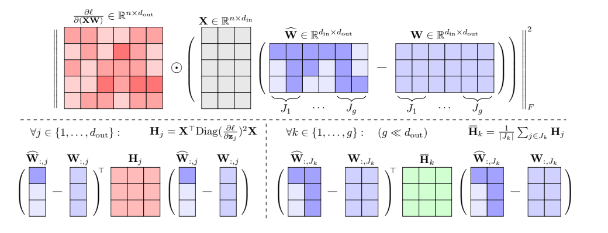

# 113. GuidedQuant：让层输出误差按最终损失的重要性加权

**GuidedQuant: Large Language Model Quantization via Exploiting End Loss Guidance**  
ICML 2025；固定阅读版本：**arXiv:2505.07004v4，2025-09-22，27 页**。整理于 2026-10-28。

[本地 PDF](paper-arxiv-v4.pdf) · [固定版本页面](https://arxiv.org/abs/2505.07004v4) · [官方代码](https://github.com/snu-mllab/GuidedQuant) · [作者讲解](https://jinukkim.me/blog/guidedquant/) · [版本记录](metadata.json) · [返回总目录](../README.md)

作者：Jinuk Kim、Marwa El Halabi、Wonpyo Park、Clemens JS Schaefer、Deokjae Lee、Yeonhong Park、Jae W. Lee、Hyun Oh Song。

本文页码为本地 PDF 物理页码。手算例子和迁移讨论是教学补充，实验表来自论文。本地未采集梯度、运行量化、推理或 benchmark。

## 1. 它问的问题，比“换一种码本”更靠前

量化时，我们通常希望某一层的输出尽量接近原模型。但同样大小的输出误差，对最终预测的影响可能完全不同：某些 feature/token 很关键，另一些影响很小。

**GuidedQuant 用最终损失对层输出的梯度，衡量这些误差的重要性，同时保留同一输出通道内多个权重之间的相互作用。**

读本文要分清两项贡献：

| 名称 | 改变什么 | 可以配什么 |
|---|---|---|
| GuidedQuant | 量化时优化的局部误差目标 | LNQ、QTIP、SpinQuant 中的 GPTQ 等 |
| LNQ | 非均匀标量量化的求解算法 | 普通层输出目标，或 GuidedQuant 加权目标 |

所以 GuidedQuant 不是一种固定的存储格式。LNQ 也不是一个新的高维 VQ 码本。

## 2. 先统一矩阵方向，避免与 GPTVQ/QuIP# 混淆

本文沿论文采用：

\[
X\in\mathbb R^{N\times d_{in}},\quad
W\in\mathbb R^{d_{in}\times d_{out}},\quad Z=XW.
\]

每一行 \(X_i\) 是一个校准位置的输入，每一列 \(w_j\) 对应一个输出通道。量化后 \(\widehat Z=X\widehat W\)。前面几篇经常写成 \(WX\)，只是转置记号不同，不是方法冲突。

| 符号 | 含义 |
|---|---|
| \(\ell\) | 语言模型最终损失，本地方法需要据此反向传播 |
| \(G_{ij}=\partial\ell/\partial Z_{ij}\) | 第 \(i\) 个校准位置、第 \(j\) 个输出特征的重要性信号 |
| \(H=X^TX\) | 普通层输出重建目标的二阶矩阵 |
| \(H_j\) | 考虑第 \(j\) 个输出梯度后的加权矩阵 |
| \(g\) | 输出通道分组数量，不是每组通道数，也不是 VQ 向量维度 |

## 3. 三种量化目标，分别漏掉了什么？

### 3.1 普通层输出重建：看见权重相互作用，但不知道最终重要性

\[
\mathcal L_{out}=\|X(W-\widehat W)\|_F^2
=\sum_j(w_j-\widehat w_j)^TX^TX(w_j-\widehat w_j).
\]

\(X^TX\) 的非对角项能表示不同输入坐标之间的关联；但不同位置的输出误差统一按平方相加。

### 3.2 对角 Fisher/逐权重加权：知道重要性，但丢失权重间的抵消

另一类方法先求最终损失对权重的梯度，再形成每个权重的敏感度 \(F_{aa}\)，优化：

\[
\mathcal L_{diag}=\sum_a F_{aa}(\widehat w_a-w_a)^2.
\]

它让不同权重的重要性不同，但保留的只有对角项。两个权重的误差可能相互抵消，这种作用会消失。论文以 SqueezeLLM 的相应目标作为重要对照。

### 3.3 GuidedQuant：给输出误差加权，保留通道内耦合

论文第 4 页 Eq. (4)：

\[
\boxed{\mathcal L_G=\|G\odot X(W-\widehat W)\|_F^2}
=\sum_{i,j}G_{ij}^2(Z_{ij}-\widehat Z_{ij})^2.
\]

\(\odot\) 是逐元素乘。先看重建后的层输出在哪些位置出错，再用最终损失梯度放大或缩小这些错误的权重。

这不是在损失里简单加一项 \(\lambda\ell\) 然后训练模型，也不是仅按权重幅值决定 bit allocation。

## 4. 一个手算例子：同样的 MSE，最终损失风险可以不同

**教学例子，不是模型实验。**假设两个输出位置的梯度为 \(G=(10,1)\)。有两种量化方案：

| 方案 | 两个输出误差 | 普通平方误差和 | GuidedQuant 加权误差 |
|---|---|---:|---:|
| A | \((0.1,1.0)\) | 1.01 | \(10^2\times0.1^2+1^2\times1^2=2\) |
| B | \((1.0,0.1)\) | 1.01 | \(10^2\times1^2+1^2\times0.1^2=100.01\) |

普通 MSE 分不出两者，梯度加权目标明显偏好 A，因为它保护了第一个更敏感的位置。

梯度被平方，所以正负号不决定“奖励还是惩罚”；方法在乎的是这种局部误差的敏感程度。该近似仍然不是准确计算一次完整模型量化后的最终损失变化。

## 5. 为什么它还保留了 cross-weight dependency？

把每个输出通道单独展开：

\[
\mathcal L_G=\sum_j e_j^TH_je_j,
\quad e_j=w_j-\widehat w_j,
\quad H_j=X^T\operatorname{Diag}(G_{:,j}^2)X.
\]

\(H_j\) 一般是一个有非对角项的 \(d_{in}\times d_{in}\) 矩阵。同一输出由许多输入权重共同产生；它们的误差如何相互影响，仍在二次型里。

**教学例子：**某个输出只依赖 \(x=(1,1)\)，重要性为 1，因此

\[
H_j=\begin{pmatrix}1&1\\1&1\end{pmatrix}.
\]

两个权重误差 \(e=(0.1,-0.1)\) 给出 \(e^TH_je=(0.1-0.1)^2=0\)。若只保留对角项，会得到 0.02，漏掉抵消。

这个例子没有说抵消在所有输入上都成立。真实 \(H_j\) 汇总多个校准输入；它说明为什么保留非对角项比逐权重打分表达能力更强。

## 6. 与最终损失的联系：是一种近似链条

论文用训练后模型附近的二阶 Taylor 近似解释方法，再用 empirical Fisher 近似难以计算的最终损失 Hessian。

通过链式法则，单个样本对输出通道 \(j\) 的权重梯度包含 \(G_{ij}X_i\)。保留同一输出通道内部的 Fisher block，会得到与 \(X^T\operatorname{Diag}(G_j^2)X\) 对应的形式，常数归一化在这里省略。

该解释保留：**同一层、同一输出通道内，不同输入权重之间的耦合。**

该解释忽略：**跨层耦合、不同输出通道之间的耦合，以及 Taylor/Fisher 近似之外的非线性效应。**

所以“使用 end-loss guidance”不等于“直接准确优化完整 end loss”，更不等于“获得完整全模型 Hessian”。

## 7. 为什么要分组？每通道一个矩阵太贵

如果每个输出通道都保存一个 \(H_j\)，一层就需要约

\[
O(d_{out}d_{in}^2)
\]

个数。对数千输入、数千输出的 LLM Linear，这个成本过高。

GuidedQuant 将相邻输出通道分成 \(g\) 组 \(J_1,\ldots,J_g\)。同组共享平均矩阵：

\[
s_{ik}=\frac1{|J_k|}\sum_{j\in J_k}G_{ij}^2,
\qquad \overline H_k=X^T\operatorname{Diag}(s_{:,k})X.
\]

\[
\mathcal L_{group}=
\sum_k\sum_{j\in J_k}e_j^T\overline H_ke_j.
\]

这样只需 \(g\) 个二阶矩阵，而不是 \(d_{out}\) 个。

### 7.1 三个容易弄反的细节

1. **先平方、再跨通道平均。**\(\operatorname{mean}(G^2)\) 不等于 \(\operatorname{mean}(G)^2\)；后一种会让正负梯度相互抵消。
2. **\(g=1\) 不等于普通重建目标。**它仍按不同校准位置的平均梯度平方加权；只有该权重对位置恒定时，才与普通目标相差整体常数。
3. 分组并没有恢复不同输出通道间的交叉项。同组只是共享一个通道内二阶矩阵。

**教学例子：存储量级。**若 \(d_{in}=d_{out}=4096\)，FP32 下逐通道矩阵约 256 GiB；\(g=4\) 时四个矩阵约 256 MiB。这里仅算这一层矩阵，不包含模型、梯度、activation、临时工作区或缓存文件。

### 7.2 原图怎么读？

来源：本地 v4，第 2 页 Figure 1 原图区域，未重绘。

上排是 \(G\odot X(W-\widehat W)\)；左下说明每输出通道有自己的 \(H_j\)；右下用同组共享的 \(\overline H_k\) 降低成本。颜色表示对应的矩阵与分组，而不是不同 bit-width。

## 8. 它需要反向传播，但不必用梯度更新权重

Algorithm 1 的主流程可以理解为：

1. 用原模型与校准文本计算最终语言建模损失。
2. 反向传播，收集层输出梯度，并只保留需要的分组平方统计。
3. 结合层输入构造 \(\overline H_k\)。
4. 把普通量化器所用的 \(X^TX\)，替换为对应的 \(\overline H_k\)。
5. 调用已有 layer-wise quantization solver，生成量化权重。

这一步梯度采集不等于梯度下降微调；但计算与显存成本都真实存在。最终选择什么量化 solver、是否另加 FT，仍需明确记录。

论文还把梯度统一放大 \(10^3\) 来减少下溢。理论上共同缩放只整体缩放该目标；实际数值稳定性、damping 和有限精度实现仍需考虑。

## 9. LNQ：另一项独立贡献

LNQ，Layer-wise Non-uniform Quantization，为每个输出通道学习一组标量码值。设 bit-width 为 \(b\)，码值数 \(M=2^b\)，则

\[
\widehat w_j=P_jc_j,
\quad P_j\in\{0,1\}^{d_{in}\times M},
\quad P_j\mathbf1=\mathbf1.
\]

\(P_j\) 每行恰有一个 1，表示该权重选了哪个标量码值；真正存储时是短索引，不需要显式保存巨大的 one-hot 矩阵。

### 9.1 固定索引，码本有闭式最小二乘解

\[
c_j^*=(P_j^THP_j)^{-1}P_j^THw_j.
\]

不可逆或病态时需要最小二乘/正则化处理。若 \(H\) 含有非对角项，最优码值通常不是简单把同簇原权重取平均。

### 9.2 固定码本，用坐标下降优化索引

一次只更新一个量化权重，其余保持不变。对第 \(i\) 个坐标，先计算考虑其他误差后的修正目标，再舍入到最近的码值：

\[
\widehat w_i\leftarrow\operatorname{Round}_{c}
\left(w_i-\frac{H_{i,-i}(\widehat w_{-i}-w_{-i})}{H_{ii}}\right).
\]

循环多个坐标，再重新解码本，形成 alternating minimization。

**教学例子：**若 \(H=\begin{pmatrix}1&0.5\\0.5&1\end{pmatrix}\)，\(w=(0.8,0.2)\)，固定码值为 \(\{0,1\}\)，当前 \(\widehat w=(1,1)\)，则误差为 \((0.2,0.8)\)，二次目标为 0.84。更新第二坐标时修正目标为 \(0.2-0.5(1-0.8)=0.1\)，应选 0，得到 \((1,0)\)，目标降至 0.04。

### 9.3 “单调下降”保证的到底是什么？

在论文的精确交替更新与可行初始化条件下，固定分配时最优更新码本，固定码本时坐标下降不增大目标。因此相应**局部二次目标的数值单调不增并收敛**。

这不保证找到全局最优码本/分配，不保证参数本身唯一收敛，也不保证每轮完整模型 PPL、任务准确率或机器人成功率都单调改善。实现中的 damping 与浮点误差需要另行对待。

## 10. 实验：三条路线分别看

### 10.1 LNQ 与指导目标各自贡献多少？

第 8 页 Table 3，**Llama-2-7B，约 2-bit，WikiText2/C4，context 4096，无 end-to-end FT**：

| 方法 | Bits | WikiText2 PPL ↓ | C4 PPL ↓ |
|---|---:|---:|---:|
| FP16 reference | 16 | 5.12 | 6.63 |
| SqueezeLLM，无 mixed precision | 2.01 | 39.58 | 44.05 |
| LNQ | 2.01 | 23.31 | 26.71 |
| LNQ + GuidedQuant | 2.01 | 8.83 | 11.15 |

这把“更好的求解器”和“更好的目标”分开了。收益很大，但 8.83 仍明显高于 FP16 的 5.12，不能概括成 2-bit 无损。

### 10.2 QTIP + GuidedQuant：注意量化版本

第 9 页 Table 4，**相同 context 4096，无 end-to-end FT，QTIP 的 1MAD/3INST 路线**：

| 模型，2-bit | QTIP WikiText2 PPL ↓ | 加 GuidedQuant 后 ↓ |
|---|---:|---:|
| Llama-2-7B | 6.82 | 6.11 |
| Llama-2-13B | 5.52 | 5.33 |
| Llama-2-70B | 3.87 | 3.80 |

论文在两种纯计算码中采用更好的结果。这里不是 QTIP 主论文中经过微调的 HYB 路线；HYB 的 7B 2-bit PPL 为 5.86，见 [QTIP 阅读包](../111-qtip/README.md)。

本表引用的 QuIP# 行对应无 FT 数字 8.22/6.06/4.16，也不能据此说完整 QuIP# 的最佳值就是这些数。

### 10.3 SpinQuant：W4A4KV4 的增益比较小

第 9 页 Table 5，**WikiText2 context 2048**：

| 模型 | SpinQuant PPL ↓ | SpinQuant + GuidedQuant ↓ |
|---|---:|---:|
| Llama-2-7B | 5.95 | 5.89 |
| Llama-2-13B | 5.24 | 5.19 |
| Llama-2-70B | 3.71 | 3.71 |

这里把 GuidedQuant 加到权重量化步骤。不能把它写成重新发明了 activation/KV 的量化格式，也不能说每个设置都有明显提升。此表的 2048 context 与前面 4096 的 PPL 不宜直接混比。

### 10.4 吞吐表比较的是格式和 kernel，不是指导目标免费带来的提速

第 7 页 Table 2 与附录 C.1，在 RTX 4090 上用 `torch.compile` 优化的推理流程生成 100 tokens；Llama-2-7B 的 2-bit non-uniform scalar 为 347 tok/s，vector 路线为 200 tok/s，FP16 为 67 tok/s。

这里分别采用 Any-Precision-LLM、QTIP HYB 等 kernel。**质量表中的纯计算 QTIP 与吞吐表中的 HYB 并非同一配置。**吞吐差异说明表示和 kernel 的实际成本，不应直接变成某个 QTIP+GuidedQuant checkpoint 已同时达到的配对速度与精度结果。

## 11. 代价与分组怎么读？

主实验 weight-only 对 7B/13B 使用 \(g=4\)，70B 使用 \(g=2\)；weight-and-activation 使用 \(g=1\)。详见正文与附录设置。

附录 D.1、Tables 8–9 将成本拆为：

1. 梯度采集与保存。
2. 加权二阶矩阵计算与缓存。
3. 加载矩阵并量化权重。

增加 \(g\) 通常增加二阶矩阵存储与计算，但不必使全部量化耗时按 \(g\) 倍增长，因为各组处理的输出权重也变少。相同模型、校准数据与配置下，缓存可以在多次 bit-width 搜索中复用；重新训练 checkpoint、换 loss/数据或变换后，不能不核对就继续使用旧缓存。

“最终 checkpoint 没变大”也不等于“离线过程没有额外显存与磁盘成本”。论文 70B 的相关 Hessian 缓存量可达到数百 GiB，阅读时应看具体 \(g\) 和缓存方式。

## 12. 官方代码怎样对照论文？

先看 [官方 README](https://github.com/snu-mllab/GuidedQuant)，按三条路线进入：

- `scripts/run_sqllm.sh` 与 `scripts/run_lnq.sh`：非均匀标量量化与 LNQ。
- [any_precision/quantization/gradients.py](https://github.com/snu-mllab/GuidedQuant/blob/main/any_precision/quantization/gradients.py)：梯度采集入口。
- [qtip](https://github.com/snu-mllab/GuidedQuant/tree/main/qtip)：QTIP 的指导目标版本。
- [spin_quant/eval_utils/gptq_guided_utils.py](https://github.com/snu-mllab/GuidedQuant/blob/main/spin_quant/eval_utils/gptq_guided_utils.py)：GPTQ 权重量化与指导目标结合。

第一次读代码时只追踪一件事：**普通 \(X^TX\) 在哪里变成了 \(X^T\operatorname{Diag}(s)X\)？**再追踪梯度从什么 loss 计算、平方在哪一层做、如何分组与缓存。

仓库的安装涉及 Python/CUDA 与自定义 kernel。本包未下载模型或校准集，也未安装环境；代码链接是当前访问入口，PDF 版本单独固定。

## 13. 与当前 FYP 的联系：相关，但不能等同

如果你的方法在量化训练中直接使用 action loss、future latent loss 或 frozen-reader KL，确实与“更重视最终有用误差”的动机相关。但至少应分清：

| 维度 | GuidedQuant 原论文 | 移到 WAM 必须重新明确 |
|---|---|---|
| End loss | LLM 语言建模损失 | action/future/reader 中的哪一个，或怎样组合 |
| 如何利用 loss | 采集输出梯度，形成加权局部二次目标 | 仍用梯度统计，还是直接反传优化码本 |
| 耦合近似 | 保留同一输出通道内的权重耦合 | 多模态、时间、分支耦合如何处理 |
| 校准分布 | 文本与 token | 场景、采样时刻、噪声、闭环状态分布 |
| 成功证据 | PPL、zero-shot 与格式相关吞吐 | 固定输入误差、闭环成功率、真实部署性能 |

**教学层面的迁移难点：**若某个蒸馏损失在原模型与自身比较时恰好为零，其输出梯度也可能为零，直接套用 \(G^2\) 会得不到有意义的重要性。因此不能只把“语言损失”替换成一个在参考点恒为零的 reconstruction loss 就认为方法已迁移，需要定义能提供信息的任务信号或局部敏感度估计。

这一点是从公式推出的分析，不是 GuidedQuant 已完成的 WAM 实验；原论文没有验证 action/future latent、reader KL 或机器人闭环效果。

## 14. 阅读路线

| 时间 | 阅读内容 | 读完应能解释 |
|---|---|---|
| 25 分钟 | 第 1–2 页 Figure 1/Table 1；本 README §3–7 | 为什么给输出误差加权、为什么要分组 |
| 60–90 分钟 | 第 3–7 页，Eq. (1)–(11)、Algorithm 1–2 | Fisher block、分组近似、LNQ 的两个更新步骤 |
| 实验核对 | 第 8–9 页 Tables 3–5；第 17–19 页附录设置/成本 | FT、QTIP variant、context 与 kernel 的区别 |
| 深入阅读 | 附录 A/B、D.1/D.5/D.10/D.11 | 收敛保证、实现成本、组数与不同近似的比较 |

## Reading Questions：读完后自行回答

1. 普通输出 MSE、对角 Fisher、GuidedQuant 分别保留和丢掉了什么？
2. 为什么要平均梯度平方，而不是平均梯度后平方？
3. \(g=1\) 为什么通常仍不同于普通层输出重建？
4. 梯度采集与 end-to-end fine-tuning 有什么区别？
5. LNQ 的单调下降保证作用于什么目标，不能保证什么？
6. GuidedQuant 的 QTIP 表为何不能直接与 HYB+FT 的 5.86 比较？
7. 若迁移到 action/future loss，参考点的梯度是否可能退化为零？

## Meeting Card：阅读后填写

- 我对 GuidedQuant 目标的直觉解释：
- 我能写出的 \(H_j\) 与 \(\overline H_k\)：
- LNQ 与 GuidedQuant 各自贡献：
- 我会采用的实验对照：
- 与现有 FYP 的相同点和关键差别：
- 待讨论的问题：
