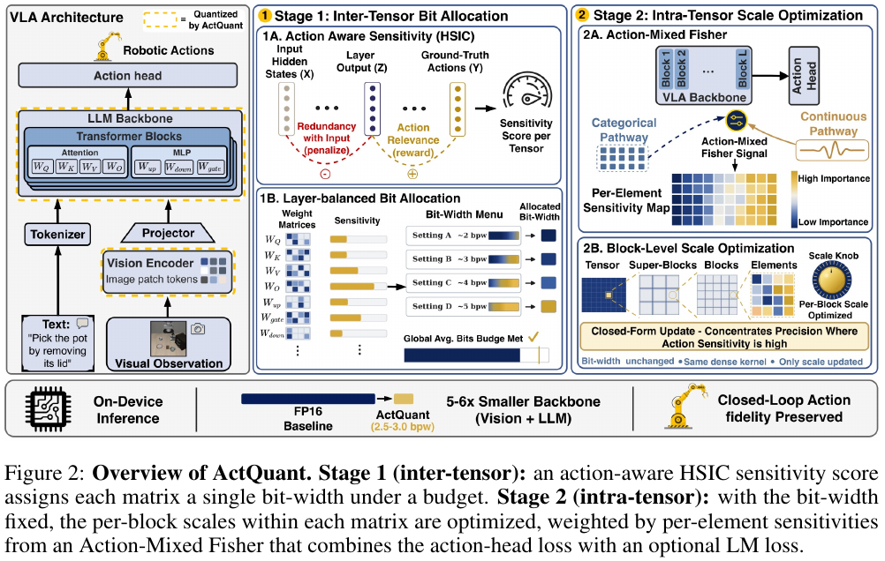
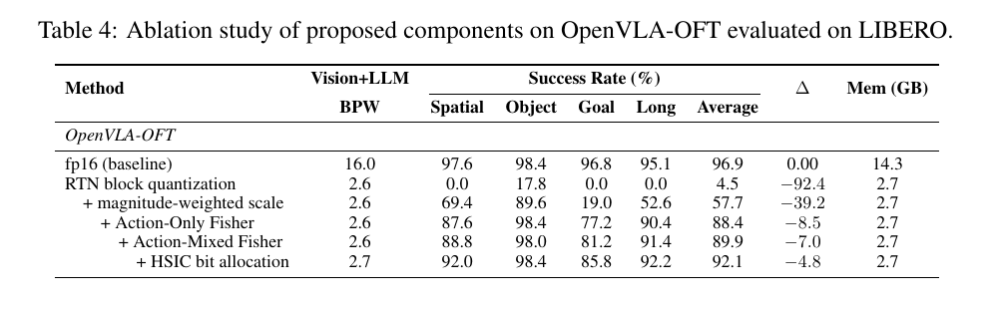

# 97. ActQuant：用动作相关性分配 bit，用 Action-Mixed Fisher 优化 scale

**ActQuant: Sub-4-bit Action-Guided Quantization for Vision-Language-Action Models**  
固定版本：**arXiv:2605.24011v3** · 17 页 · v3 发布于 2026-08-03 · 导读更新：2026-10-12  
分类：VLA / action-guided / mixed-precision / weight-only PTQ / native deployment

[本地论文 PDF](paper-arxiv-v3.pdf) · [固定版本 arXiv](https://arxiv.org/abs/2605.24011v3) · [HTML 原文](https://arxiv.org/html/2605.24011v3) · [官方代码](https://github.com/arashakb/ActQuant) · [项目页](https://actquant.github.io/) · [阅读包信息](metadata.json) · [返回 VLA 论文库](../README.md)

本文按“直觉 → 小例子 → 公式 → 实验证据 → 与你的研究的联系”讲解。页码均为本地 PDF 的**物理页码**，从封面所在页算第 1 页。本包沿用现有编号 #097，保留已有 v3 PDF，并扩充原简略提纲。

**所有实验数字均来自论文，本地没有运行 calibration、量化、LIBERO、real-robot 或速度 benchmark。** 标为“教学例子”的数字只解释方法。论文、官方代码静态阅读和本地复现是不同的证据来源。

## 1. 先用一句话理解整篇论文

**ActQuant 希望把 VLA 的主要权重压到平均 2.5–3 bits-per-weight，同时尽量保住机器人完成任务的能力。它先决定每个 weight matrix 用多少 bit，再在 bit 已经确定的情况下，调整各个小 block 的 scale。**

你听到的 “action Fisher”，最直接对应 **Action-Only Fisher** 和 **Action-Mixed Fisher，简称 AMF**，位于论文 §4.2，物理第 6–7 页。

可以把两个阶段想象成预算分配：

- **Stage 1 / HSIC**：哪些部门值得多给预算？对应“每个 matrix 分到多少 bit”。
- **Stage 2 / AMF**：一个部门的预算确定后，怎样花得更有效？对应“固定 bit-width，优化 block scale”。
- **OmniModel.cpp / runtime**：这些决策如何兑现成设备上的收益？对应“用实际 low-bit 格式和 kernels 执行模型”。

它们分别影响精度分配、量化误差和部署效率。阅读时，把各自解决的问题记清楚。

## 2. 从抓杯子理解：为什么 VLA 的量化误差难处理？

假设机器人接到指令：“抓起白色杯子。”

模型接收图像、语言和相关状态，生成动作。机器人执行一段动作后，看到新画面，再生成下一段动作。

一次轻微偏差，可能让手指落到杯子边缘。下一次相机看到的位置关系就变了，之后的输入也会偏离原来的成功轨迹。

首先，**参数误差的影响很不均匀**。同样大小的 weight error，有的只改变无关 hidden feature，有的会改变抓取位置或夹爪动作。

其次，**离线误差与闭环成功之间还有距离**。固定图像上的动作偏差很小，并不能保证完整抓取过程受影响也很小。

因此，ActQuant 想让量化更关注动作任务：在有限存储预算下，尽量把表示能力留给影响动作的参数。

不过，它的 calibration 使用已有轨迹上的监督信号。**calibration 没有直接优化完整闭环成功率，也没有建立所有未来状态下的控制保证。**

原文定位：§1，物理第 1–3 页；§5，物理第 7–9 页。

## 3. 分清 matrix、Transformer block、quantization block

这里的 “block” 可能指两种完全不同的对象。

| 名称 | 含义 | 举例 |
|---|---|---|
| Transformer block / layer | 模型的一层，包含 attention 和 MLP | 第 12 层 Transformer |
| weight matrix / tensor | 一个具体 Linear 的参数矩阵 | 这一层的 \(W_Q\)、\(W_O\)、\(W_{\mathrm{down}}\) |
| channel | feature 的一维，或矩阵的一行/列，取决于定义 | hidden feature 的第 37 维 |
| quantization block | 同一 matrix 中的一小组 weight elements | 一组共享 scale 的连续 weights |
| super-block | 若干 quantization blocks 的组合 | 进一步编码各子 block 的 scale metadata |

一个 Linear 可以写成 \(y=Wx\)。\(W\) 是模型已经学到的 weight，\(x\) 是运行时的 activation。降低 \(W\) 的存储精度，就是 weight quantization。

一个 Transformer layer 通常包含多个 matrix：

\[
\mathcal J=\{Q,K,V,O,\mathrm{up},\mathrm{down},\mathrm{gate}\}.
\]

ActQuant 允许同一层这些 matrix 使用不同量化类型。例如，\(W_Q\) 可以低一些，\(W_{\mathrm{down}}\) 可以高一些。

**同一 matrix 内采用相同量化类型；内部不同 quantization block 可以有不同 scale。**

所以，“一个 tensor 一个 bit-width”不等于“一个 tensor 只有一个 scale”，也不等于“整个 Transformer layer 只有一种精度”。

原文定位：§3，物理第 3–4 页。

## 4. 它量化哪些部分？为何属于 PTQ？

| VLA 部分 | 作用 | 论文中的处理 |
|---|---|---|
| vision encoder \(\mathcal E_v\) | 将图像变成视觉 features | 量化 weight |
| projector \(\mathcal P\) | 对齐视觉与语言表示空间 | 保留 full precision |
| language backbone \(\mathcal G\) | 融合条件并生成 hidden states | 量化 weight |
| action head / expert \(\mathcal H\) | 生成机器人动作 | 保留 full precision |

OpenVLA-OFT 使用连续 action head，\(\pi_{0.5}\) 使用 flow-matching action expert。“head”在具体架构中不一定只是一个很小的 Linear；要结合实际参数范围理解。

**这是 weight-only PTQ。** Appendix H 说明 activation 保持 half precision。“3 bpw”不表示整个模型所有计算采用 3-bit，不能写成 W3A3 或 W4A4。

它在训练好的模型上，用 calibration data 估计重要性、分配格式、优化 scale，没有执行 QAT 式模型训练。

**PTQ 可以使用 backward。** 这里反向传播用来估计 Fisher，没有执行更新整套模型参数的 optimizer step。不能只凭有没有 backward 判断 PTQ / QAT。

原文定位：§3，物理第 3–4 页；Appendix H，第 16 页。公开代码的实际 vision / language 路径见 §26。

## 5. Scale 是什么？一个小例子

简化的对称 quantizer：

\[
\hat w_i=s_bq_i.
\]

\(q_i\) 是离散表示值，\(s_b\) 是 block 的 scale，\(\hat w_i\) 是恢复出的 weight。

**教学例子：**codebook 是 \(\{-1,0,1\}\)。

- \(s=0.5\)：可表示 \(\{-0.5,0,0.5\}\)。
- \(s=1.0\)：可表示 \(\{-1,0,1\}\)。

前者在 0 附近更细，后者覆盖范围更大。scale 太大，会牺牲小值分辨率；太小，大值会映射到边界。

论文更一般地写：

\[
\hat w_i=s_b(q_i-z_b).
\]

\(z_b\) 是 zero point。实际 GGML 格式可能使用非均匀 codebook 和 block / super-block metadata，不能用三点教学网格替代真实编码。

ActQuant 的重点是：**选择 scale 时，除了所有 weights 的 MSE，还应考虑重要 weights 的误差。**

原文定位：Eq. (1)，第 4 页；Eq. (10)–(11)，第 7 页。

## 6. 为什么在 matrix 之间混精度，在 matrix 内固定格式？

假设一层中 A matrix 很敏感，B 不太敏感。整层统一 3-bit，可能让 A 表示能力不足，同时让 B 多占了不必要的空间。

更细的办法是让每个 channel / weight 都有不同 bit-width，但存储和执行会更复杂：kernel 需要处理不同格式与 packing，还可能增加访存或调度开销。

ActQuant 选择中间粒度：**matrix 之间允许不同格式，matrix 内部保持统一格式，使用已有 dense low-bit kernels。**

AMF 仍然为每个 weight 估计重要性，只是用来调整 scale，而不是给每个 weight 改 bit 数。

这是具体的系统选择，不能推广成“所有 per-channel 方法都无法高效执行”。实际速度还依赖 kernel、布局与硬件。

原文定位：§1–2，第 2–3 页；Figure 2，第 5 页。

## 7. 先看 Figure 2，串起完整方法

图源：固定 v3 PDF，**Figure 2，物理第 5 页**；裁去页面外围，保留原图与原 caption。

从左到右：

1. VLA 的 vision / language backbone 是主要量化对象，action head 接收输出。
2. HSIC 为每个 matrix 算 score，在总预算内选 quantization type。
3. AMF 对 calibration loss 求梯度，得到 per-element sensitivity。
4. 在既定格式下，每个 block 的 scale 更照顾高敏感度 weight。
5. 最后用 native runtime 执行，并做 closed-loop evaluation。

**概念上的 Stage 1 → Stage 2 不要求统计采集也严格按这个顺序。** HSIC 和 Fisher 可以在同一原始模型上分别准备。官方 runner 会读取预先准备的 Fisher imatrix，再做 bit allocation，最后调用 quantizer。

## 8. HSIC 的直觉：样本之间的“相似关系”是否一致？

HSIC 是 **Hilbert-Schmidt Independence Criterion**，用 kernel 衡量 statistical dependence。

先不用学习 Hilbert space，从样本关系理解即可。

**教学例子：**四张抓取图像中，两张对应向左移动，两张对应向右移动。如果某个 matrix 的 features 也呈现“向左的彼此相似、向右的彼此相似”，features 与 action labels 的相似关系一致，说明存在统计联系。

如果 features 主要区分桌布颜色，而动作不随桌布颜色变化，那么与动作的依赖可能弱一些。

HSIC 比较这两组相似关系，可以捕捉非线性联系。但高 dependence 不直接证明因果作用。sample 数、bandwidth、normalization 都会影响结果。

RBF kernel 下“population HSIC 为零当且仅当独立”的性质，也不等于有限 calibration data 上的排名一定准确。

原文定位：Eq. (2)，第 4 页；Appendix A，第 13 页。

## 9. HSIC 公式的每个符号在做什么？

\[
\widehat{\mathrm{HSIC}}(A,B)
=\frac{\operatorname{tr}(K_A C K_B C)}{(K-1)^2}.
\]

| 符号 | 含义 |
|---|---|
| \(K\) | 用于估计的样本数，不是 attention K projection |
| \(K_A\) | A 样本两两相似度，大小 \(K\times K\) |
| \(K_B\) | B 样本两两相似度 |
| \(C=I-\frac1K\mathbf1\mathbf1^\top\) | centering，移除整体平均相似性 |
| \(\operatorname{tr}\) | trace，将对角元素相加 |

RBF kernel 可以写成：

\[
k(a_i,a_j)=\exp\left(-\frac{\|a_i-a_j\|^2}{2h^2}\right).
\]

\(h\) 是 bandwidth；features 越接近，similarity 越大。HSIC 衡量居中后的两组相似度模式有多一致。

**60 episodes 是轨迹级数据量，不等于只有 60 个 feature vectors。** 一条 episode 有多个时刻，实际 sample selection 与 aggregation 要看实现。

## 10. Stage 1 score：奖励 action relevance，惩罚 input redundancy

论文 Eq. (5)：

\[
S(W_j^{(\ell)})
=-\alpha_{\mathrm H}\widehat{\mathrm{HSIC}}(X,Z_j^{(\ell)})
+\beta_{\mathrm H}\widehat{\mathrm{HSIC}}(Z_j^{(\ell)},Y).
\]

这里将系数写成 \(\alpha_{\mathrm H},\beta_{\mathrm H}\)，对应原文的 \(\alpha,\beta\)。后面 AMF 的 \(\alpha\) 是另一处 mixing coefficient。

- \(X\)：input hidden states。
- \(Z_j^{(\ell)}\)：第 \(\ell\) 层第 \(j\) 个 matrix 的 output hidden states。
- \(Y\)：ground-truth actions。
- 第一项：作者将其作为 input redundancy 的 proxy。
- 第二项：action relevance 的 proxy。

**教学例子：**令两个系数均为 1。

| matrix | input–output HSIC | output–action HSIC | score |
|---|---:|---:|---:|
| A | 0.3 | 0.9 | 0.6 |
| B | 0.6 | 0.7 | 0.1 |

A 与动作更相关、与输入的重复性 proxy 更低，因而更值得保护。

不过，\(Z\) 本来就由 \(X\) 经网络产生，较强 dependence 不自动意味着信息无用。减去第一项是 information-bottleneck 风格的**设计 proxy**，没有直接测量该 matrix 的真实 action damage。

差分 score 也不是概率，理论上不必天然非负。复现时需查看 normalization、score key 与 allocator，不宜把任意原始差值当成精确损伤。

## 11. 分 bit 为什么不能简单选 Top-K？

给十亿个 weights 多 1 bit，与给一万个 weights 多 1 bit，存储成本不同。allocator 同时看预计收益、额外存储成本以及所在层的预计损伤。

论文使用：

\[
\eta(t)=2^{-2b(t)}.
\]

\(t\) 是 quantization type，\(b(t)\) 是 bit cost。**教学例子：**

\[
\eta(2)=1/16,\quad \eta(3)=1/64,\quad \eta(4)=1/256.
\]

这个 proxy 中每多 1 bit，预计 squared error 缩为四分之一。它不是实际低 bit codebook、outlier 和闭环误差严格遵循的规律。

平均预算按参数数目加权：

\[
\bar b_{\mathrm{used}}
=\frac{\sum_{\ell,j}b(t_j^{(\ell)})|W_j^{(\ell)}|}
{\sum_{\ell,j}|W_j^{(\ell)}|}.
\]

**教学例子：**100 万 weights 用 4-bit、300 万用 2-bit：

\[
\bar b=\frac{4\times1+2\times3}{1+3}=2.5,
\]

不是简单平均后的 3。实际格式的 scales、zero points 和 packing 也占空间，应使用具体有效 bit cost；整数例子只解释加权平均。

原文定位：Eq. (6)，第 6 页。

## 12. Layer-balanced：避免把某一层变成短板

先定义一层的预计损伤：

\[
E_\ell=\sum_{j\in\mathcal J}S(W_j^{(\ell)})\eta(t_j^{(\ell)}).
\]

再优化：

\[
\min_{\{t_j^{(\ell)}\}}\sum_\ell E_\ell^2,
\qquad \bar b_{\mathrm{used}}\leq\bar b_{\mathrm{target}}.
\]

**教学例子：**两层总损伤均为 4。分配为 \((2,2)\) 的平方和是 8；分配为 \((0,4)\) 的平方和是 16。目标偏向前者，惩罚某层特别大的预计损伤。

它不要求各层使用相同 bit，也不保证真实 action error 相等。它均衡的是 surrogate。

greedy procedure 从便宜格式开始，每次选可行升级中

\[
\frac{E_\ell^2-\widetilde E_\ell^2}{\Delta\mathrm{bits}}
\]

最大的一个，相当于先花最划算的一笔预算。这是离散格式与 surrogate 上的近似求解，不是全局最优控制的保证。

## 13. 从 weight MSE 走向 action sensitivity

普通量化重建关注：

\[
\sum_i(w_i-\hat w_i)^2.
\]

**教学例子：**一个方案让重要 weight 产生 0.01 的 squared error，另一个让不重要 weight 产生相同误差。总 MSE 相同，动作质量却可能不同。

因此，改为：

\[
\sum_i\omega_i(w_i-\hat w_i)^2.
\]

ActQuant 用 calibration loss 对参数的 gradient square，构造其中 action-aware 的重要性。

直观地说，**一个参数变化一点，若经常带来强烈的 loss 变化，就应谨慎量化。** 这是所选 loss 下的局部 sensitivity，不等价于任何输入下的 action deviation。

## 14. 为什么从 Hessian 近似成 Fisher？

令量化扰动 \(\delta=\hat\theta-\theta\)。Taylor expansion：

\[
\mathcal L(\theta+\delta)-\mathcal L(\theta)
\approx g^\top\delta+\frac12\delta^\top H\delta,
\]

其中 \(g=\nabla_\theta\mathcal L\)，\(H=\nabla_\theta^2\mathcal L\)。

若接近这个目标和分布下的局部最优点，\(g\) 较小，作者用二阶项近似损伤。曲率大的方向对扰动更敏感。

7B 模型的完整 Hessian 有约 \((7\times10^9)^2\) 个 entries，不现实。改用一阶计算的 surrogate：

\[
F_{\mathrm{emp}}=\frac1{|\mathcal D|}\sum_d
\nabla_\theta\mathcal L_d(\nabla_\theta\mathcal L_d)^\top,
\qquad
F_{ii}=\frac1{|\mathcal D|}\sum_d
\left(\frac{\partial\mathcal L_d}{\partial\theta_i}\right)^2.
\]

保存对角由 \(O(P^2)\) 降到 \(O(P)\)，但丢掉参数之间的 cross interactions。

**准确地说，这是 diagonal empirical-Fisher surrogate。** true Fisher、data empirical Fisher 与 observed Hessian 不是一般情况下恒等的量。negative log-likelihood、模型与数据分布匹配等条件支持相关近似；fine-tuning 本身不保证相等。

官方 OpenVLA-OFT 路径使用 L1 action loss。普通 L1 在可微区间的二阶曲率与梯度平方并不相同，所以不要把该 score 当成“精确 action Hessian”。

原文定位：§3，第 4 页；Appendix B，第 13–14 页。

## 15. Action-Only Fisher：平方后平均，不能先平均再平方

\[
F_{ii}^{\mathrm{act}}=\frac1{|\mathcal D|}\sum_d
\left(\frac{\partial\mathcal L_d^{\mathrm{act}}}{\partial\theta_i}\right)^2.
\]

**教学例子：**两个 samples 的梯度：

- weight A：\(+10,-10\)；
- weight B：\(+1,+1\)。

A 的平均梯度是 0，但正确 Fisher 是

\[
F_A=(10^2+(-10)^2)/2=100,\qquad F_B=1.
\]

不同样本的方向相反，不代表影响幅度小。平方保留敏感性。

同理，“一个 batch 的平均梯度平方”不能不加说明地代替“每个 sample 梯度平方的平均”。sample 粒度与 batch aggregation 会改变估计，要看脚本。

**action head 保留高精度，仍可以给 backbone weights 提供梯度。** loss 从 head 反向传播到被量化参数；被保护的 head 与被评分的 weight，是两个概念。

## 16. AMF：LM head 这里预测的是 action tokens

论文定义：

\[
\mathcal L_d^{\mathrm{AMF}}
=\lambda\mathcal L_d^{\mathrm{act}}
+(1-\lambda)\mathcal L_d^{\mathrm{cls}},\quad \lambda\in[0,1].
\]

这里 \(\lambda\) 对应 Eq. (8) 中的 \(\alpha\)，与 HSIC 系数分开理解。

- \(\mathcal L^{\mathrm{act}}\)：连续 action-head loss。
- \(\mathcal L^{\mathrm{cls}}\)：LM head 在指定 **action-token positions** 上的 classification / cross-entropy loss。

第二项经 language-modeling head，但监督的是离散动作 token，不是一般聊天文本 loss。

然后：

\[
F_{ii}^{\mathrm{AMF}}=\frac1{|\mathcal D|}\sum_d
\left(\frac{\partial\mathcal L_d^{\mathrm{AMF}}}{\partial\theta_i}\right)^2.
\]

| 模型 | 论文设置 | 含义 |
|---|---|---|
| OpenVLA-OFT | 默认 \(\lambda=0.5\) | 结合 continuous action 与 categorical action-token signals |
| \(\pi_{0.5}\) | \(\lambda=1\) | 只有 action 路径，退化为 Action-Only Fisher |

两个 loss 系数相等，不代表实际 gradient 贡献相等，因为它们的数值尺度可能不同。

原文定位：Eq. (7)–(9)，第 6 页；Appendix C，第 14 页。**当前 OFT 脚本 CLI 默认 0.6，复现论文需显式传 0.5，详见 §26。**

## 17. 最关键的细节：先混合 gradient，再平方

令 \(g_d^{\mathrm{act}},g_d^{\mathrm{cls}}\) 是两条 loss 对同一参数的梯度，则：

\[
F_{ii}^{\mathrm{AMF}}
=\mathbb E_d[(\lambda g_d^{\mathrm{act}}+(1-\lambda)g_d^{\mathrm{cls}})^2]
=\lambda^2F_{ii}^{\mathrm{act}}+(1-\lambda)^2F_{ii}^{\mathrm{cls}}
+2\lambda(1-\lambda)C_{ii},
\]

\[
C_{ii}=\mathbb E_d[g_d^{\mathrm{act}}g_d^{\mathrm{cls}}].
\]

原文称 \(C_{ii}\) 为 covariance；按式子，它是没有显式减均值的 gradient cross moment。均值接近零时才更接近通常的 covariance。

**教学例子：**\(\lambda=0.5\)，先看一个 sample。

| action gradient | categorical gradient | mixed gradient | mixed gradient squared |
|---:|---:|---:|---:|
| 2 | 2 | 2 | 4 |
| 2 | -2 | 0 | 0 |

方向一致时信号保留，方向相反时可能抵消。

所以，AMF 不等于 \(\lambda F^{\mathrm{act}}+(1-\lambda)F^{\mathrm{cls}}\)。先分别平方再混合，会丢掉 cross term；上表第二行的这种算法会得 4，而真正 AMF 得 0。

**抵消说明混合目标下的 gradient 小，不说明两条路径各自都不敏感。** AMF 没有无条件同时保护两个目标的保证。

原文定位：Appendix C / Eq. (17)，第 14 页。

## 18. Fisher 如何进入 block-scale optimization？

论文将 Fisher 与局部 magnitude 结合：

\[
\omega_{b,i}=F_{ii}^{\mathrm{AMF}}\sqrt{\sigma_b^2+w_i^2},
\qquad
\sigma_b^2=\frac1{|\mathcal B_b|}\sum_{j\in\mathcal B_b}w_j^2.
\]

\(\sigma_b^2\) 是 **mean square**，没有减均值，不是中心化 variance。

Fisher 表示 loss sensitivity，magnitude factor 结合 block 尺度与当前 weight 幅度。优化：

\[
\min_{s_b,\{q_i\}}\Phi_b
=\sum_{i\in\mathcal B_b}\omega_{b,i}(w_i-s_bq_i)^2.
\]

这是 Eq. (10) 的对称形式；Eq. (1) 给出含 zero point 的一般表示，实际格式还有编码约束。

**重要 weight 不会获得专属 bit。** 调整的是整个 block 的共享 scale，使它更照顾重要 weight；其他 weight 误差可能增大。

## 19. 算一个例子：普通 MSE 更小，加权误差却更大

**教学例子，与论文实测无关。** 固定 code values，只比较 scale：

\[
w=(0.9,1.9),\qquad q=(1,2).
\]

普通 least squares：

\[
s_{\mathrm{MSE}}=\frac{\sum_iw_iq_i}{\sum_iq_i^2}
=\frac{0.9+3.8}{1+4}=0.94.
\]

恢复为 \((0.94,1.88)\)，residuals 为 \((-0.04,0.02)\)。

假设第一个 weight 更重要，教学 importance weights 是 \(\omega=(100,1)\)，不是论文实际 Fisher 值。加权 scale：

\[
s_{\mathrm{weighted}}
=\frac{\sum_i\omega_iw_iq_i}{\sum_i\omega_iq_i^2}
=\frac{90+3.8}{100+4}\approx0.901923.
\]

| 方式 | 恢复的 weights | 普通 squared error 总和 | 按 \((100,1)\) 加权的 error |
|---|---|---:|---:|
| 普通 MSE | \((0.94,1.88)\) | 0.002000 | 0.160400 |
| 加权 MSE | \((0.901923,1.803846)\) | 约 0.009249 | 约 0.009615 |

加权方案几乎恢复准确第一个重要 weight，代价是第二个更不准确。**总 weight MSE 变大，但重视的加权误差显著变小。**

这就是 task-aware quantization 的直觉：质量的尺子变了，最好的量化位置也会变。

## 20. 为什么交替更新 code 与 scale？

同时优化 \(q_i,s_b\) 是非凸问题。论文交替做两个简单步骤。

固定 scale，更新 code：

\[
q_i^\star=\arg\min_{q\in\mathcal Q_n}|w_i/s_b-q|.
\]

固定 code，更新 scale：

\[
s_b^\star=\frac{\sum_i\omega_{b,i}w_iq_i^\star}
{\sum_i\omega_{b,i}(q_i^\star)^2}.
\]

第二式是前面的 weighted least-squares solution。

第一式为何没有 \(\omega_i\)？当 scale 固定、每个元素独立选 code、且 \(\omega_i>0\) 时，该元素的所有候选 error 都乘同一正数，不改变最近的 code。若 \(\omega_i=0\)，该元素在此目标下不受约束；实际实现要处理 tie、零分母等情况。

交替步骤改善局部目标，论文讨论收敛到局部最优。**block objective 改善，不保证 closed-loop success rate 单调改善。** 两者还隔着 surrogate、模型非线性与环境反馈。

原文定位：Eq. (10)–(11)，第 7 页。

## 21. Calibration：60 episodes 到底是什么？

论文在 LIBERO 上使用 **60 条 calibration episodes**，所有比较方法共享这个数据预算。

| suite | task 数 | 每个 task 采样的 episodes | 合计 |
|---|---:|---:|---:|
| Spatial | 10 | 1 | 10 |
| Object | 10 | 1 | 10 |
| Goal | 10 | 1 | 10 |
| Long | 10 | 3 | 30 |
| 总计 | 40 | 按 suite 分层覆盖 | 60 |

数据来自 LIBERO fine-tuning split；每个 task 内抽取 episode 的随机 seed 为 42。Long 分配更多 episode，是为了覆盖较复杂的长程任务。

这不是从全部轨迹中随便抽 60 条，更不是“只使用 60 帧”。同一组 episode 用于 HSIC 与 AMF。原文所谓 shared calibration pass 表示共享数据来源，不能自动理解成一次 forward 就能同时完成所有梯度统计。

Appendix G 还说明：

- QVLA 原文使用 **512 episodes**。
- ActQuant 将 QVLA 重新运行在 **60 episodes** 下，其他 hyperparameters 保持默认。
- 因此 Table 1 说明同一低数据预算下的表现，不能直接代替 QVLA 原始 512-episode 设置的结果。

该工作适合讨论有限 calibration data 下的 sub-4-bit PTQ，但未系统刻画 calibration 与 deployment 分布偏移时的退化。

原文定位：§5.1，第 7 页；Appendix E，第 15–16 页；Appendix G–H，第 16 页。

## 22. 主实验：3 bpw 的精度与内存折中较好

以下是 **Table 1，物理第 8 页**的选定行。“Vision+LLM BPW”和“VLA BPW”是原表的不同列。

| 模型 | 方法 | Vision+LLM BPW | 全 VLA BPW（原表） | LIBERO 平均 SR | Mem.（原表 GB） |
|---|---|---:|---:|---:|---:|
| OpenVLA-OFT | FP16 | 16.0 | 16.0 | 96.9% | 14.3 |
| OpenVLA-OFT | ActQuant | 4.0 | 4.4 | 96.6% | 4.2 |
| OpenVLA-OFT | ActQuant | 3.0 | 3.5 | 95.0% | 3.2 |
| OpenVLA-OFT | ActQuant | 2.5 | 3.0 | 90.1% | 2.7 |
| OpenVLA-OFT | QVLA，60-episode 重跑 | 3.0 | 3.9 | 37.4% | 3.7 |
| \(\pi_{0.5}\) | FP16 | 16.0 | 16.0 | 97.0% | 6.7 |
| \(\pi_{0.5}\) | ActQuant | 3.0 | 5.6 | 94.8% | 2.4 |
| \(\pi_{0.5}\) | ActQuant | 2.5 | 5.2 | 85.7% | 2.2 |
| \(\pi_{0.5}\) | ActQuant | 2.0 | 4.8 | 48.0% | 2.0 |

三个值得注意的观察：

第一，OpenVLA-OFT 在 3.0 backbone bpw 时，从 96.9% 到 95.0%，下降 **1.9 个百分点**；2.5 bpw 时下降 6.8 个百分点。

第二，\(\pi_{0.5}\) 在 3.0 bpw 时仍有 94.8%；降到 2.0 bpw 后虽然没有完全 collapse，但 **48.0% 与 97.0% baseline 相差很大**。可以运行不代表质量接近原模型。

第三，平均值会掩盖 task / suite 差异。\(\pi_{0.5}\) 的 2.5 bpw 行中，Object 为 98.4%，Long 为 73.6%，不能只看平均 85.7%。

摘要中的 “only method” 等表述，要限定在本论文比较的模型、baseline、bit budget 和 calibration protocol 内。读主表时还应追问 evaluation rollout 数、随机性与误差条；本文不依据 SR 的小数步长自行反推未明确给出的仿真分母。

## 23. BPW、模型内存与运行显存：三种分母

量化和未量化模块共存，整体平均位数自然高于 backbone 的低 bit 目标。

**教学例子：**80% parameters 用 3-bit，20% 保留 16-bit，不计 metadata：

\[
b_{\mathrm{whole}}=0.8\times3+0.2\times16=5.6.
\]

这个例子解释为什么 backbone 3 bpw 对应的全模型 BPW 可以更高，不声称论文模型恰好是这个 80/20 比例。

Table 1 中，\(\pi_{0.5}\) 的 ActQuant 3.0 backbone bpw 对应 5.6 VLA bpw，提醒我们不能忽略高精度 action expert 等部分。

OpenVLA-OFT 的 compression ratio 按原表计算：

\[
14.3/2.7\approx5.30.
\]

不能直接用 \(16/2.5=6.4\) 替代。未量化模块、metadata、格式开销和实际统计口径都会影响结果。

还应区分：

- packed model / weight footprint；
- 模型加载后的 resident memory；
- 包含 activations、temporary buffers、cache 等的 peak runtime memory。

原表列名是 Mem. (GB)，本文沿用该名称。没有额外测量时，不将它扩写为整个机器人控制程序的峰值显存。

## 24. 消融：Action Fisher 有明显帮助，预算也要一起看

图源：固定 v3 PDF，**Table 4，物理第 9 页**；保留原表标题、列名与数值。

| 配置 | Vision+LLM BPW | 平均 SR | 相比上一行的变化 |
|---|---:|---:|---:|
| RTN block quantization | 2.6 | 4.5% | 起点 |
| + magnitude-weighted scale | 2.6 | 57.7% | +53.2 个百分点 |
| + Action-Only Fisher | 2.6 | 88.4% | +30.7 个百分点 |
| + Action-Mixed Fisher | 2.6 | 89.9% | +1.5 个百分点 |
| + HSIC bit allocation | 2.7 | 92.1% | +2.2 个百分点，同时 BPW 增加 0.1 |

它支持四项具体观察：scale 的选择很重要；action-loss sensitivity 有帮助；在 OpenVLA-OFT 上 categorical pathway 进一步改善；完整组合取得较高平均 SR。

不过，最后一行从 2.6 到 2.7 bpw，不能把 +2.2 个百分点全部解释成完全相同 bit budget 下的纯 HSIC 效应。Mem. 都四舍五入成 2.7 GB，也不证明实际字节数完全一样。

此外，这是累积加入组件的消融。它支持组合有效，但没有列出所有交互组合，不能仅据此证明严格的统计独立性或所有预算下的可加性。

## 25. Real robot 与速度，分别说明什么？

**Real robot：Table 3，物理第 9 页。**

UR3 上 4 个 manipulation tasks，每个方法每个 task **10 trials**：

| task | FP16 \(\pi_{0.5}\) | ActQuant，3.0 backbone bpw |
|---|---:|---:|
| Pick pink cylinder | 9/10 | 7/10 |
| Pick white cup | 7/10 | 7/10 |
| Remove nested cups | 8/10 | 8/10 |
| Single-finger push | 7/10 | 8/10 |
| 总成功次数 | 31/40 | 30/40 |
| 平均 SR | 77.5% | 75.0% |
| 原表 Mem. | 6.7 GB | 2.7 GB |

平均差 2.5 个百分点，在这组试验中对应少成功一次。它支持现实部署可行性及较接近的观测 SR；**40 trials per method 没有建立广泛任务上的等效性或无损保证**。

Table 1 的 simulation \(\pi_{0.5}\) 3.0 bpw Mem. 是 2.4 GB，real-robot 是 2.7 GB。实验设置不同，应分别引用，不能合并为一个通用数字。

**速度：Table 2，物理第 8 页。**

表标题明确是 **OpenVLA per-token latency**，比较 PyTorch 与 OmniModel.cpp 的 F16、Q8_0、Q4_K_M builds。

| 平台 | PyTorch GPU | native F16 GPU | native Q4_K_M GPU | PyTorch / Q4_K_M |
|---|---:|---:|---:|---:|
| RTX A6000 | 233±1 ms | 260±2 ms | 153±1 ms | 约 1.52× |
| M4 Pro | 1319±49 ms | 1269±57 ms | 999±5 ms | 约 1.32× |
| AGX Thor | 598.5±2 ms | 668±4 ms | 465±2 ms | 约 1.29× |

它支持这些具体 build 的 per-token 性能收益。同为 F16，native 在 A6000 / AGX Thor 上反而比 PyTorch 慢，说明换成 C++ 本身不保证更快。

**Q4_K_M build 的速度，不能直接当成 Table 1 的 2.5/3.0 bpw mixed-precision VLA checkpoint 的速度。** 模型、format、输出单位都要匹配。

per-token latency 也不是 action chunk latency，更不是含相机、环境、机械运动的完整 control-loop wall time。表中的 50/50 CPU/GPU offload 是另一种内存方案，latency 通常更高。

这张表没有隔离“只增加 HSIC”或“只增加 AMF”的 runtime 变化，不能把 1.52× 全部归因于 Action Fisher。

## 26. OmniModel.cpp 和官方代码：从哪里读，有哪些实际差异？

OmniModel.cpp 将 PyTorch forward graph 转成 C/C++ / GGML graph，将 weights 序列化为 GGUF。GGUF 包含 packed codes、scales 和 format tags，runtime 调用实际 low-bit kernels。

Appendix D 描述 analyzer、planner、GGUF converter、C++ model design、validator、reflector loop；使用 intermediate tensors 对照 PyTorch，文中提到 cosine similarity 阈值 0.99。该检查是实现验证的一部分，不代表任意输入的严格等价，也不能代替 task evaluation。

以下是 **2026-10-12 对官方 default branch 的静态阅读**，没有运行代码。论文仍固定 v3，公开分支没有在这些入口中绑定一个 v3 commit。

| 阅读目的 | 官方入口 |
|---|---|
| OFT HSIC 与格式分配 | [run_hsic_fisher_quant.sh](https://github.com/arashakb/ActQuant/blob/main/tools/hsic/run_hsic_fisher_quant.sh)，调用 compute_hsic_tensor.py、allocate.py |
| \(\pi_{0.5}\) HSIC 与格式分配 | [run_hsic_quant_pi05.sh](https://github.com/arashakb/ActQuant/blob/main/tools/hsic/run_hsic_quant_pi05.sh)，调用 compute_hsic_pi05.py、allocate_pi05.py |
| OFT action / categorical 混合 loss | [compute_amf_lq.py](https://github.com/arashakb/ActQuant/blob/main/tools/fisher-diag/compute_amf_lq.py) |
| \(\pi_{0.5}\) action-only Fisher | [compute_fisher_pi05.py](https://github.com/arashakb/ActQuant/blob/main/tools/fisher-diag/compute_fisher_pi05.py) |
| native export / runtime | [tools/openvla-oft](https://github.com/arashakb/ActQuant/tree/main/tools/openvla-oft)、[tools/pi0.5](https://github.com/arashakb/ActQuant/tree/main/tools/pi0.5) |
| imatrix 读入与逐 weight 接口 | [tools/quantize/quantize.cpp](https://github.com/arashakb/ActQuant/blob/main/tools/quantize/quantize.cpp)、[src/llama-quant.cpp](https://github.com/arashakb/ActQuant/blob/main/src/llama-quant.cpp) |

**第一，论文设置与 CLI 默认值不同。** OFT 的 compute_amf_lq.py 按 \((1-\alpha)\mathrm{NLL}+\alpha\,\mathrm{action\_loss}\) 计算，但 CLI 默认 alpha 为 **0.6**；论文 Appendix C 使用 **0.5**。要复现论文需显式传入 --alpha 0.5。HSIC runner 不会替你计算这一份 AMF 文件，也不会自动纠正这个系数。

**第二，\(\pi_{0.5}\) 使用自己的 flow-matching MSE 路径。** compute_fisher_pi05.py 没有同样的 alpha mixing 参数。README 将其概括为 alpha=1，从概念上是 action-only，但实现并不是调用 OFT 的同一个混合 loss 函数。

**第三，主要 HSIC / Fisher 流程针对 language backbone。** OFT runner 量化 LLM GGUF；\(\pi_{0.5}\) runner 只量化 PaliGemma LLM，再合并回完整 GGUF。action head / expert 不属于这次量化的 targets。另有 export_pi05.py 的可选 --quant_action，并不等于主 runner 使用了它。

**第四，vision 路径要另看。** 官方 README 的 recipe 将 OFT DINOv2 / SigLIP 描述为可选固定 Q4_K_M 量化，没有把它们纳入主 LLM 的 HSIC / AMF 流程。不过，当前 compute_amf_lq.py 实际也收集 vision gradients，并输出 DINOv2 / SigLIP 的 AMF GGUF。因此要区分“脚本支持产生 vision importance”和“默认 recipe 实际消费这些文件”。论文 §3 的概括不能自动变成每个公开 vision 量化入口都完成了相同两阶段优化，单个脚本能力也不能代替实际流程的运行证据。

**第五，imatrix 确实可以承载逐 weight importance。** Fisher 脚本写出与 weight matrix 对应的 .in_sum2 与 .counts；quantizer 能识别完整 weight 大小的 importance，并把对应行切片传给 block quantization。它是**离线量化时的 importance 数据**，不是推理时额外输入一套 imatrix，更不是 activation quantization。

**第六，复现入口仍需配置。** runner 有路径占位符与预计算 Fisher 文件依赖；OFT / Pi05 构建和 Python 环境分开。官方 README 说明部分 LIBERO rollout driver 在上游 OpenVLA-OFT / OpenPI 仓库，OFT 要接入 native binding，Pi05 使用 server 配合上游 client。

公开入口与 native 实现提供了可复现起点。本包没有据静态代码宣称 calibration、checkpoint、成功率或 kernels 已在本地验证。

## 27. 对你的 Fast-WAM / W4A4 研究，最值得带走什么？

第一，**loss 选择决定重要性的含义**。language loss、action loss、joint video–action loss 会给出不同的参数保护方向。

ActQuant 是清晰的 action-supervised weight-sensitivity 例子，但这里实验的是 OpenVLA-OFT 和 \(\pi_{0.5}\)，没有实验 Fast-WAM 的 joint video–action backbone。

第二，**重要性 granularity 与执行 format 可以分开设计**。per-element importance 可以服务于 block-scale optimization，不必让每个元素采用不同 bit。这对保留已有 kernels 很有启发。

第三，**Action Fisher 与 action-output Jacobian metric 有联系，但不是同一个量。**

- ActQuant 对所选 loss 求 **weight parameter gradients**。
- output-Jacobian 方法可能计算 action 对 **hidden activation / perturbation direction** 的 \(J^\top J\)。

即使变量都统一到参数 \(\theta\)，二者一般也不一样。**教学推导：**用 \(\frac12\|A_\theta-y\|^2\) 作为 squared action loss，令 residual 为 \(r=A_\theta-y\)，则

\[
g_\theta=J_\theta^\top r,\qquad
g_\theta g_\theta^\top=J_\theta^\top rr^\top J_\theta.
\]

这一般不等于 \(J_\theta^\top J_\theta\)。loss-gradient Fisher 受 residual 大小和方向影响。例如 residual 很小，gradient 可以小，但 action 对参数扰动的 Jacobian 仍可以大。

这个推导说明两种指标不能直接互换；它是教学解释，不是论文额外报告的实验。若比较的是 activation Jacobian，还要先处理参数空间与 activation 空间的差别。

第四，**weight-only 的结果不能直接外推到 W4A4**。activation quantization 会改变 runtime features；WAM 还有 denoising、video–action coupling、step 分布等因素。ActQuant 的 3 bpw 权重证据没有直接回答这些问题。

可以配合 [QVLA](../092-qvla/README.md)、[QuantVLA](../093-quantvla/README.md)、[QuantWAMs](../../wam/008-quantwams/README.md)、[Q-WAM](../../wam/013-q-wam/README.md) 阅读。这些是相邻阅读入口，不能把其不同实验视为同一 protocol。

## 28. 分时阅读路线：先把 AMF 读懂，再补齐全篇

### 20 分钟：回答“action Fisher 是什么？”

1. 读本导读 §1–5，建立模型与量化概念。
2. PDF **第 5 页 Figure 2**：明确 HSIC / AMF 分工。
3. PDF **第 6 页 Eq. (8)–(9)**：记住“混合 loss → gradient → 平方 → 平均”。
4. 本导读 §16–19：混合梯度与 scale 教学例子。
5. PDF **第 9 页 Table 4**：Action-Only 与 AMF 的观测增益。

读完应能说出 AMF 计算什么、优化什么、为什么它不负责分配 bit。

### 90 分钟：完整方法与证据链

1. PDF **第 1–3 页**：问题、架构动机、粒度选择。
2. PDF **第 3–4 页**：quantization block、HSIC、Fisher preliminaries。
3. PDF **第 5–7 页**：两阶段，Eq. (5)–(11)。
4. PDF **第 8–9 页**：主表、real robot、速度、消融，对照导读 §22–25。
5. PDF **第 13–14 页 Appendix B–C**：近似条件与 cross-pathway term。
6. PDF **第 15–16 页 Appendix E–H**：60 episodes、QVLA 重跑、limitations。

然后填 Meeting Card，记下最可信的结论与最需要补充的证据。

### 180 分钟：带着复现与 FYP 问题重读

1. PDF **第 13 页 Appendix A**：HSIC estimator 与实际采样。
2. 手算导读 §11、§17、§19 的例子。
3. PDF **第 14–15 页 Appendix D / Figure 4**：conversion、numerical validation、task validation 的区别。
4. 官方 HSIC / Fisher 脚本：score key、loss normalization、sample aggregation、quantizer interface。
5. 对照 Table 1 三种存储列；检查 Table 2 模型、format、单位。
6. 回答下面 Reading Questions，记录尚未找到依据的地方。

### 物理页快速索引

| 物理页 | 内容 |
|---|---|
| 1–3 | Abstract、Introduction、Related Work；Figure 1 在第 2 页 |
| 3–4 | §3 Preliminaries，Eq. (1)–(4) |
| 5 | Figure 2；HSIC score，Eq. (5) |
| 6 | allocator、AMF，Eq. (6)–(9) |
| 7 | block-scale optimization、runtime、experimental setup |
| 8 | Table 1 主结果；Table 2 per-token latency |
| 9 | Figure 3；Table 3 real robot；Table 4 ablation |
| 10–12 | References |
| 13 | Appendix A；Appendix B 起点 |
| 14 | Appendix B–C；Appendix D 起点 |
| 15 | Figure 4 runtime；Appendix E calibration |
| 16 | Appendix F hardware / cost；G QVLA；H limitations；I 起点 |
| 17 | Appendix I 结尾；J LLM Usage |

## 29. Reading Questions（留给你自己回答）

不提供配套答案。先写自己的理解，再回原文找依据。

1. Stage 1 / 2 各在哪个 granularity 上决策？输出分别是什么？
2. 一个 matrix 使用统一 quantization type，为什么仍可以做到 per-element task awareness？
3. HSIC 比较哪些样本关系？它与 linear correlation 的区别是什么？
4. Eq. (5) 减去 input–output dependence 的直觉是什么？它严格证明了 redundancy 吗？
5. matrix 大小不同，为什么不能简单按 sensitivity 排名分 bit？
6. \(\sum E_\ell^2\) 与 \(\sum E_\ell\) 对预算分配有什么不同偏好？
7. \(2^{-2b}\) 用于哪一步？低 bit 下将其当成真实误差有什么问题？
8. 为什么要平均 gradient squares，而非平方 average gradient？
9. action head 保持高精度时，如何给 backbone weights 提供 Fisher？
10. OFT categorical loss 监督哪些 token positions？它等于一般文本 loss 吗？
11. 混合 gradient 后平方，与混合已经计算的两个 Fisher，有什么区别？
12. gradient 抵消后，AMF score 小支持哪种判断，不能支持哪种判断？
13. empirical Fisher 为什么不一般地等于 Hessian？L1 loss 如何影响这个解释？
14. \(\sigma_b^2\) 是 mean square 还是 variance？magnitude factor 做什么？
15. 如何推导固定 code 下的 scale solution？importance 为什么从独立 code update 中消失？
16. 60 episodes 如何分配，与 60 frames 有何区别？
17. Table 1 的 QVLA 比较说明哪个 calibration budget 下的结果？
18. Table 4 最后一行的 bit budget 完全相同吗？这影响哪项解释？
19. backbone BPW、VLA BPW、Mem. 各回答什么问题？
20. UR3 的 77.5% / 75.0% 分别是多少次成功？分母是多少？
21. Table 2 的模型、format、latency 单位是什么，能否直接替代 2.5 bpw OFT 的速度？
22. 当前 OFT Fisher 脚本默认 alpha 与 v3 是否相同？复现时如何处理？
23. 移到 Fast-WAM W4A4，哪些结论能作动机，哪些问题必须重新验证？

## 30. Meeting Card（空白，读完再填）

| 项目 | 你的笔记 |
|---|---|
| 阅读日期 / 固定版本 |  |
| 一句话问题定义 |  |
| 最重要的方法贡献 |  |
| HSIC 在决定什么 |  |
| AMF 在决定什么 |  |
| Action-Only 与 AMF 的区别 |  |
| 最有说服力的实验与原文页码 |  |
| calibration / bit / 模型范围 |  |
| 最重要的近似或限制 |  |
| 与 Fast-WAM / W4A4 的联系 |  |
| 不能直接迁移的结论 |  |
| 下次讨论的问题 |  |

## 31. 来源与阅读包状态

主要来源：

1. [ActQuant arXiv:2605.24011v3](https://arxiv.org/abs/2605.24011v3)，本地 PDF 17 页；讲解、公式与表格以固定版本为准。
2. [官方 GitHub](https://github.com/arashakb/ActQuant)，2026-10-12 静态查看 README 与关键入口；default branch 可能继续更新。
3. [官方项目页](https://actquant.github.io/)，进一步访问作者材料。

原论文许可：**CC BY-SA 4.0**。Figure 2 / Table 4 来自原 PDF，裁去页面外围，保留原始内容与出处。

本地状态：已有 v3 PDF 保留；中文教学 README、两个原文图表片段和 metadata 已整理。未执行 calibration、量化、kernels、LIBERO 或 real-robot reproduction。

Appendix F 的“约两小时 / 单 L40S / 峰值低于 48 GB”是作者报告，不是本地测量，也不是你的 Fast-WAM 任务的资源估计。

