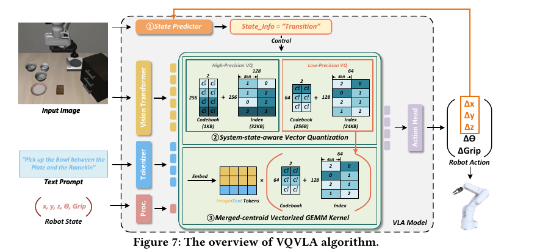
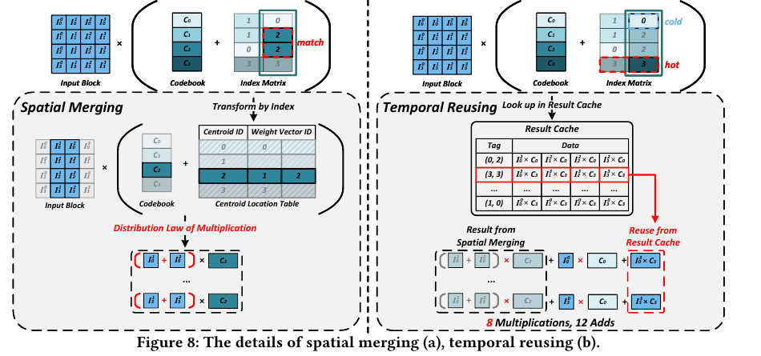

# 101. VQVLA：共享权重的数值，怎样进一步共享计算？

**A Motion-Aware Vector Quantization Framework with Centroid Reuse for Efficient VLA Inference**  
Zhuoran Song, Haozhe Jiang, Chunyu Qi, Minnan Pei, Gang Li, Xiaoyao Liang, Haibing Guan  
固定阅读版本：**arXiv:2607.24148v1，2026-07-27，14 页** · 阅读状态：`unread`  
正文讲解重写日期：**2026-10-10**。下文 p./pp. 指本地 PDF 的物理页码，第一页为 p. 1。

- [本地固定版本 PDF](paper-arxiv-v1.pdf)
- [官方 arXiv 与版本记录](https://arxiv.org/abs/2607.24148v1) · [对应版本 HTML](https://arxiv.org/html/2607.24148v1)
- [返回 VLA paper library](../README.md)

本篇 **VQVLA** 研究的是 **VLA transformer 的 weight Vector Quantization，以及怎样用专用硬件执行压缩后的权重计算**。另一篇 [060. VQ-VLA](../060-vq-vla/README.md) 研究 action tokenizer，两篇的量化对象不同。

本文 PDF 使用 MICRO 2026 模板，但其中 conference DOI、ISBN 仍是 placeholders。本阅读包以明确的 arXiv v1 为依据，不根据模板自行认定正式出版信息。

这份讲解由主 agent 直接撰写，按“问题 → 小例子 → 数学 → 完整执行流程 → 实验 → 阅读判断”展开。论文报告的结果标出原文位置；教学数字和补充推导明确标注。这里没有训练模型、运行量化 benchmark 或复现硬件。

## 1. 先用一个搬运物体的过程理解整篇论文

设机器人要把桌面上的物体放到盒子里。它会经历几个阶段：移动到物体附近、细调夹爪、抓取、搬到盒子附近、细调位置、放下。

这些阶段有两个值得利用的差别。

第一，**同样大小的模型误差，在不同阶段可能造成不同后果**。远离物体移动时，一点偏差可能仍能在下一轮修正；夹爪正要接触物体时，同样的偏差可能让抓取失败。始终使用同一套精度，未必是最好的成本分配。

第二，**VQ 会让很多不同位置的权重，变成完全相同的近似向量**。如果十个位置都引用同一个向量，还逐个进行相同类型的乘法，可能浪费了这种共享关系。

VQVLA 围绕这两点做了三个相互配合的部分：

| 部分 | 具体做什么 | 希望省下什么 |
| --- | --- | --- |
| MotionVQ | 用上一轮动作幅度判断状态，选择 high / low 两套 weight VQ 表示 | 本轮读取权重所需的数据量 |
| Merged-centroid Vectorized GEMM | 同一 centroid 对应的输入先聚合，已有的输入–centroid 乘积再复用 | 重复的乘法 |
| VQVLA accelerator | 用专门的索引处理、加法树、计算阵列和 cache 执行上述流程 | 把算法上的机会转成实际延迟与能耗收益 |

它的思路可以说成：**先让相似权重共用词典里的一个向量，再让这些共享向量所对应的计算共用结果；本轮选哪本词典，由运动状态决定。**

“选词典”和“共享计算”是两件事。没有 MotionVQ 也可以研究 centroid reuse；有 MotionVQ 也不代表普通 GPU 已经能够高效执行 reuse。

原文定位：Introduction pp. 1–2；整体结构 Fig. 1 p. 2；MotionVQ Sec. 4 pp. 4–5；计算重排 Sec. 5 p. 5。

## 2. 它到底量化了什么？与 QuaRot、SpinQuant 有何不同？

### 2.1 Weight、activation、action、index 的身份

| 名称 | 在本文中是什么 | 是否随本轮输入变化？ |
| --- | --- | --- |
| Weight | 预训练 VLA transformer 内部 Linear 等模块的参数 | 原始参数固定；运行时选择的量化表示可以切换 |
| Activation | 当前图像、语言、状态在网络中产生的中间特征 | 会变化 |
| Robot action | 模型给机器人的输出，例如 XYZ 运动与 gripper 控制 | 会变化；上一轮的 XYZ 被用作状态信号 |
| Codebook centroid | 代表一组权重数值的向量，例如两个浮点数 | 两套 weight VQ 表示离线准备 |
| Index | 指向某个 centroid 的整数编号 | 每套权重表示的 indices 预先确定 |
| Result cache | 当前计算中，activation 与 hot centroid 的乘积 | 依赖当前 activation 和 codebook 上下文 |

最需要分清：**被 VQ 压缩的是模型权重；robot action 用来选择权重精度；activation 用来与 centroid 做运算。** 不是把上一轮动作放进 codebook 里，也不是把 activation token 化后直接输出。

本文核心算法是 weight VQ 和 centroid-aware execution。不能根据“同时谈到 activation”就把它归为完整的 W4A4 activation quantization 方法。Sec. 7.2 的 4.125 / 3.125 bits 是权重表示的平均存储成本；Table 1 又列出 32-bit PEs。因此它们也不是所有乘法器都使用 INT4 / INT3 的声明。

### 2.2 接着你刚才的 QuaRot / SpinQuant 问题看

| 比较点 | QuaRot / SpinQuant | 本篇 VQVLA |
| --- | --- | --- |
| 主要表示手段 | 正交 rotation 配合低比特 scalar quantization | Weight vectors 用 codebook centroids 表示 |
| 低比特数是什么？ | 数值量化后的整数，配合 scale / zero-point | Centroid 的编号，需要查 codebook 才知道数值 |
| 主要问题 | 怎样让 weight / activation 更容易量化 | 怎样随状态选 weight 表示，并利用 centroid 重复减少计算 |
| Activation 的角色 | 本身可被低比特量化，rotation 改变其分布 | 当前计算的输入；可先聚合，或复用它与 centroid 的乘积 |
| 运行时切换 | 不以本篇的 robot-motion threshold 为核心 | 依据上一轮 XYZ 幅度切换 high / low weight set |
| 加速路径 | 低精度 Linear，加上必要的在线 transforms | 为 codebook–index 数据流设计专用 accelerator |

这是方法分类的比较，不是精度或速度排行榜。不同模型、数据、硬件和计算路径的结果不能直接比较。

阅读入口：[QuaRot](../../llm/023-quarot/README.md)、[SpinQuant](../../llm/022-spinquant/README.md)。

## 3. 为什么作者先盯住 transformer backbone？

VLA 的一轮处理可以粗略分成：文字 tokenizer、视觉编码器 ViT、融合图像与语言的 transformer backbone、生成动作的 action head。

Sec. 3.1 / Fig. 3（p. 3）在 A100 上对 OpenVLA、OpenVLA-OFT、RDT 做了时间分解，报告四部分的平均占比：

| 部分 | 作者报告的平均时间占比 |
| --- | ---: |
| Tokenizer | 2.7% |
| ViT | 16.6% |
| Transformer backbone | 80.6% |
| Action head | 0.1% |

这解释了为何作者集中优化 backbone：它既要读取很多参数，又有大量 GEMM。**这是这三个模型、这一测量设置的平均结果，不是所有 VLA 都有 80.6% 的同一瓶颈。** 尤其不能把概括性的 OpenVLA 架构描述套成 RDT、π0、GR00T 的完整内部结构。

下面是**补充教学推导**。即使 backbone 加快 2 倍，假设其余部分耗时不变，整轮加速也只有：

$$
S=\frac{1}{(1-0.806)+0.806/2}\approx1.68.
$$

即使 backbone 耗时趋近于零，这个固定分解下的上限也是：

$$
S_{\max}=\frac1{1-0.806}\approx5.15.
$$

这个例子帮助理解优化覆盖范围，**不能用来审判或重算论文的 6.5×**：后者包含另一套完整硬件执行与比较设置，未必满足“其余部分完全不变”的假设。

## 4. Weight VQ：一本向量词典怎样代替很多浮点权重？

### 4.1 先从 scalar quantization 区分

Scalar quantization 是把每个数映射到一套离散数值。例如某个整数 `3` 配合 scale 后，代表一个近似权重。

Vector Quantization 把若干数一起作为向量。假设一次表示两个权重：

$$
w_i=(w_{i,1},w_{i,2}),\qquad
C=\{c_0,c_1,\ldots,c_{K-1}\},\quad c_j\in\mathbb R^2.
$$

- $w_i$：第 $i$ 个待压缩的二维 weight vector。
- $C$：codebook，里面有 $K$ 个候选向量。
- $c_j$：第 $j$ 个 centroid。

最基本的分配方式是：

$$
z_i=\arg\min_j\|w_i-c_j\|_2^2,\qquad\widehat w_i=c_{z_i}.
$$

也就是找到最接近的 centroid，保存它的编号 $z_i$，以后用 $c_{z_i}$ 近似原向量。

编号只是地址。例如 `0` 可以表示 $(2,1)$，`1` 可以表示 $(-1,3)$。**编号从 0 变成 1，并不表示权重加了 1；编号大小也不保证 centroid 距离大小。**

### 4.2 一个可以看见误差的例子

**教学例子，不是论文真实权重。** 假设四个 weight vectors 是：

$$
w_0=(2.01,0.98),\quad w_1=(-1.02,3.03),\quad
w_2=(1.99,1.01),\quad w_3=(-0.98,2.97).
$$

使用：

$$
c_0=(2,1),\qquad c_1=(-1,3).
$$

则近似表示为：

| 原始 vector | 保存的 index | 重建 vector | 重建减原值 |
| --- | ---: | --- | --- |
| $(2.01,0.98)$ | 0 | $(2,1)$ | $(-0.01,0.02)$ |
| $(-1.02,3.03)$ | 1 | $(-1,3)$ | $(0.02,-0.03)$ |
| $(1.99,1.01)$ | 0 | $(2,1)$ | $(0.01,-0.01)$ |
| $(-0.98,2.97)$ | 1 | $(-1,3)$ | $(-0.02,0.03)$ |

原先不同的向量，近似后变成两种完全相同的向量。这同时带来：

1. **存储机会**：相同 centroid 只存一份，其余位置保存短 index。
2. **计算机会**：某些位置实际使用同一个 centroid，可以研究合并或复用运算。

这个极小例子未必压缩。若原始数与 centroid 都按 FP16 存，原来的 8 个数占 128 bits；2 个二维 centroids 占 64 bits，4 个 1-bit indices 占 4 bits，总计 68 bits。这里忽略了所有 metadata、对齐和小数组的实际存储粒度，才得到这个教学预算。

真正要计算压缩比例，必须明确词典服务多少权重；词典太大而共享范围太小，也可能比原始权重更贵。

### 4.3 Codebook 从哪里来？

Sec. 2.2（pp. 2–3）介绍使用 k-means 聚类 weight vectors。它可以用标准教学目标理解：

$$
\min_{C,\{z_i\}}\sum_i\|w_i-c_{z_i}\|_2^2.
$$

固定 centroids 时，把每个 vector 分配给最近的 centroid；固定分配时，更新 centroid 为对应 vectors 的均值，反复进行。

这里需要分清：**离线拟合 codebook，不等于运行时重新训练整个 VLA；weight reconstruction MSE 也不等于 robot task loss。** 本文固定 v1 没有充分说明完整 weight-VQ preparation 的所有超参数、恢复训练配置和成本，不据此声称“无需任何准备”或“已经使用 action-aware gradient 来训练 codebook”。

## 5. Matrix、block、weight group 和 vector 分别是哪一层？

这些名字混在一起，最容易把 VQ 存储公式和 reuse 方向看错。

统一用：

$$
X\in\mathbb R^{N\times d_{\mathrm{in}}},\quad
W\in\mathbb R^{d_{\mathrm{in}}\times d_{\mathrm{out}}},\quad
Y=XW.
$$

$N$ 是本次 Linear 处理的 activation rows，例如 tokens；$d_{\mathrm{in}}$ 是输入通道数；$d_{\mathrm{out}}$ 是输出通道数。实现中的 weight 存储可能转置，这里固定使用上述数学方向。

取一个 $m\times m$ weight block，再把每一行沿输出通道划分为长度 $v$ 的 vectors：

| 层次 | 数量 / 形状 | 怎么理解 |
| --- | --- | --- |
| Weight block | $m\times m$ | 选出的一个方形权重块 |
| Weight vector | $1\times v$ | 同一输入通道，对连续 $v$ 个输出通道的权重 |
| Weight group | $m$ 个这样的 vectors | 产生同一组 $v$ 个输出通道所需的全部权重 |
| Groups 数量 | $m/v$ | 一个 block 含多少组输出通道 |
| Index matrix | $m\times(m/v)$ | 每个 vector 用一个 index 代替 |

因此，一个 vector 不是一个 token，也不是一个 robot timestep。**Index matrix 的同一列代表同一个 output group；同一行对应同一个输入通道位置。**

本文的 $VQ[m,v,K]$ 依次表示 block 边长、vector size、centroid 数量。例如：

| 配置 | Block | 每个 vector | Codebook 大小 | 一个 index 的最低位数 |
| --- | --- | --- | ---: | ---: |
| High：VQ[256,2,256] | 256×256 | 2 个 scalar weights | 256 个 centroids | 8 bits |
| Low：VQ[128,2,64] | 128×128 | 2 个 scalar weights | 64 个 centroids | 6 bits |

注意，high / low 不只是 index 位数变了，block size 也从 256 变为 128。两套表示不应默认是“同一批 indices 丢掉最低两位”。

原文定位：Sec. 2.2 pp. 2–3；实际配置 Sec. 7.2 p. 8。

## 6. “4.125 / 3.125 bits”怎样从存储预算算出来？

### 6.1 先写一般公式：要数几份 codebook

设一个 $m\times m$ block 含 $q$ 份 codebook，每份有 $K$ 个 $v$ 维 centroids，每个 centroid scalar 用 $b_c$ bits。假设 indices 按最低位数紧凑存储，且 $v$ 整除 $m$：

$$
B_{\mathrm{indices}}=\frac{m^2}{v}\log_2K,
\qquad B_{\mathrm{codebooks}}=qKvb_c.
$$

除以 block 的 $m^2$ 个 scalar weights，得到：

$$
\boxed{
b_{\mathrm{eff}}=\frac{\log_2K}{v}+\frac{qKvb_c}{m^2}
}
$$

第一项是 index 的平均成本；第二项是所有 codebooks 的平均成本。这是**教学存储推导**，不包含 padding、metadata、scales、location tables 或 result cache。

### 6.2 如何得到论文报告的两个数？

用“一份 codebook 服务一个 block”，即 $q=1$，以及 $b_c=16$，可以复算出 Sec. 7.2 报告的数字。

High set：

$$
b_{\mathrm{high}}=\frac82+\frac{256\times2\times16}{256^2}
=4+0.125=4.125\ \text{bits/weight}.
$$

对应数据量：

- 256×256 / 2 = 32,768 个 vectors。
- 32,768 个 8-bit indices = 32 KiB。
- 256×2 个 FP16 centroid scalars = 1 KiB。
- 合计 33 KiB，分摊到 65,536 个 weights。

Low set：

$$
b_{\mathrm{low}}=\frac62+\frac{64\times2\times16}{128^2}
=3+0.125=3.125\ \text{bits/weight}.
$$

对应数据量：

- 128×128 / 2 = 8,192 个 vectors。
- 8,192 个 6-bit indices = 6 KiB。
- 64×2 个 FP16 centroid scalars = 256 B。
- 合计 6.25 KiB，分摊到 16,384 个 weights。

这里 KiB = 1024 bytes。**一个 8-bit index 代表两个 weights，所以 index 部分平均是 4 bits/weight；这不等于把一个权重存成某个 INT4 数值。**

### 6.3 原文共享范围与图中标注有需要确认的地方

Sec. 2.2 的文字写到“对每个 weight group 的 vectors 做聚类”；但 Fig. 7 展示一份 codebook，报告的 4.125 / 3.125 也可按上述 $q=1$ 复算。**单靠固定 v1，不能把 codebook 在所有 group / block 间如何共享、如何存储的细节完全确定下来。**

如果理解成每个 output group 都独立保存一份完整 codebook，则 $q=m/v$，公式会变成：

$$
b_{\mathrm{eff,group}}=\frac{\log_2K}{v}+\frac{Kb_c}{m}.
$$

同样的 high 配置会得到 20 bits/weight，low 配置得到 11 bits/weight，显然不是论文报告的预算。这不是本文另一个实验结果，而是展示：**codebook 的共享范围会改变存储结论，不能省略这个假设。**

Fig. 7（p. 6）还有 low index 的 `4bit / 24KB` 标注，与正文 64 centroids、128×64 index matrix 的配置不一致：64 个可选项需要 6 bits；按该形状紧凑存储为 6 KiB。阅读本文时保留正文报告值和以上解释；若要复现，需要向实际实现确认 packed layout，而不是替作者猜一个确定答案。

### 6.4 两套表示的总存储，与本轮读取量不同

MotionVQ 离线准备 high / low 两套表示。本轮只读一套，不等于部署只需要保存一套。

**教学预算**：若两套覆盖同一批 scalar weights，且分别满足前面的共享与紧凑存储假设，两套一起保存的平均成本约为：

$$
4.125+3.125=7.25\ \text{bits/weight}.
$$

以原 FP16 的 16 bits/weight 为参照，单套 high 的理想压缩比为 $16/4.125\approx3.88$，单套 low 为 $16/3.125=5.12$，两套一起则为 $16/7.25\approx2.21$。

这些只是覆盖权重的理想预算，不是整模型文件大小或 measured VRAM。模型中其他模块、未量化 weights、buffers、activation、cache 和 metadata 都可能另占空间。若另一套表示放在主存或外存，本轮驻留量又会不同。

## 7. MotionVQ：上一轮动作怎样决定本轮的权重表示？



原图摘自本地 PDF p. 6。图中的低精度 index 标注问题见 §6.3；读流程时重点看 state predictor、两套表示与计算路径的关系。

### 7.1 先观察，再用一个便宜的信号代替复杂判断

作者在 Fig. 4（p. 4）观察动作幅度与机器人到物体距离的关联：小幅动作更常出现在靠近物体、精细操作的阶段；大幅动作更常出现在转移阶段。

随后，Fig. 5 用 OpenVLA-OFT / LIBERO 做 noise 注入实验，在两种阶段分别加扰动。作者报告 transition state 在相同 noise 水平下更耐扰动，作为精度按阶段分配的经验支持。

这一步的逻辑是：

1. 不同阶段的容错程度可能不同。
2. 真实“是否需要高精度”的判断很复杂。
3. 动作幅度便宜、容易获得，可以作为状态 proxy。

**Proxy 是近似线索，不是敏感性的直接测量。** Noise 注入的证据也不等于证明所有 weight-VQ error 都遵循同一关系。

### 7.2 状态规则非常简单

上一轮 VLA inference 输出的 XYZ 动作用作输入：

$$
D=\sqrt{A_x^2+A_y^2+A_z^2}.
$$

$A_x,A_y,A_z$ 是上一轮输出的三个运动分量；$D$ 是它们的 Euclidean norm。给定阈值 $T_d$：

$$
\text{set}(D)=
\begin{cases}
\text{High},&D\le T_d,\\
\text{Low},&D>T_d.
\end{cases}
$$

| 状态 | 作者的典型场景 | 本轮选择 |
| --- | --- | --- |
| Execution | 接近物体、细调、抓取或放置 | VQ[256,2,256] |
| Transition | 物体间的移动、较粗的运动 | VQ[128,2,64] |

**教学例子**，假设使用同一种归一化动作单位，$T_d=0.8$：

- 上一轮 $(A_x,A_y,A_z)=(0.3,0.4,0)$，则 $D=0.5$，下一轮取 high。
- 上一轮 $(0.6,0.6,0)$，则 $D\approx0.849$，下一轮取 low。
- $D=0.8$ 时，按原规则仍取 high。

这里不能把 0.8 自动读成 0.8 米。模型若输出归一化增量、绝对坐标或另一种动作表示，需要先确认这个 norm 的物理含义与预处理。

### 7.3 运行时改的是选择，不是重新拟合 codebook

High / low 两套 codebooks 和 indices 已离线生成。Runtime 预测状态，再读取相应的一套。

所以不是每轮把原 FP16 weights 临时聚类一次，也不是动态改变 VLA 的层数或重新训练 weight。**State predictor 只是一个条件分支，昂贵的量化准备在之前完成。**

两套配置改变 $m$ 和 $K$，它们可能有不同的 block partition、centroids 和 index assignments。不能直接假设 high 的 centroid ID 7 与 low 的 ID 7 表示同一向量。

### 7.4 阈值怎样选？为什么越小通常越省？

Sec. 7.4（pp. 11–12）随机取每个 benchmark 的 10% 数据选择 threshold，在剩余 90% 数据上评价；搜索 $T_d=0.4$ 到 1.0，默认取 0.8。作者报告继续降低到 0.6 会让成功率明显下降。

因为判断条件是 $D>T_d$ 才取 low：

- 阈值降低，更多步骤满足 $D>T_d$，使用 low 的比例增加。
- 阈值升高，更多步骤使用 high，读取成本一般更大。

**补充教学预算**：若 low 的使用比例为 $p$，覆盖权重的平均读取 bits 可简化为：

$$
\bar b=(1-p)\times4.125+p\times3.125=4.125-p.
$$

例如 $p=0.6$，得到 3.525 bits/weight。它只演示切换比例如何影响读取量；真实 traffic 还要算 tiling、重复取数、metadata、cache 和其他模块，不用这个公式直接替代 Fig. 14。

另外，在这个理想预算中，全部 high 变成全部 low，读取量下降约 $(4.125-3.125)/4.125=24.2\%$。**论文相对原浮点 baseline 的 79.4% 不能全部归因于动态切换；VQ 本身的压缩也占重要部分。**

### 7.5 哪些情况会骗过这个 predictor？

以下是**阅读判断，不是作者已验证的失败统计**：

- 大动作也可能出现在障碍、快速接触或高风险操作附近。
- 小动作也可能只是等待，并不一定需要高精度。
- 上一轮仍在转移，本轮却已经进入精细接触，存在状态滞后。
- XYZ norm 没有直接描述旋转误差、夹爪控制或 task geometry。
- Action chunk 输出多步动作时，取哪一个 XYZ、如何聚合，以及第一轮没有上一轮动作时怎样初始化，需要具体实现说明。

因此更合适的理解是：**作者用轻量运动信号，把精度需求的经验差异转成了一个运行时策略。** 它没有证明“小动作一定敏感，大动作一定不敏感”。

## 8. 为什么“存得更小”不自动等于“算得更快”？

传统 weight VQ 的一种执行方式是：

1. 读取短 indices。
2. 查 codebook，得到对应的浮点 vectors。
3. 重新拼出近似 dense weight matrix $\widehat W$。
4. 用原来的 dense GEMM 计算 $X\widehat W$。

这样减少了读取原始权重的数据量，但 dense GEMM 仍按原矩阵形状工作。一个 $N\times m$ 输入乘 $m\times m$ 权重，朴素算法仍需约 $Nm^2$ 次 scalar multiplications，还增加了查表与解码。

即使采用融合查表的 kernel，也要看解码成本和真实硬件吞吐；不能只从压缩比推出加速比。

VQVLA 的新执行方式是：**保留 codebook–index 结构，利用相同 centroid 对应的运算关系，直接产生输出。**

这不等于“永远不读取浮点数”。Centroid 本身仍包含数值，必须进入运算。它省的是先完整展开 dense weights 的步骤，并尝试省掉重复乘法。

原文定位：传统路径 Sec. 2.2 p. 3；compressed-domain 计算 Sec. 5 p. 5。

## 9. Spatial merging：相同 centroid 的输入先加起来

### 9.1 先把一个 output group 的计算写出来

取一个 activation row：

$$
x=(x_0,x_1,\ldots,x_{m-1}).
$$

某个 output group 含 $v$ 个输出通道，其第 $k$ 个 weight vector 由 index $z_k$ 指向 centroid $c_{z_k}\in\mathbb R^v$。这个 group 的输出是：

$$
y=\sum_{k=0}^{m-1}x_kc_{z_k}\in\mathbb R^v.
$$

如果位置 0 和位置 2 都引用 $c_0$，就会出现：

$$
x_0c_0+x_2c_0=(x_0+x_2)c_0.
$$

这是普通的乘法分配律：**先把对应输入加起来，只乘一次 centroid。**

### 9.2 完整数值例子

**教学例子**，使用 §4 的 centroids：

$$
x=(1,2,3,4),\quad c_0=(2,1),\quad c_1=(-1,3),\quad z=[0,1,0,1].
$$

普通计算：

$$
y=1c_0+2c_1+3c_0+4c_1
=(2,1)+(-2,6)+(6,3)+(-4,12)=(2,22).
$$

4 个输入，每个乘一个二维 vector，共 **8 次 scalar multiplications**。

按 centroid 聚合输入：

$$
s_0=x_0+x_2=1+3=4,\qquad s_1=x_1+x_3=2+4=6.
$$

然后：

$$
y=s_0c_0+s_1c_1=4(2,1)+6(-1,3)=(2,22).
$$

现在是 2 个输入和，各乘一个二维 centroid，共 **4 次 scalar multiplications**。

| 操作 | 普通向量累加 | Spatial merging |
| --- | ---: | ---: |
| Scalar multiplications | 8 | 4 |
| 输入聚合 additions | 0 | 2 |
| 将乘积 vectors 相加的 additions | 6 | 2 |

表中的 additions 采用“先算乘积，再顺序相加”的教学计数，没有计入索引处理，也没有等同于真实 fused instructions 或 cycle 数。它说明省下了哪种运算；实际硬件成本还要看数据访问、并行度和流水线。

### 9.3 一般化公式：乘法量由不同 centroid 数决定

令：

$$
S_j=\{k:z_k=j\},\qquad s_j=\sum_{k\in S_j}x_k.
$$

则：

$$
\boxed{y=\sum_{j:S_j\ne\varnothing}s_jc_j}
$$

如果这一 group 的 $m$ 个 vectors 只使用 $U$ 个不同 centroids：

$$
M_{\mathrm{dense}}=mv,\qquad M_{\mathrm{merged}}=Uv,
\qquad\text{理想乘法减少比例}=1-\frac Um.
$$

例如教学配置 $m=128,v=2,U=32$：原先 256 次 scalar multiplications，聚合后 64 次，减少 75%。但这是一个假设的 index pattern，不是论文某个 workload 的 measured reduction。

$U=m$ 时没有重复，公式也没有乘法收益。**Codebook 大小 $K$ 不等于实际用到的 centroid 数 $U$，也不能直接把 $K$ 当成精确的计算量。**

### 9.4 为什么合并不再引入一份 VQ 误差？

原始 $(2.01,0.98)$ 与 $(1.99,1.01)$ 只是接近，直接当成同一个向量会引入近似。VQ 已经把它们映射成同一个 $c_0$ 后，$x_0c_0+x_2c_0=(x_0+x_2)c_0$ 在精确 arithmetic 中成立。

因此应分成两步：

- **VQ 表示**：$W\rightarrow\widehat W$，产生权重近似误差。
- **计算重排**：更省地计算 $X\widehat W$，在精确 arithmetic 下保持同一量化模型的输出。

实际浮点或有限位宽加法改变求和顺序，还可能有 rounding 或 overflow 等实现影响，不能进一步写成所有硬件上 bitwise identical。

### 9.5 Centroid location table 是什么？

普通 index 列按 weight positions 排列：`[0,1,0,1]`。算法要把它组织成：

| Centroid ID | Weight-vector IDs / 输入通道位置 | Count |
| --- | --- | ---: |
| 0 | 0、2 | 2 |
| 1 | 1、3 | 2 |

这样硬件才知道去加 $x_0+x_2$ 和 $x_1+x_3$。这张表相当于把“每个位置使用哪个 centroid”反过来，变成“每个 centroid 服务哪些位置”。

构建表需要扫描 indices、比较和写入位置，读取 activations 也可能不连续。因此，分配律本身很简单，**高效组织数据是硬件设计要解决的问题**。

原文定位：Sec. 5.1 / Eq. (1) p. 5；IPU 如何生成表见 Sec. 6.3 pp. 7–8。

## 10. Temporal reusing：跨输出组复用已经算好的乘积



原图摘自本地 PDF p. 6；算法文字在 Sec. 5 p. 5。先读左边“相同 centroid 的 inputs 相加”，再读右边“已有乘积从 result cache 取出”。

### 10.1 Spatial 和 temporal 指的是矩阵里的两个方向

设一个 block 的 index matrix 为 $Z$，$Z_{k,j}$ 表示输入通道位置 $k$、output group $j$ 使用哪个 centroid。

| 机制 | 哪些位置重复？ | 省乘法的方式 |
| --- | --- | --- |
| Spatial merging | 固定 $j$，不同 $k$ 使用相同 centroid | 不同 inputs 先加起来，再乘 centroid |
| Temporal reusing | 按顺序处理不同 $j$，相同 $k$ 又使用同一个 centroid | 当前 input 与该 centroid 的乘积已经存在，直接复用 |

**本文 temporal 指计算先后，不能直接理解成机器人前后两轮控制。** 一轮 GEMM 内跨 output groups 的共享，和跨 observation / robot timesteps 的复用，是不同的问题。

### 10.2 一组能核算 cache hit 的数字

**教学例子**，假设两个 output groups 明确共享同一份 codebook：

$$
x=(3,4),\quad c_0=(2,1),\quad c_1=(-1,3),\quad c_2=(0.5,-2).
$$

第一个 group 的 indices 是 `[0,1]`：

$$
y_0=3c_0+4c_1=(6,3)+(-4,12)=(2,15).
$$

第二个 group 的 indices 是 `[0,2]`：

$$
y_1=3c_0+4c_2=(6,3)+(2,-8)=(8,-5).
$$

$3c_0=(6,3)$ 出现两次。若已经缓存这份乘积，计算第二个 group 时只需新算 $4c_2$，再把缓存结果加上去。

两个 groups 原先合计 8 次 scalar multiplications；复用后 6 次。这个计数只展示一次已有乘积的节省，未计算 cache 初始化、查询、写入和其他 overhead。

实际 VQVLA 可以根据离线识别的 hot centroids，在处理当前 input block 时预先计算并填入 result cache。**预计算不是免费计算**：只有后续足够多的 hits，才能摊薄预计算与保存成本。

### 10.3 为什么只比 centroid ID 不够？

同一个 $c_0=(2,1)$：

$$
3c_0=(6,3),\qquad4c_0=(8,4).
$$

Centroid 相同，input 不同，乘积就不同。另一本 codebook 中编号也叫 `0`，数值还可能完全不同。

因此复用必须保证：

1. Centroid 的实际数值相同，属于正确的 codebook / precision set。
2. 对应 input position 相同。
3. Activation 属于同一份有效输入上下文。
4. 缓存里的结果类型和维度符合当前运算。

Sec. 5.2 给出的 tag 是 **centroid ID + weight vector ID**，其中 weight vector ID 对应输入位置 $k$；Fig. 8 的 data 可以一次保存当前 input block 多行与该 centroid 的乘积。

上面的正确性条件不等于论文 tag 明确含有所有字段。实现可以用 cache 的作用域、重新初始化或其他控制保证上下文一致；固定 v1 没有把所有生命周期细节完整展开。**更换输入、codebook、block 上下文时，不能只因整数编号相同就保留旧结果。**

### 10.4 聚合输入的乘积，不能随意当成单个输入的乘积

Spatial merging 可能得到：

$$
(x_0+x_2)c_0.
$$

另一个 group 若只需要 $x_0c_0$，不能直接取这份聚合结果。它多了一项 $x_2c_0$。

因此，要区分缓存的是某个 input position 的 product，还是一组 inputs 的 aggregated product。本文 temporal cache 描述的是前者的可识别乘积；不能把“任何算过的 centroid 结果”都视为可用 hit。

### 10.5 Hot centroid 为什么离线选择？

作者先分析压缩 weight matrices 中各 indices 的 occurrence frequency，再离线做 Top-k，找出更常被引用的 hot centroids。这利用的是已经确定的权重表示，不需要当前图像才能知道某个 index 在 weights 里出现多少次。

它与 MotionVQ threshold calibration 是两套信息：

| 准备工作 | 主要使用什么？ |
| --- | --- |
| 拟合 codebook / 分配 indices | Weight vectors |
| 识别 hot centroids | 压缩权重的 index frequency |
| 选择 motion threshold | Benchmark calibration data 与任务表现 |
| 填 result cache | 当前 activations 与选中的 centroids |

存储所有 activation–centroid combinations 可能浪费容量，尤其是很少访问的 cold codes。Hot-code 策略试图只为更有希望被复用的结果付出这笔成本。

## 11. 两种 reuse 怎样一起工作？

理论上它们处理两类冗余：同一 output group 内的重复，以及不同 output groups 之间的重复。但不能把两个“减少百分比”直接相加。

Sec. 6.3（pp. 7–8）描述 IPU 先生成 centroid–weight-vector relationship table，并记录每个 centroid 的 count：

- $\mathrm{Cnt}>1$：该 group 内有多个 weight vectors 引用同一 centroid，送到 spatial 路径。
- $\mathrm{Cnt}=1$：没有该 group 内的聚合机会，送到 temporal 路径，检查是否可复用已有乘积。

这是一种分工：**重复项先聚合，其他项再检查乘积 cache**。两条路径的 partial results 最后累加为输出。

在理想数学模型中，它们都试图得到同一个 $X\widehat W$；改变的是执行方式。若统计 saved multiplications，需要避免把同一份消除的工作在两个机制里重复计算。

还有一个与 §6.3 对应的条件：跨 output groups 复用要求真实 centroid 相同。如果每个 group 有独立 codebook，只比较相同 ID 不足以成立；需要共享 codebook、相同数值或明确的映射。Fig. 8 以共享 codebook 示意，固定 v1 的完整共享布局仍应在实现时确认。

## 12. 为什么普通 GPU 可能把这件事做慢？

GPU 擅长规则、大批量、连续的数据运算。Dense GEMM 能把很多乘加打包到高度优化的路径，充分使用 Tensor Cores。

Centroid-aware execution 则需要额外工作：

- 扫描 index matrix，并按重复关系组织位置。
- Gather 分散的 activations，先聚合输入。
- 查询 result cache，区分 hit / miss。
- 为少量不规则运算调度不同路径。
- 运行 state prediction、weight loading、merging、reuse 等 kernels。

乘法少了，**有效硬件利用率也可能下降**；额外的访问和调度时间可能超过省掉乘法的收益。

下面是**教学时间模型，不是论文拟合**：

$$
T_{\mathrm{reuse}}\approx
T_{\mathrm{index}}+T_{\mathrm{gather}}+T_{\mathrm{aggregation}}
+T_{\mathrm{cache}}+T_{\mathrm{remaining\ math}}+T_{\mathrm{launch}}.
$$

Dense GEMM 与此处的计算吞吐不同，不能只把其乘法时间乘上“剩余乘法比例”。此外，硬件流水线可以重叠部分工作，所以这个加法模型只是帮助识别成本，不是精确的 critical-path 公式。

Sec. 7.3（p. 10）实际报告 **GPU-VQVLA 相对 GPU-A100 有 45.2% performance loss**。作者归因于不规则索引处理，以及分解后的多个 kernels 难以有效重叠。

这一结果非常关键：**VQVLA 的算法搬到 GPU，并没有自动得到 headline speedup。** 原文使用 performance loss 的表述，这里不未经定义把它换成“latency 增加 45.2%”。

## 13. 专用 accelerator 怎样补上数据组织的成本？

### 13.1 各模块用一句人话解释

Sec. 6（pp. 5–8）的架构围绕前面的流程安排硬件：

| 模块 | 它接收什么、做什么？ | 为什么需要它？ |
| --- | --- | --- |
| State Predictor | 读取上一轮 XYZ，计算幅度并比较 threshold | 选择本轮 weight set |
| Codebook / Index Buffers | 保存所选 centroids 与 indices | 提供压缩权重表示 |
| Index Processing Units（IPUs） | 把 indices 转为 centroid location tables | 让计算阵列知道该聚合或复用哪些 inputs |
| Adder Tree | 并行加多个指向相同 centroid 的 inputs | 执行 spatial merging 的输入聚合 |
| Spatial Merging PE Array | 聚合后的输入与 centroid 相乘 | 避免同一组内重复乘法 |
| Cache Initialization Unit | 为当前 input block 的 hot centroids 准备乘积 | 建立 temporal reuse 的候选结果 |
| Result Cache / Hit-Miss Buffers | 查找已有乘积，组织复用与补算 | 减少跨组重复运算 |
| Temporal Reusing PE Array | Hit 走累加；miss 计算新乘积再累加 | 完成剩余输出项 |
| Accumulation Unit | 汇合各路径与各块的 partial results | 得到完整输出 |

PE 是 Processing Element，可以理解为计算阵列里的一个小运算单元；它不是一整个 transformer layer。

这些模块使用独立硬件资源，作者可以把取数、索引准备和计算做成流水线，减轻 GPU 多个分散 kernels 的组织问题。

### 13.2 为什么加法树不是越宽越好？

不同 centroids 的重复次数不同：有的只出现 2 次，有的出现 15 次。若硬件永远按 16 个输入配满，大部分时候会有很多空位。

作者采用三阶段加法树，并把位置分成合适大小的 sets。比如某 centroid 对应 15 个 inputs，可拆成 8 个和 7 个，后者补齐到 8 lanes；部分和再累加。同一固定树还支持较小的 4-input、2-input reductions。

它体现的是：**让不规则重复次数适应固定硬件，兼顾并行度与利用率**。算法上写一个求和符号，硬件上却必须决定一次能接收多少数、怎样分批、怎样填空位。

原文定位：Sec. 6.2.1 p. 7；Fig. 11 p. 8；stage 数量探索 Fig. 20 p. 12。

### 13.3 Cache 和 index processing 都占资源

Table 1（p. 11）报告部分配置：

| 项目 | 配置 | 报告的面积 | 报告的功耗 |
| --- | --- | ---: | ---: |
| Index Processing Engine | 7 MB SRAM 等 | 27.93 mm² | 9.00 W |
| Result Cache | 1.5 MB SRAM | 15.93 mm² | 7.97 W |
| Spatial PE Array | 24×256，32-bit PEs | 2.44 mm² | 0.69 W |
| Temporal PE Array | 24×256，32-bit PEs | 1.76 mm² | 0.50 W |
| 全架构 | 包含表中其他单元 | 51.15 mm² | 19.28 W |

按表中数字做**补充计算**，index engine 与 result cache 合计占约 85.7% 的总面积、88.0% 的总功耗。这个比例不是额外测量，而是说明：**为了省运算，数据组织与缓存本身可能成为主要硬件成本。**

这些面积、功耗来自综合和工艺缩放估计，不能写成实物芯片测得；具体方法见 §17。

## 14. 从离线准备到输出动作，把完整过程串起来

### 14.1 离线准备

1. 选定要压缩的 transformer weights，并划分 blocks / vectors。
2. 准备 high / low 两套 codebooks 与 indices。
3. 分析 index frequency，识别 hot centroids。
4. 用 calibration data 选择 motion threshold。
5. 为硬件配置 cache、加法树、两类 PE 的资源分配。

上述步骤没有相同的数据来源与成本。把 runtime state predictor 写成一个简单公式，不代表整个 preparation 也是无数据、零成本。

### 14.2 一轮 VLA inference

1. 输入新图像、语言、机器人状态，产生模型需要的 features。
2. State predictor 根据上一轮动作信号选择 high / low。
3. 读取对应 codebooks 和 index matrix。
4. IPUs 构建 location tables，安排 spatial / temporal 路径。
5. 对当前 activations：重复项先聚合，hot 乘积准备到 cache。
6. Spatial / temporal arrays 计算并复用，汇合 partial results。
7. 后续模块按原模型动作接口输出 action 或 action chunk。
8. 执行动作，下一轮再根据新的观察与动作信号继续。

这不是把旧 action 当成新 action，也不是缓存整轮模型输出。**动态精度影响本轮的近似模型，centroid reuse 改变这个近似模型的执行路径。**

## 15. 实验设置：先确认模型、任务、precision 与分母

### 15.1 五个模型，各有四个 model–suite 条件

Sec. 7.1（p. 8）使用五种 VLA models：

| 模型 | Benchmark | 四个 suite / task entries | Action chunk length |
| --- | --- | --- | ---: |
| OpenVLA | LIBERO | Spatial、Object、Goal、10 | 该段未另列多步 chunk length |
| OpenVLA-OFT | LIBERO | Spatial、Object、Goal、10 | 8 |
| RDT | ManiSkill | PickCube、PushCube、PegInsertionSide、StackCube | 8 |
| π0 | LIBERO | Spatial、Object、Goal、10 | 5 |
| GR00T | LIBERO | Spatial、Object、Goal、10 | 16 |

这合计是 20 个 model–suite entries，**不是只有 20 个 episodes，也不是 20 个真实机器人实验**。LIBERO 的一个 suite 又可以包含多项任务。

作者保留各模型的 action chunking 设置，因此不同模型“一次 inference”对应的动作数量不同。比较 invocation latency 和 amortized per-action latency 时，要保留这个区别。

### 15.2 GPU baseline 的 precision 不完全相同

Sec. 7.3（p. 9）报告：

| 模型 | GPU default precision |
| --- | --- |
| OpenVLA | FP16 |
| OpenVLA-OFT | FP32 |
| RDT、π0、GR00T | BF16 |

作者启用 Tensor Core 与 FlashAttention 2。压缩比需要相对于各自 baseline 算，不能把总体 79.4% 解释成所有模型从同一 FP32 格式转换成统一 INT4。

### 15.3 两种 calibration 不要混成同一套

Codebook preparation 用到 weights；threshold exploration 用 benchmark data。Sec. 7.4 说明后者是 10% calibration / 90% unseen evaluation，但没有把 data unit、绝对数量、全部 trials 与 random seeds 充分列明。

固定 v1 也没有提供完整的 checkpoint、所有量化超参数、各 model–suite rollout 分母和置信区间。读图可以理解作者结论；要严格复现，还需要补齐这些信息。

不要拿另一篇 LIBERO 实验的“500 episodes”来替这篇补分母，也不要把 threshold 的 10% 数据比例当成 weight VQ 的完整训练预算。

## 16. Algorithm 结果：哪些量确实变少了？

### 16.1 Fig. 14 报告的是三种不同指标

Sec. 7.2 / Fig. 14（pp. 8–9）的总体描述：

| 指标 | 作者报告 | 可以支持什么？ |
| --- | --- | --- |
| Task success rate | 平均下降约 2.5% | 任务表现存在代价，并非完全无损 |
| Memory consumption for retrieving weights | 平均减少 79.4% | 权重读取相关数据量明显减少 |
| Multiplications | 平均减少 54.8% | Centroid-aware 计算减少了乘法数量 |

原文对 2.5% 没有充分区分相对百分比与 percentage points，也未把所有 aggregation weighting 和区间说明完整。这里保留原文口径，不自行换算成“下降 2.5 个百分点”，更不据此声称统计等价。

**教学区分**：若成功率从 80% 变成 78%，下降是 2 percentage points；相对下降是 $(80-78)/80=2.5\%$。这只是解释单位，不是论文原始成功率。

作者还举出 multiplication reduction 的 workload 差异：OpenVLA / LIBERO-Object 为 71.4%，RDT / ManiSkill-StackCube 为 52.2%。这符合前面的机制：收益依赖 centroid repetition 与运行状态，不是统一常数。

### 16.2 Weight traffic reduction 不是 total VRAM reduction

完整内存需求可以概念性写为：

$$
M_{\mathrm{total}}=
M_{\mathrm{weights}}+M_{\mathrm{activations}}+M_{\mathrm{KV}}
+M_{\mathrm{workspace}}+M_{\mathrm{metadata/cache}}+\cdots
$$

这只是分类示意，不表示论文测了这些项。VQVLA 的 79.4% 对应权重获取相关 memory consumption，不能自动覆盖 activation、KV、codebook metadata 和 result cache。

模型文件大小、驻留 VRAM、每轮从外存读多少 bytes，是三个不同指标。尤其 MotionVQ 保存两套 weight 表示，却在本轮选读一套，更需要分开统计。

### 16.3 乘法数量少，不等于全部 operations 少同样比例

54.8% 的对象是 multiplications。新的 input aggregation、index comparisons、cache accesses、miss handling 和数据搬运都可能增加别的操作。

它支持 centroid reuse 的机制有效，但不直接证明 latency 减少 54.8%、能耗减少 54.8%，或所有算术指令总量减少 54.8%。实际收益需要后面的 architecture evaluation。

### 16.4 另一个“低于 1.8%”来自不同范围

Sec. 7.4（pp. 11–12）在选定 threshold 后，报告 remaining unseen test data 的 success-rate degradation 低于 1.8%。该 design exploration 使用 OpenVLA、OpenVLA-OFT、RDT 三种模型。

它与 Fig. 14 的五模型总体描述不是同一口径，不能拿 1.8% 替掉前面的 2.5%，也不能声称两项来自同一个完整 paired run。

## 17. Architecture 结果：6.5× 加速究竟怎样得到？

### 17.1 先看证据类型，再看数值

Sec. 7.3（p. 9）的评估方法：

| 对象 | 作者采用的评估方式 |
| --- | --- |
| GPU baseline | 运行相应模型及 GPU implementations，使用各模型 default precision |
| VQVLA accelerator latency | 自建 cycle-level simulator，统计计算和 buffer accesses |
| Off-chip memory timing | 集成 Ramulator，参考 Scale-Sim 方法 |
| Accelerator area / power | Verilog 实现，经 Synopsys Design Compiler 综合 |
| 工艺设置 | 28 nm，500 MHz；area / power 按引用方法 scale 到 7 nm |
| External memory | 为对齐 A100，使用 80 GB HBM2e、1935 GB/s peak bandwidth |
| Off-chip access energy | 按 3.9 pJ/bit 估计 |
| Dadu-Corki / LUT-DLA | 在同一 cycle simulator 中重新实现 |
| CodeGEMM / ShiftAddLLM | 使用官方开源 implementations 评价 |

所以这一组结果的正确身份是：**GPU baseline + simulated accelerator latency + synthesized / scaled area-power estimates**。

它不是已制造芯片的实测，也不是一份现成 A100 VQVLA kernel 的 6.5× 实测。论文中“real speedup”的措辞不能抹掉其 simulator 方法。

### 17.2 不同 speedup 的分母是什么？

| 比较 | 作者报告 | 范围 / 位置 |
| --- | ---: | --- |
| VQVLA architecture vs GPU-A100 | 平均 6.5× | VLA inference，Fig. 15 / Sec. 7.3，pp. 9–10 |
| vs LUT-DLA | 1.9× | 同上 |
| vs CodeGEMM | 3.3× | 同上 |
| vs ShiftAddLLM | 4.3× | 同上 |
| vs Dadu-Corki | 2.8× | 系统 per-action latency，Fig. 18 p. 10 |
| VQVLA-Corki vs Dadu-Corki alone | 6.0× | 组合方案，Fig. 18 p. 10 |

不能把 6.5× 与 2.8× 相乘：它们使用不同 baseline 与 latency 范围。组合的 6.0× 也应引用实际报告，而不是用其他 speedups 拼出来。

**Speedup 的教学定义**是 $S=T_{\mathrm{baseline}}/T_{\mathrm{new}}$。例如从 650 ms 降到 100 ms 是 6.5×；这些示例时间不是 Fig. 15 的原始读数。

### 17.3 最有助于理解硬件必要性的对照

Fig. 15 同时包含：

- GPU-A100：GPU 上的原模型路径。
- GPU-VQVLA：GPU 上实现 VQVLA algorithm。
- VQVLA：本文专用 accelerator 的模拟结果。

第二项并没有拿到第三项的加速，反而报告 45.2% performance loss。这帮助把两件事拆开：

1. VQ / reuse 创造了压缩和运算机会。
2. 专用架构让这些机会在其评估设置中转化成速度。

因此，若目标是现有 Fast-WAM GPU deployment，不能把 6.5× 当成算法移植后的预期收益。

### 17.4 Energy efficiency 与 power 也不同

作者在 Fig. 17 / Sec. 7.3（p. 10）报告 energy efficiency 相对 GPU 为 75.5×，VQVLA power 为 A100 的 6.4%；Table 1 给出全架构 19.28 W。

**教学关系**：能耗近似 $E=\bar P T$，其中 $\bar P$ 是运行期间平均功率，$T$ 是持续时间。低功率与短时间都可降低能耗；单个时刻的 power 不等于一次 inference 的 energy。

这些数字继承综合、缩放、off-chip energy 和 simulator 假设。不同 workloads 的平均倍率也不能任意相乘，重建一个原文没有报告的总体倍率。

### 17.5 “30–60 ms per action”不是每 30–60 ms 看一次新图

Fig. 18 的定义可写为：

$$
L_{\mathrm{per\ action}}=
\frac{L_{\mathrm{VLA\ inference}}+L_{\mathrm{robot\ control}}+L_{\mathrm{communication}}}
{H},
$$

$H$ 是 action chunk length。因此 30–60 ms 是 effective / amortized per-action latency。

**教学例子**：一次 inference、控制与通信合计 400 ms，预测 8 个动作，摊销后是 50 ms/action。这个数字不表示系统每隔 50 ms 都重新拍摄图像并进行一轮全新的 400 ms 决策。

需要分别理解：

- **Invocation latency**：本轮输入到得到本轮预测，需要多久。
- **Amortized per-action latency**：一次预测多个动作，把整体成本除以动作数量。
- **Fresh-observation decision frequency**：多久根据新观察重新决策。

它们影响机器人不同方面的响应能力，不能混用。

## 18. 消融和设计探索分别回答了什么？

### 18.1 Fig. 19：各部分有没有可观察的贡献？

Fig. 19（p. 11）在 OpenVLA-OFT 上与排除优化的 VQVLA-plain 比较，分别讨论：

| 部分 | 作者报告的相关 latency 改善 | 可以怎样理解？ |
| --- | ---: | --- |
| 动态取用 high / low weight sets | Memory access latency 约 3.8× reduction | Weight representation 与选择减少外存读取成本 |
| Spatial merging | 对应部分约 1.5× reduction | 聚合减少重复乘法 |
| Temporal reusing | 对应部分约 1.6× reduction | Cache 减少跨组重复运算 |

这些是组成部分的耗时对比，不是三个互不影响、可机械相乘的端到端 speedups；也不能把 memory 分项的 3.8× 全部归于 threshold 分支，而忽略 VQ 表示本身。

### 18.2 Fig. 20：缓存更大，收益为什么会饱和？

作者把 result cache 从 384 KB 探索到 3 MB。部分 workloads 在 1.5 MB 已接近 reuse 饱和；增至 3 MB 没有额外收益，因此默认采用 1.5 MB。

直觉是：若当前输入与 hot centroids 所需的可复用结果已经装下，更大的 cache 不会凭空制造更多重复。它仍要付面积、功耗等成本。

这支持该 workload 下的折中，不证明所有模型、sequence lengths 和 repetition patterns 都以 1.5 MB 为最佳。

### 18.3 加法树与 PE ratio：还要考虑资源利用率

作者比较加法树 1–4 stages，选择 3 stages；比较 spatial-to-temporal PE ratio 1:1、1:2、2:1，选择 1:1。Fig. 16 报告 VQVLA-1:1 的 PE utilization 为 90.6%，LUT-DLA 为 73.3%。

用更大的聚合能力处理很少的重复，会浪费 lanes；把资源过多地放在一种 reuse 路径，也可能让另一条路径排队。本文采用的配置是在其 benchmark 和预算下得到的折中。

固定 v1 的 Sec. 7.4 有一句对 spatial / temporal ratio 方向的解释，与 Sec. 5 的 within-column / across-column 定义不完全对齐。理解机制时以前面明确的操作为准：spatial 做组内输入聚合，temporal 做跨组乘积复用；不要据这一句话推导确定的调度实现。

### 18.4 Threshold 的质量–成本折中

更小的 $T_d$ 让更多步骤用 low，读取更少，但可能损害任务表现。Fig. 21 支持 threshold 需要通过任务数据选择；不是越省越好，也不是一个普遍的 0.8 常数。

Design exploration 只使用三种模型，与五模型主 workload 范围不同。比较时保留这个范围。

## 19. 用数学看：权重误差、计算复用与动作风险是三层问题

本节是**补充推导与阅读判断，不是本文已经证明的理论**。

### 19.1 VQ 先改变了模型的权重

对一个 Linear：

$$
Y=XW,\qquad\widehat Y=X\widehat W,\qquad E_W=\widehat W-W.
$$

于是：

$$
\Delta Y=\widehat Y-Y=XE_W,
\qquad\|\Delta Y\|_F\le\|X\|_2\|E_W\|_F.
$$

$E_W$ 是 weight approximation error，$\Delta Y$ 是 layer output error。即使 $E_W$ 固定，不同 activations $X$ 也会放大、抵消或改变输出误差。

继续使用 §4 和 §9 的**教学例子**。原始 weight vectors 乘 $x=(1,2,3,4)$ 得到：

$$
y_{\mathrm{original}}=(2.02,21.95).
$$

VQ 后得到：

$$
y_{\mathrm{VQ}}=(2,22),\qquad
\Delta y=(-0.02,0.05).
$$

Spatial merging 得到的也是 $(2,22)$。**它保持的是量化后的计算，不能把 VQ 已经产生的 $(-0.02,0.05)$ 误差消掉。**

Temporal reuse 同理：它减少重复工作，不能自动恢复原始权重。

### 19.2 动作误差还取决于后续网络

设后续动作映射为 $a=g(Y)$，在足够小的扰动附近，教学上的局部近似是：

$$
\Delta a\approx J_g(Y)\Delta Y=J_g(Y)XE_W.
$$

$J_g(Y)$ 是后续网络对 $Y$ 的 Jacobian。它说明小 weight MSE 不自动意味着小 action error；输入状态与后续网络敏感性都重要。

实际成功率还取决于环境：动作误差 1 mm，在开阔区域和插入细孔时可能产生不同后果。上式也不构成闭环成功率保证，尤其跨很多控制步骤后，模型会收到量化动作改变后的新观察。

### 19.3 MotionVQ 用的是风险 proxy，没有直接优化上述 Jacobian

MotionVQ 根据上一轮 action magnitude 选择两套表示。它没有在每轮显式计算 $J_g$，也没有直接判断 contact state、碰撞距离或未来 task cost。

所以它提供的是 **state-dependent precision 的经验实现**。不能根据名字就断言 codebook 是通过 robot task loss 或 action-error gradient 学出来的。

### 19.4 Codebook 大小带来三个方向的取舍

通常更大的 $K$ 意味着更多候选 centroids，表示能力更强，但：

- Index 需要更多 bits，codebook 本身也变大。
- 在同一组固定 positions 内，可能出现更多不同 centroids，重复机会减少。
- Result cache 与索引组织可能面临不同的工作量。

较小 $K$ 有机会改善压缩与重复度，却可能增大量化误差。这个方向不是每个 workload 的严格单调定理；本文 high / low 还改变 block size，不能把所有差别视为仅由 $K$ 引起。

因此完整目标需要同时看 **任务质量、表示存储、执行成本**，不能只优化一个 reconstruction MSE 或一个 multiplication count。

## 20. 对 FYP 哪些是可用的机制线索？哪些仍需证明？

### 20.1 比较具体的两条线索

第一条是**按状态分配精度**。在你关注的 action-dependent dynamics / VLA quantization 中，可以先问：某个运行状态是否确实对应更高的误差放大或更严格的动作容错，再选择状态信号。MotionVQ 给出一个便宜的例子，但不是已经验证适用于 Fast-WAM 的规则。

第二条是**压缩格式与计算路径一起设计**。VQ 不一定只是磁盘压缩；如果有稳定重复的 centroid pattern，计算可以利用这一关系。前提是实际硬件能够处理索引、聚合、查询，并保留足够的吞吐。

### 20.2 可以从一个有边界的假设开始

**补充研究判断**：与其先尝试很多精度组合，可以先检查一个具体假设，例如：

> 在固定模型、固定输入下，某个可观测状态量是否能预测量化造成的 action error；这种关系是否仍出现在闭环进入精细操作阶段时？

这不是本次已经开展的实验。固定输入上的相关性只支持对应 error 指标；后续闭环成功率、packed memory 和 native latency 还要分别评价。

若进一步研究 centroid reuse，应先区分：

| 要验证的内容 | 相应证据 |
| --- | --- |
| VQ 表示是否保留模型行为 | 固定输入输出误差，随后闭环 task results |
| 重复度是否足够高 | 实际 indices 的 distinct-centroid / hot-code 分布 |
| 理论上省了什么 | Multiplications、additions、访问与 metadata 预算 |
| 真实 GPU 是否更快 | Native execution，包含索引、解码、聚合和 launch 开销 |
| 系统是否更有用 | 相同 action interface 下的端到端延迟与闭环表现 |

Fake VQ、dense dequantize 后的 GEMM、native compressed-domain kernel 和 simulated accelerator 是不同证据阶段，不应互相替代。

### 20.3 这篇没有直接覆盖什么？

固定 v1 没有直接证明 Fast-WAM 的 action-conditioned world-model / diffusion components 能以同一 codebook、threshold 和 dataflow 获得收益；也没有直接提供你的现有 GPU 上的加速保证。

它最有价值的贡献是把三件事连起来：**运行状态的精度需求、共享权重表示的计算机会、实现这种机会的硬件成本。** 阅读时把这三层分别写清楚，就能判断哪些值得借鉴。

## 21. 分时阅读路线：先把方法走通，再读系统结果

| 时间 | 建议顺序 | 读完应能独立说明什么 |
| --- | --- | --- |
| 20–30 分钟 | README §§1–2、4、7、9–10 → PDF Fig. 7–8 p. 6 → Fig. 14 p. 9 → GPU-VQVLA 段 p. 10 | 量化对象；为什么省乘法；temporal 的时间轴；为什么 GPU 未必变快 |
| 60–90 分钟 | README §§5–6、8–14 → PDF Sec. 2.2 pp. 2–3、Secs. 4–5 pp. 4–5、Sec. 6 pp. 5–8 | Matrix / block / vector 的形状；完整 bits 计算；cache hit 的正确性条件；各硬件模块的用途 |
| 2–3 小时 | README §§15–20 → PDF Sec. 7 pp. 8–12 → 完成 Questions 和 Meeting Card | 质量、存储、乘法和延迟的区别；simulator / synthesis 范围；FYP 中可迁移的假设与待验证内容 |

建议第一个阅读产物是：用自己的数值重算一次 spatial merging 和 temporal hit，而不是先背 6.5×。

| 想查的内容 | 本地 PDF 物理页位置 |
| --- | --- |
| 全文问题与三层贡献 | Abstract / Introduction pp. 1–2；Fig. 1 p. 2 |
| VLA 结构与 weight VQ 的分组 | Secs. 2.1–2.2 pp. 2–3；Fig. 2 p. 3 |
| Backbone bottleneck | Sec. 3.1 / Fig. 3 p. 3 |
| Motion 与距离的关联 | Sec. 3.2 / Fig. 4 p. 4 |
| 状态 noise tolerance | Fig. 5 p. 4 |
| Hot / cold centroid frequency | Fig. 6 p. 4 |
| Predictor、threshold 与两套 precision | Sec. 4 pp. 4–5；Fig. 7 p. 6 |
| Spatial merging 公式与位置表 | Sec. 5.1 / Eq. (1) p. 5；Fig. 8 p. 6 |
| Temporal cache tags 与复用 | Sec. 5.2 p. 5；Fig. 8 p. 6 |
| Accelerator 总体结构 | Sec. 6.1 pp. 5–6；Fig. 9 p. 6 |
| PE arrays 与加法树 | Sec. 6.2 p. 7；Figs. 10–12 pp. 7–8 |
| State predictor 与 IPU | Sec. 6.3 pp. 7–8；Fig. 13 p. 8 |
| Models、suites、chunks 与 VQ 配置 | Secs. 7.1–7.2 p. 8 |
| Success / traffic / multiplication | Fig. 14 / Sec. 7.2 pp. 8–9 |
| Simulator、synthesis 与 baselines | Sec. 7.3 p. 9 |
| Speed、GPU-VQVLA、energy、per-action latency | Figs. 15–18 / Sec. 7.3 p. 10 |
| Area / power 与组成部分比较 | Table 1 / Fig. 19 p. 11 |
| Cache、adder-tree、PE ratio 探索 | Sec. 7.4 pp. 11–12；Figs. 16、20 pp. 10、12 |
| Threshold data split 与 unseen 结果 | Sec. 7.4 pp. 11–12；Fig. 21 p. 12 |
| Conclusion | Sec. 9 pp. 12–13 |

References 在 pp. 13–14；本地固定 v1 没有额外 experimental appendix。

## 22. Reading Questions（留给你独立回答）

1. 本文量化的是 weight、activation 还是 action？上一轮 action 在算法中扮演什么角色？
2. 一个 index 为什么不是某个 INT4 / INT3 权重值？它需要配合什么才有数值意义？
3. 用自己的例子解释 matrix、block、weight group、weight vector 和 index matrix 的形状。
4. 为什么存储预算必须说明 codebook 的共享范围？写出含 $q$ 份 codebooks 的 bits/weight 公式。
5. 重算 VQ[256,2,256] 的 indices、codebook bytes 和平均 bits，再指出这些计算的假设。
6. 两套表示一起保存时，为什么不能继续只报告当前使用的一套 bits？
7. MotionVQ 的 high / low 是如何决定的？降低 threshold 会把更多步骤分到哪边？
8. 上一轮 XYZ norm 怎样可能错过本轮的精细接触？Action chunk 和第一轮初始化还有哪些实现问题？
9. 为什么 noise-tolerance 实验只给 motion proxy 提供经验支持，而不是普遍的量化敏感性定理？
10. 自己构造一个 spatial merging 例子，分别计算乘法、输入聚合加法与最终累加。
11. 在一个 output group 中，$K$、$U$、$m$ 分别是什么？哪个直接决定理想聚合后的乘法数？
12. Temporal reuse 的 tag 为什么不能只有 centroid ID？哪些上下文必须一致？
13. 为什么 $(x_0+x_2)c_j$ 不能当成 $x_0c_j$ 的 cache hit？
14. 若不同 output groups 有独立 codebooks，跨组 reuse 还需要什么条件？
15. Hot centroid 的 offline selection 与 threshold calibration 分别使用什么数据？
16. 54.8% fewer multiplications 为什么可以同时伴随 GPU-VQVLA 性能下降？
17. 79.4% 的指标能否代表模型文件、total VRAM 和端到端延迟都下降同样比例？
18. Fig. 14 的 2.5% 与 threshold exploration 的 below 1.8%，在范围和单位上需要怎样区分？
19. 6.5×、2.8×、6.0× 各自的 baseline 与 latency 范围是什么？
20. 为什么 50 ms/action 的摊销成本不等于每 50 ms 基于新图像重新决策？
21. 51.15 mm² / 19.28 W 与 75.5× energy efficiency 继承了哪些 simulator / synthesis / scaling 假设？
22. 对你的 FYP，最先能形成哪一个 bounded hypothesis？需要什么证据才可以从机制判断走到部署结论？

## 23. Meeting Card（保持留空，读完后填写）

- 论文固定版本与阅读日期：
- 我理解的目标问题：
- 本文量化对象与未覆盖对象：
- 三层贡献分别是什么：
- 一个自己算出的 VQ / spatial / temporal 例子：
- High / low 的形状与 bits 预算：
- Codebook sharing 与 packed layout 的假设：
- Motion signal、threshold、使用上一轮信息的边界：
- Result cache 正确命中的条件：
- 我最认可的质量证据及 PDF 页码：
- Traffic、乘法、latency、energy 的各自口径：
- GPU-VQVLA 与 custom architecture 的区别：
- Simulator / synthesis 的关键假设：
- 数据 split、episodes 或实现信息中仍不清楚的部分：
- 对 FYP 可迁移的机制：
- 我想先验证的一个有边界的假设：
- 需要向导师或作者确认的问题：

## 24. 引用与使用说明

```bibtex
@misc{song2026motionawarevqvla,
  title={A Motion-Aware Vector Quantization Framework with Centroid Reuse for Efficient VLA Inference},
  author={Song, Zhuoran and Jiang, Haozhe and Qi, Chunyu and Pei, Minnan and Li, Gang and Liang, Xiaoyao and Guan, Haibing},
  year={2026},
  eprint={2607.24148},
  archivePrefix={arXiv},
  primaryClass={cs.AI},
  url={https://arxiv.org/abs/2607.24148v1}
}
```

阅读包保留原固定版本 PDF 与两张论文原图摘取。正文中的教学例子、预算推导和 FYP 判断由主 agent 撰写；论文结果按作者的 evidence 范围整理，没有把模拟硬件结果改写成本地 GPU 或实物芯片复现。